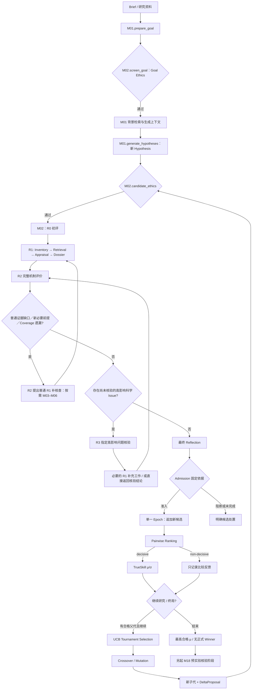

# 01｜Architecture Baseline：单一科学优先 Co-Scientist

**Document:** `M00-ARCH-v1.0`（基于已批准的 RC2）  
**状态：** `design_accepted`（用户于 2026-11-01 验收）  
**已确认决定来源：** M00 Phase 1 反馈、Phase 2 反馈及用户对 F1/F2 的明确选择。  
**当前代码事实的审查 SHA：** `7313ca032e4f5f0c84578523e0f5639ad038e7af`（2026-10-31 再次核实 main 未变）。  
**这是一份目标架构规范，不代表仓库已经实现。**

## 0. 一页架构决策

1. **[已定] 单一新系统。** 不扩张 G3、不运行双轨正式 Controller、不负担旧 G3 数据恢复和版本兼容。旧 G3 只作为独立研究基线；算法／工具按能力单独验证后选择性复用。
2. **[已定] 科学先于排名。** 每个 Hypothesis 经 Candidate Ethics、R0、R1（M03–M06）、R2；R2 发现普通 Coverage／证据缺口时，可请求必要的 R1 补核查后重新 R2；仅高影响科学风险可由 R2 触发 R3，R3 一律返回 R2 最终汇总。
3. **[已定] Reflection 不修改 Hypothesis。** M01/M11 创建新的科学内容；修订形成新候选，保留父子关系。
4. **[已定] Ranking 只比较。** 不检索，不触发 R0–R3，不回写 Dossier 或 Reflection。`needs_more_evidence` 等非决定性结果不更新 TrueSkill，只作为比较反馈。
5. **[已定] 固定入场依据。** 正常 Run 有一个持续的 Evaluation Epoch；候选可跨代加入，已参赛候选的核心科学评价输入（主要支持、反证、缺口与最终 Reflection）在各场 Match 中保持一致；无常规 Epoch 重建、比较撤销与评分迁移。
6. **[已定] 保留 TrueSkill／UCB／Crossover／Mutation。** 父代仅从**已准入且满足 M10 父代资格**的候选中按 UCB tournament 选择；未准入候选不会通过自动修复通道繁殖。
7. **[已定] 终局最高合格 μ。** 达到 M10 规定终局资格的候选中选最高 TrueSkill μ；资格不足明确输出无正式 Winner。不追加终局 R3，UCB 不用于最终选择。
8. **[已定] 科学责任优先，少造抽象。** 保留必要运行追溯、调用记录和恢复；不使用历史兼容、多层 Hash 包装或调度代理替代科学评测。
9. **[已定] 不设置用户资源预算。** 记录真实模型／检索消耗；单次调用容量、超时与技术重试仍需正常处理。
10. **[设计基线·已验收]** 将最终 Reflection 作为整体评议输出、Admission 作为轻量固定输入引用、模型调用记录保存实际 Evidence View；DeltaProposal／ResolvedDelta 两阶段以解决科学先后依赖；M20a 科学评测先于正式开发。

## 1. 研究对象与科学边界

一个 **Research Run** 对应一份确定的 Goal/Context 与科学评价政策及一套明确的搜索日程。工作区的 Project/Brief Draft 可编辑，但启动的 Run 不受之后草稿修改影响。Goal 科学内容／研究体系发生实质变更应创建新的 Run，**不在原 Run 内重建 Epoch**。

**Hypothesis** 是不可变科学内容（科学主张、机制链、前提、预测、证伪）；新内容须使用新候选身份。对同一候选的材料获取、检索和评议可以在**入场之前**持续完善，但已完成的外部模型调用输入必须留存。

**Claim Inventory** 是该候选的必要科学主张与机制覆盖清单，不是任意固定数量的语句切分。既有明确主张，也有评价中识别的必要隐含前提（必须显式标示为推导，而非候选原文）。

**Evidence Dossier** 整合实际材料及可访问范围、科学发现、Claim×Evidence 关系、适用性、限制、Prior-art 和矛盾；Dossier 可用来追问科学依据，不能将文献出处正确等同科学解释正确。

**最终 Reflection** 由 R2 负责汇总整个机制，包括 R0、R1、已执行 R3 的发现与其局限；只有它可形成最终整体机制评议。Admission **检查** 完整性、阻断性与可检验性，不能再独立生成整体科学判决。

**Match／TrueSkill** 是同一 Epoch 的相对优先级评价；μ 和 σ 不是科学真实性和科学证据强度，UCB 不是最终推荐价值。跨 Run 的 μ 不直接比较科学质量。

## 2. 工作流与双向箭头的严格含义

### 2.1 目标研究主线

**允许的科学返回路径：** ① R2 发现新的必要前提、Claim Coverage 遗漏或普通证据缺口时，提出范围明确的 R1 补核查请求，由 M12 调度 M03–M06 必要环节，更新 Dossier 后返回 R2；② 只有 R2 提出的高影响科学风险进入 R3，R3 核验结果和必要补充材料仍由 R2 汇总。同一已核查 Issue 不因措辞变化重复发起。普通补核查可以完善 Inventory 与证据，但不能改写 Hypothesis；需要改科学内容时只提出 RevisionSuggestion。**禁止的路径：** Ranking→R1/R2/R3；Ranking→自动新 Epoch；终局排名→R3；R3→修改 Hypothesis／自动生成修复子代。

### 2.2 子代的实际 Delta 顺序（已验收的跨模块方案）

`M11 offspring + DeltaProposal → M02 Ethics → M02 R0 → M03 完整 Claim Inventory → M03 ResolvedDelta → M04/M05 条件性证据复用/必要检索和评估 → M06 新 Dossier → M07 新的完整 R2 → 需要时 M08 R3 → M07 汇总 → M09 Admission`。

- DeltaProposal 仅表达“希望相对父代改变什么”，不是已核实的变化关系。
- ResolvedDelta 基于**已经建立的真实子代 Inventory**，可表达 `retained / modified / removed / split / combined / new`；语义解析与证据适用性是不同工作。
- M04/M05 可复用原始材料及条件相容的科学评价；**不得复用整条新机制的 R2 结论或父代评分**。
- Delta 无法可靠解析时，允许回退为**完整证据核查**。这不是候选科学失败。
- 未准入候选的 RevisionSuggestion 留作记录，但**第一版不自动进入 Mutation**。另一个修复入口若要研究，必须作为后续独立的全局变更提出。

### 2.3 R3 问题闭环

R3 仅接受 M07/R2 提出的**高影响科学 Issue**。检查范围由 M08 为指定 Claim／核心前提提出，检查结束可能为：(a) 查完且没有阻断，但仍未知；(b) 查完且发现关键冲突／阻断；(c) 执行不完整。三种结论都必须交回 R2；仅前两种是科学范围内检查已完成。

R2 重新汇总后，如果**没有范围或事实上的实质新 Issue**，不能重复派发相同 R3；若还有新的独立高影响问题，可由 M08 科学标准决定后续核查。为防止无限技术循环，M15 对重试/重复调用有操作性终止，M12 对范围无法完成的研究输出明确不完整结果；**不强设“最多三次 R3”假冒科学关闭**。

### 2.4 准入、比较成熟度、父代资格和终局资格

这四种资格不合并：

1. **Admission**：伦理、必要覆盖、规定证据评估、完整 R2/必要 R3、无阻断性科学缺陷且可检验。
2. **Comparison Coverage**：候选接受了何种比较、有效结果数量和跨机制可比性；由 M10 科学研究定义，不在 M00 固定次数。
3. **Parent Eligibility**：已 Admission 且满足 M10 父代资格的候选，方可进入 UCB 父代池。
4. **Final Eligibility**：满足 M10 规定的正式终局资格的候选，方可参加最高 μ 选择；可以不同于父代资格标准。

注意：“未找到直接支持”不自动构成 Admission 拒绝或 `needs_more_evidence`。决定性/非决定性／技术失败各自有明确定义。非决定性比赛不更新 TrueSkill，也不产生额外科学核查任务。

### 2.5 研究结束与未完成结果

只有满足搜索日程、所有必要候选审查／待处理比较的终止条件，且 M10 判断有合格比较结论时，才能正式选择 `argmax μ`。若 Run 工作完整但无法满足 Winner 资格，必须明确记为 `NO_QUALIFIED_WINNER`（示例语义，非要求枚举）；若外部调用／必要科学核查未完成，必须记录 `INCOMPLETE`（例），不得用最高当前 μ 代替正式 Winner。是否公开 best-so-far 是呈现策略，不应改变科学资格。

第一版不在最后一轮额外核验前三名／高 UCB 候选；M18 与 M19 是**已结束 Ideation Run 之后的独立阶段**，不改变历史结果。自适应收敛及其阈值由 M12/M20 后续评测。

## 3. 单一 Epoch、输入与持久化

**正常 Run 一个 Epoch**；它承载一个研究目标及统一的科学／Ranking 政策。G0/G1/G2/G3 都可以先完成各自评议再加入，入场依据固定；参加 Match 时以固定 Admission 引用解析双方科学内容。**不是每代一个 Epoch**，也不因 Ranking 的意见自动重建。

仅在**入场前**允许补证据／重新 R2（包括 R3 的结果）。已参赛的内容/依据不可原地变更；若发现严重来源错误或错误的评分输入，M09/M12 首版可考虑暂停受影响任务或结束该 Run 并保留不完整状态，而非自动修改已完成比赛、迁移评分或重置 Epoch。具体恢复动作和检验由 M09/M12/M15 定义，不预先设定完整错误矩阵。

**Ranking 科学输入一致性：** 同一候选入场后，每场 Match 均使用来自其固定 Admission／Dossier 的**同一核心科学评价呈现**，至少包含主要支持证据、重要反证、关键缺口与最终 Reflection。针对具体候选对可追加来自双方已冻结科学依据的相关材料，但须采用一致、对称的筛选与呈现策略；不得替换、遗漏或弱化一侧的核心反证，也不得在 Ranking 中检索新证据。M10 负责轻量输入准备，M15 的 `ModelCall` 记录双方实际可见材料、摘要／裁剪、顺序、最终输入与调用结果，供 M10/M20 审查跨 Match 一致性及偏差。**Evidence View** 仅表示模型实际看到的输入记录，不新增独立科学评价层或 Evidence View 服务。

推荐尽可能少的必要标识：`run_id`、候选身份、候选科学内容标识、Inventory 与 Dossier 引用、最终 Reflection 引用、Admission 引用、`match_id`、`epoch_id`、外部调用记录引用、`terminal_result`。这些是**接口语义**；不强制每层单独 Hash、独立数据库表、独立微服务或旧版事件兼容。

M15 必须保存足够的外部请求／响应、工具访问范围和实际资源消费，使原有任务失败/恢复时不会错误地重复应用领域结果。保留必要幂等，而非强制复制旧 Orchestrator 的所有历史状态分支。

## 4. 五层系统组织（职责，不是部署拓扑）

| 层 | 责任 | 非责任 |
|---|---|---|
| **L1 Scientific Domain** | Hypothesis、Claim/Inventory、Dossier、Reflection、Admission、Match/Rating、Delta、Terminal 语义 | 模型供应商与数据库技术细节 |
| **L2 Scientific Workflow** | M01–M11 的科学方法；R0–R3 与成对比较、演化 | 历史 G3 双轨；Judge 自动调研与反向 R3 |
| **L3 Orchestration & Runtime** | M12 根据已存在的任务/科学结果推进、终局；M15 执行模型工具任务、记录/恢复 | 重新判断科学证据或替代 LLM Judge |
| **L4 Persistence** | 科学快照、原始文献、调用输入输出、必要事件与索引 | 任意历史契约的向后兼容引擎 |
| **L5 Workspace & Handoff** | Project/BriefRevision/Run、候选证据和决策阅读、报告；M18/M19 独立阶段 | 重新计算排名、改写固定科研评价 |

M13 为可选的机制主题与 Meta-review 建议，可按需消费 M03（主张／机制）、M06（Dossier）、M07（Reflection）、M10（比较）和 M11（子代／Delta）的科研数据；不构成上述模块的反向必需依赖。它可以为下一轮演化提供来源明确的建议，但不能改当次 Run 的评价政策／已入场依据。M20 是贯穿所有层的科学质量与工程验证，不应只在最后运行集成测试。

## 5. 跨模块先行确定、模块内部继续研究

**M00 只固定：** 单一科学流程；所有权；入场前核查方向；已参赛输入不可变；唯一 Epoch；父代／终局选择规则；最低跨模块对象引用；M18/M19 分界；科学评测与工程验收分开。

**M00 不决定：** Claim 的细粒度、因果／证据质量 Rubric、检索数据库、R3 高影响阈值和充分性、配对轮数、先验校准、代际日程、自适应停止、具体 Prompt、完整 Pydantic Schema、任务重试的全部错误码、数据库拓扑、HITL 交互。

先交付 **M09a/M11a/M14a/M15a/M20a** 最小公共接口与科学夹具，再并行发展科学能力。项目经费支持 API 消耗，设计时科学覆盖、真实证据与可检验性优先于为省 Token 减少核查。全部实际消耗仍须统计，且技术约束与用户额度不同。

## 6. 与论文和旧代码的关系

- **[Nature 明确披露]** 原论文提供分层评议、Proximity、Meta-review、Supervisor 等方法起点；不能据此声称本项目详细 R0–R3 契约是 Nature 的原生内部 Schema。
- **[arXiv 明确披露]** 后续研究报告 TrueSkill、UCB tournament 与交叉/变异；不存在可据此直接复制的本地配额、Dossier 和 Epoch 生产规范。两篇对同一机制有直接差异时以后续 arXiv 为参考；较早 Nature 的未重述功能不自动删除。
- **[现有源码（固定提交）]** 有数学、候选、检索和运行基础，但独立 Claim Verification/Lineage 并非 G3 正式流程的组成部分。详见 [`08_SOURCE_TRACEABILITY.md`](08_SOURCE_TRACEABILITY.md)。
- **[本项目已定]** 新架构比论文更多科学证据组织与评价、单一 Run/单一 Epoch、比较反馈不自动核查、M20a 科学评测等，属于本项目方法选择，**不得标成论文披露**。

## 7. 本基线验收门

- 文档已覆盖用户确认的最终两项裁决 F1、F2，不再留作选择题。
- 旧 Phase 1／2 不再作为当前目标流程，尤其不能恢复 G3 双轨、终局 R3、Ranking 补检索、常规 Epoch 重建和自动修复未准入候选。
- 各模块必须用当前已验收上游接口与专家案例作为实际实施输入；M00 文件本身不代表任何模块已经实现或已被科学验证。
- **状态：`design_accepted`（2026-11-01）**。本文已定的全局方向及被采纳的跨模块最小语义已作为设计基线；不意味着自动批准 M01 实施。
