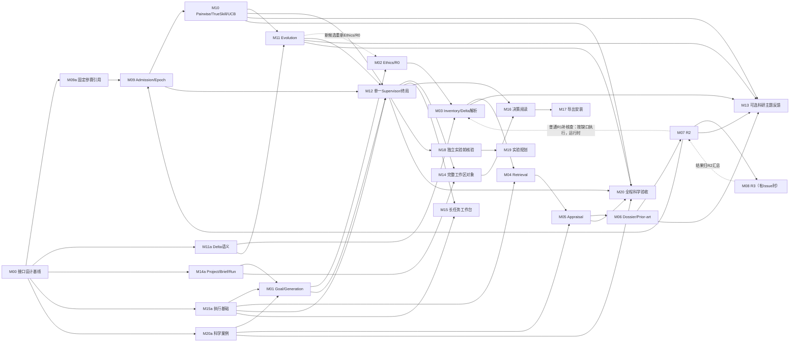

# 04｜M01–M20 Module Dependency Map 与独立交付门

**状态：** `M00-MODULES-v1.0 / design_accepted（2026-11-01）`。模块编号延续项目规划，不表示对应仓库实现已经验收。**可独立研究 ≠ 可不等上游验收直接接入正式科学链。**

## 1. 可实施的依赖策略

**先确定少量不可变化的科学语义，再用固定专家案例并行研发，最后按真实数据链集成。** 不因运行时存在双向回调，就建立代码包循环依赖：模块只调用统一的输入/输出接口，M12负责调度。**Goal Ethics 的运行时调用顺序固定为 `M01.prepare_goal → M02.screen_goal → M01.generate_hypotheses → M02.candidate_ethics/R0`；M01/M02 开发时仅依赖共同契约与固定样例，不存在彼此实现的循环依赖。**

五个前置工作包是原模块的最小先导，不是新正式模块：

| 先导包 | 必需交付／不必实现的部分 | 所有人 |
|---|---|---|
| `M09a` | Admission固定候选/Inventory/Dossier/FinalReflection/共同政策引用；每个候选跨Match固定核心科学呈现与对称输入要求；唯一Epoch；四类比赛结果及样例。不做全部Schema、Epoch重建 | M09/M10/M12 |
| `M11a` | DeltaProposal/ResolvedDelta的关系语义、M03解析归属、M04/M05复用判断；两个父子科学例子。不建全局主张注册系统 | M11/M03/M05 |
| `M14a` | Project、BriefRevision、Run的最小引用、草稿与运行快照区分。无需整个UI | M14/M01/M12 |
| `M15a` | 模型/检索工具调用的最小执行接口、输入/返回持久化、用量和重试记录、新Run最低恢复机制。无需旧G3恢复或分布式框架 | M15/M12 |
| `M20a` | 小型固定生物医学研究问题、候选与证据/候选对、专家重点与错误类型、对照方法、开发/留出数据分离原则。无需完整Rubric和阈值 | M20/各科学模块 |

**共享LiteraturePort：** M04定义“取得什么材料和报告什么实际范围”的工具语义；M15a提供执行调用；M01负责背景检索策略，M04负责按主张检索策略。M01不等完整M04科研流程，M04不依赖M01实现代码。

## 2. Mermaid模块依赖图

**图解释：** 实线是阶段性交付/验收依赖；M07→M03（普通R1补核查）、M07↔M08（高影响R3）和M11→M02（新一代复审）的虚线是运行时调度，不是代码导入依赖。R2普通补核查由M12按需派发给M03–M06；R3仍只由R2高影响风险触发。**禁止推导**“M07实现必须等M08代码全部完工，M08实现又必须等M07完工”；双方先共享固定Issue/Result样例。M13 可消费 M03/M06/M07/M10/M11 的输出，但不阻断任何上游及第一版科学闭环。

## 3. M01–M12 科学内核：模块职责、所有权与下游交付

### M01｜研究输入、背景检索与初始 Generation
- **目的/上游：** 把 BriefRevision 与GoalContext固定，形成有结构的完整根候选；依赖 `M14a/M15a/M20a`，共享文献获取接口。
- **输入→输出：** Brief、材料、目标约束 → `M01.prepare_goal`形成GoalContext → `M02.screen_goal`通过 → `M01.generate_hypotheses`形成BackgroundContext、`Hypothesis`及模型/来源记录；交M02候选Ethics/R0、M03、M12。
- **全局约束：** 目标 Ethics 在正式 Generation 之前；生成器不冒充证据核验；科学内容明确、含预测与证伪。
- **内部可定：** 搜索提示、探索策略、prompt、模型、候选数量和温度；按实际专家评测选择。
- **非职责：** M03的完整机制Claim拆解、M05的证据关系、Rating、进化父代。
- **交接门：** 研究任务可复现成确定GoalContext；至少给出可检验和具有伪关联风险的候选案例；来源和模型输入可追溯。

### M02｜Goal/Candidate Ethics 与 R0
- **目的/上游：** 安全筛查和不借助深检索的初步结构审查；运行时先消费M01.prepare_goal产生的GoalContext执行screen_goal，通过后由M01生成候选，再消费Hypothesis执行candidate_ethics/R0。两模块通过M12和共同契约协调，**不是代码互相依赖**。
- **输入→输出：** Goal／候选 → `GoalEthics`、`CandidateEthics`、`R0Review`、需要核查的重点；交M01/M03/M07/M09。
- **全局约束：** Ethics与科学合理性是两种判断；R0不能把未知当已证伪；技术故障与科学阻断区分。
- **内部可定：** 安全分类、可拒绝的结构问题及策略、模型Prompt。
- **非职责：** R1 文献核验、完整R2、实验伦理审批与排序。
- **交接门：** Goal检查通过后才生成；Ethics/R0各有可信正常、阻断、未知/失败样例。

### M03｜Claim Inventory 与完整机制覆盖
- **目的/上游：** 覆盖必要因果前提、机制桥接、关键新机制和可检验预测；消费M01/M02；入场前R2发现普通必要前提/Coverage遗漏时可由M12再次调度M03，子代还消费M11a提案与父代Inventory。
- **输入→输出：** Hypothesis、R0问题、可选父代Inventory／DeltaProposal → `ClaimInventory`、Coverage/依赖、子代`ResolvedDelta`；交M04/M05/M06/M11。
- **全局约束：** 不按固定条数裁剪，隐含前提标为推断；真实Delta在子代Inventory之后解析。
- **内部可定：** Claim粒度、关键性、依赖图建模、分批Coverage验证。
- **非职责：** 编辑Hypothesis、检索、Appraisal、准入、创建评分。
- **交接门：** 专家案例能验证关键前提完整性，存在多Claim、跨条件变化、无法安全解析Delta时的全量核查退路。

### M04｜Claim-directed Retrieval 与材料获取
- **目的/上游：** 按Claim的支持、反证、先前研究、竞争机制等意图检索；消费M03，复用M15a和共享LiteraturePort。
- **输入→输出：** Inventory/R2普通补核查请求/R3 Issue/检索范围/复用材料 → 来源身份、实际材料快照、SearchCoverage、筛选和未取得记录；交M05/M06/M08。
- **全局约束：** 首版支持范围可以有限，但接口不永久绑定PubMed标题/摘要；查询成功但无结果不等于科学错误；来源访问层级可见。
- **内部可定：** 数据库、查询生成、分页、来源选择、全文/补充材料获取与停止标准。
- **非职责：** 解释因果证据强度、完整假说新颖性、完整R2。
- **交接门：** 支持/反证/竞争机制的可检查召回例；明确`SEARCHED_EMPTY`与`FAILED`及全文不可得的真实差别。

### M05｜Scientific Evidence Appraisal
- **目的/上游：** 判断文献真实报告的发现及与具体Claim的支持、反证、适用性和因果解释；消费M03/M04，依赖M20a科学样例。
- **输入→输出：** Claim上下文、原始材料、科学标准 → `ObservedFinding`、Claim×Evidence Assessment、质量/偏倚、适用性及限制；交M06/M07/M08。
- **全局约束：** 相关性不自动作为因果证明；摘要未披露不能伪装为全文核验；研究独立性不等于论文篇数。
- **内部可定：** 研究类型Rubric、证据抽取、冲突处理、专家校准、批处理与复核。
- **非职责：** 直接评分、单独裁决整条机制、管理Running状态。
- **交接门：** 真实专家例覆盖因果错判、跨体系适用性、重复数据来源、反证遗漏。独立Rubric文件目前未收到，属于明确缺口。

### M06｜Prior-art 与 Evidence Dossier
- **目的/上游：** 聚合完整Coverage、材料、已评价发现、机制级先前研究和矛盾；消费M03–M05，普通R2补核查完成后更新入场前Dossier并再次交付M07。
- **输入→输出：** Inventory/Coverage/SearchCoverage/Assessment → `EvidenceDossier`、关键缺口及局限；交M07/M08/M09/M11。
- **全局约束：** Dossier作为证据汇总输入，不能自己判完整科学质量；不能用“未检索到”证明全球首创；保持入场依据的固定引用。
- **内部可定：** Prior-art相关性、机制重合分级、冲突综合、Dossier组织。
- **非职责：** Ranking、R2整体评议、自动Epoch升级。
- **交接门：** 能说明“已知组成环节但新桥接尚未验证”、支持反证并存及检索限制；Dossier可追溯到材料。

### M07｜R2 Evidence-grounded Full Reflection
- **目的/上游：** 在完整假说与Dossier基础上给出总体机制判断；消费M02/M03/M06，按需求接收M08。
- **输入→输出：** Hypothesis、Dossier、R0、可选R3结果 → 初次R2、普通R1补核查请求（新必要前提／Coverage遗漏／一般证据缺口）或高影响R3 Issue、`FinalReflection`、RevisionSuggestion；普通请求由M12调度M03–M06并返回更新Dossier，R3结果由M08回传；交M09/M11。
- **全局约束：** 单项都有支持不等于整条机制有效；R2可独立要求普通R1补核查，R3只处理高影响Issue且必须回R2；不编辑Hypothesis；Ranking反馈不能进入任一核查执行入口。
- **内部可定：** 结构化科学评价、缺陷级别、因果桥接、竞争解释、创新性、可检验性标准。
- **非职责：** 直接运行文献检索、设置UCB或选择父代。
- **交接门：** 至少能定位整体因果链不成立的例子；R2能识别普通Coverage/证据缺口并经M03–M06补足后再次评价，且不误触发R3；能把R3无新文献、重大冲突、未完成分别汇总为科学上诚实的最终结果。

### M08｜R3 Deep Verification 内核
- **目的/上游：** 只核验M07提出的高影响Issue；调用M03–M06已有能力，结果交回M07。
- **输入→输出：** Issue/冻结核查范围/已有证据 → VerificationPlan、核查发现、完成范围、未决项、结束状态；交M07，M12据此推进。
- **全局约束：** 禁止终局或Ranking入口；禁止修改假说或自动制造修复子代；同Issue无实质新事实不重复核查。
- **内部可定：** 高影响风险识别与分解、是否充分调查、问题等价、子前提核查和关闭标准。
- **非职责：** 整条机制最终总评、Admission、改评分。
- **交接门：** 科学未知但核查完成、发现核心机制阻断、技术未完成和重复Issue均有独立样例；重新汇总由M07完成。

### M09｜最终 Reflection 交付、Admission 与单一 Epoch
- **目的/上游：** 将完成科学审查的候选固定为参赛依据，管理准入和一个Run内的连续Epoch；最小接口 `M09a` 前置，正式消费M02–M08。
- **输入→输出：** Ethics/Inventory/Dossier/FinalReflection/固定科学政策 → Admission结果与引用、Epoch成员；交M10/M12。
- **全局约束：** 入场后不能换依据；无直接证据不是自动拒绝；Admission与比较资格分开；不自动重建Epoch。
- **内部可定：** 引用/政策一致性校验、Admission具体判定、严重来源完整性异常分类。
- **非职责：** 重新做R2，设定M10比较次数，直接提升旧Match评分。
- **交接门：** 已审查新候选跨代追加、普通R1补核查及必要R3均在入场前闭合、未准入候选不能入父代池、已入场不同Match指向同一依据、严重异常不静默更改输入。

### M10｜Pairwise Ranking、TrueSkill 与 UCB
- **目的/上游：** 相对优先级比较、决定性更新μ/σ、按UCB选择合格父代；纯数学与专家候选对可前置，正式消费M09。
- **输入→输出：** 当前Run/Epoch Admission集合、固定政策 → Match、ComparativeFeedback、Rating、ComparisonCoverage、ParentEligibility、FinalEligibility、UCB ParentSelection；交M11/M12/M16。
- **全局约束：** 只比较不检索，不触发任何R1/R2/R3；同一候选跨Match使用固定核心科学呈现（主要支持、反证、缺口、最终Reflection），针对性增补仅来自冻结依据并按对称策略选取且记录；非决定性不更新；位置偏差及证据呈现要评测；最高合格μ为终局选择输入。
- **内部可定：** TrueSkill参数、对手调度、对称比较、有效比较配额、跨机制覆盖、资格阈值和公平性标准。
- **非职责：** 证据补充请求、任意改候选科学质量、用UCB作为Winner。
- **交接门：** 数值更新可重现；同一候选跨两场Match核心支持/反证/缺口/R2呈现一致，对比材料选择对称并留实际ModelCall输入；A/B换序及不同文献量有专家评测、`needs_more_evidence`不派科学任务、父代资格和终局资格可解释。

### M11｜Evolution、DeltaProposal 与证据复用
- **目的/上游：** 用已准入且达父代资格的候选与比较反馈做Crossover/Mutation；`M11a`关系接口前置，正式消费M10。
- **输入→输出：** 有效ParentSelection及父代内容、R2/R3/ComparativeFeedback → 子代Hypothesis、DeltaProposal、父代贡献及科学改进意图；交M02/M03/M12。
- **全局约束：** 仅合格父代；不直接修复未准入候选；新子代新评分；对子代完整R2独立执行。
- **内部可定：** Crossover/Mutation prompt、混合策略参数、如何利用证据与评议产生科学新机制。
- **非职责：** 自行宣称ResolvedDelta或继承Claim评价、设置Ranking政策、重写父代。
- **交接门：** 子代科学机制与父代变化可核查；在M03/M05适用性核对后才合法复用证据，能用专家案例证明增益不只是句子变长。

### M12｜单一 Supervisor、代际闭环与正式终局
- **目的/上游：** 汇集已验收的科研结果执行唯一正常工作流；依赖M01–M11科学接口及M15a。
- **输入→输出：** ResearchRun/阶段结果/执行状态/研究日程 → 合法后继任务、暂停/失败/不完整、TerminalResult；交M14–M20。
- **全局约束：** 只调用一个新控制器，不派Ranking反向核查；一个Epoch；无终局R3；只从合格父代繁殖；终局最高合格μ或无Winner。
- **内部可定：** 任务调度、持久依赖检查、代际/停止政策、恢复协调、异常出口与终局状态表达。
- **非职责：** 重新定义科学证据质量/核查阈值，自动编辑假说或继承旧G3分支。
- **交接门：** G0/Gn、新子代与R3返回均真实贯通；含无合格父代、无Winner、外部失败、资源统计与恢复；所有正式终局引用有效。

## 4. M13–M20 边界、依赖与交接

| 模块 | 上游（设计可并行；正式数据依赖） | 核心输入→输出 | 必须守住的边界及下游验收 |
|---|---|---|---|
| **M13 主题/Proximity/Meta-review** | **可选**消费 M03 Inventory、M06 Dossier、M07 Reflection、M10 Match/Rating、M11 子代/Delta；可用固定样例独立试验 | 科研记录→机制主题、重复度、可选演化建议 | 不构成上游或准入必需依赖；不改科学政策/Match；M20评估是否提高机制多样性 |
| **M14 Project/Brief/Run/Import** | `M14a`前置；正式关联M12运行结果 | 项目草稿/Run/导入→可追溯工作区目录 | Draft不改固定Goal；不恢复旧G3运行；M16/18通过引用得到候选 |
| **M15 工作台与长任务执行** | `M15a`前置；正式联动M12/M14 | 任务、调用和运行状态→真实进度、资源、暂停/恢复/诊断 | 不替代科学判断；中断后不重复应用Match或重复记账；不兼容旧Run |
| **M16 科研决策阅读** | M06/M07/M09/M10/M12/M14/M15，主题可接M13 | 冻结科学数据→决策卡、主张—证据绑定、比较解释 | 不以前端算法重算科学结论；σ不展示为证据真实性；科研人员能直接定位主要缺陷 |
| **M17 报告/导出/安装** | M12/M14–M16 | 结果与来源→人类报告、机器清单、新版安装 | 不运行旧Controller；输出正式Winner/无Winner区别和证据局限；导出不临时重评 |
| **M18 独立实验前核验** | M12 Terminal/SelectedCandidateRef；可使用M03–M08工具 | 选定候选+实际实验情境→核验发现/阶段结果 | 不属被取消的终局R3，不重排原榜单，不回写旧Run；M19使用结果 |
| **M19 最小验证实验与分阶段规划** | M18、研究实验条件 | 核验后假说→区分竞争机制的实验、对照、测量与停止条件 | 不把模型模拟当实际实验；实验可由科研人员审阅 |
| **M20 科学评测／回归／验收** | `M20a`前置；每模块交付真实输出 | 固定任务/专家标注/对照/用量→工程、科学、消融和局限 | G3仅独立对照；科学收益不能用源码Hash或跨Run μ大小证明 |

## 5. 分波次实施（不等于生产授权）

1. **W0 — 最小接口与评测：** M09a、M11a、M14a、M15a、M20a + 共享文献工具接口，交单一可运行/可比较的最小样例。
2. **W1 — 并行科学原型：** M01/M02、M03、M04、M05、M07、M08、M10、M11可以基于固定专家输入研究算法。方法本身不因主线未集成而停工。
3. **W2 — 证据驱动单候选：** M03→M04→M05→M06→M07→按需普通M03–M06补核查→M07→必要M08→M07→M09。完成真实科学评测，不只校验接口结构。
4. **W3 — 比较与子代：** M09→M10→M11→新候选Ethics/R0→Inventory/Delta→增量R1→完整R2→Admission；测量科学改进和资源。
5. **W4 — 单一多代闭环：** M12集成上述路径，M15保证长任务与恢复；M14/M16/M17交付内部科研工作区与报告；M13是否加入需有消融证据。
6. **W5 — 第二阶段与系统评测：** M18/M19独立交接，M20完整科学验证和工程验收。

## 6. 每个新模块的统一验收/交接门

**至少交付：**
- 可独立理解的已批准设计（所有权、输入输出语义、明确非职责、未决科学问题）；
- 实际实施commit/分支及运行环境；未实施标 `proposed`，不能宣称 `accepted`；
- 正常、科学反例、技术未完成的固定数据样例；
- 真实测试命令/数量/失败/跳过，及科学专家对照评价和局限；
- 模型/检索调用、时间/Token/成本（若不可得明确记不可得）；
- 可供下游直接消费的样例引用与最小契约文档；
- 如果复用旧G3组件，提供片段来源与独立验证；不要求兼容旧控制器/旧Run。

**必须返回上游设计讨论的情况：** M05认为必须改M03的Claim科学语义；M07无法根据Dossier判断必要因果链；M10要求Ranking触发新R1；M11需要未准入候选自动修复；M12建议更换Epoch生命周期。这些都是跨模块变更请求，**不能在模块代码中偷偷实现**。
