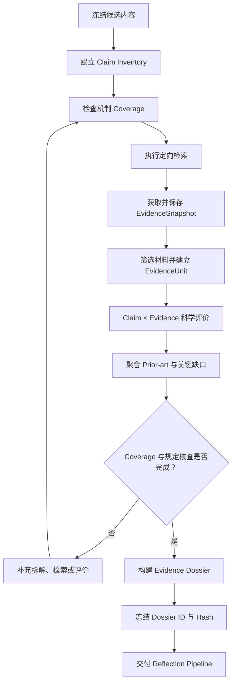

# Evidence Dossier Contract V1
## Co-Scientist WP1：科学证据数据层

**状态：** [拟议] 待评审  
**代码基准：** `7313ca032e4f5f0c84578523e0f5639ad038e7af`  
**上游依据：** 现有 Claim Verification V2、EvidenceUnit、EvidenceSnapshot、ClaimLineage  
**下游使用者：** R1、R2、R3、Ranking、Evolution  
**范围：** 第一阶段科学主张、文献证据、证据质量与先前研究的结构化表示。

## 0. TL;DR：一页决策摘要

本节结论：[拟议] Evidence Dossier 采用“主张覆盖 + 文献证据 + 科学评价 + 先前研究”四类核心数据，并以候选内容版本为边界冻结。

| 编号 | 核心决策 | 状态 | 用途 |
|---|---|---|---|
| D1 | 复用现有 V2 的来源身份、EvidenceSnapshot、EvidenceUnit 与 ClaimLineage | [已定] | 实现 |
| D2 | 为每条科学上实质的主张建立 Claim；以机制覆盖图检查完整性 | [已定] | 决策 |
| D3 | 分开记录契约有效性、检索执行、评价执行和科学认识状态 | [已定] | 决策 |
| D4 | 分别记录文献实际发现与模型对主张的解释 | [拟议] | 实现 |
| D5 | 对每个 Claim × Evidence 建立独立的关系、直接性、因果性和适用性评价 | [拟议] | 实现 |
| D6 | Prior-art 独立描述整条机制与已有研究的重合范围 | [拟议] | 决策 |
| D7 | Dossier 绑定候选内容、Claim Inventory、检索范围和评价策略的版本 | [已定] | 实现 |
| D8 | 所有阶段及 Run 总资源消耗可追溯；本阶段不设额度上限 | [已定] | 实现 |
| D9 | Dossier 为 Reflection 和 Ranking 提供结构化依据，不直接产生排名 | [已定] | 决策 |
| D10 | 新版本独立于冻结 G3；历史 V2 数据及评价保持原语义 | [已定] | 实现 |

**非目标：** [已定] 本文不定义 R0–R3 调度、TrueSkill 配对、Evolution 算法、Human-in-the-Loop、实验规划和自适应停止策略。

**开放问题：** [待定] 科学主张拆解粒度、证据质量判定标准、冲突研究综合方法、全文材料接入策略及 Prior-art 的具体判定标准。

**最大风险：** [拟议] 来源绑定完全正确，但模型错误地判断文献支持某条因果机制。数据身份验证和科学判断质量必须分别评估。

## 1. 问题、范围与非目标

本节结论：[已定] WP1 的核心任务是把假说中的科学主张与实际文献证据建立可追溯关系，并向后续科研评价提供可靠、可复现的输入。

[已定] 当前仓库已有 `claim_verification.py`、`evidence_units.py`、`source_units.py`、`claim_lineage.py` 和 `verification_route_v2.py`。这些模块提供身份、来源、绑定及核查流程的基础，但当前冻结 G3 尚未将它们整合为完整的证据驱动 Reflection 流程。

[拟议] 本契约只新增科学评价与证据聚合所需的最小能力，不重建 Raw Store，不重新发明来源 ID，也不改变旧 V2 的 `complete` 语义。完整的 Reflection Pipeline 由另一份契约定义。

## 2. 核心对象与职责边界

本节结论：[拟议] 采用六类核心对象，分别管理主张、检索、单项证据评价、先前研究、证据档案和资源使用。

| 对象 | 职责 | 状态 | 用途 |
|---|---|---|---|
| Claim Inventory | 描述假说的科学主张、机制依赖和覆盖状态 | [拟议] | 实现 |
| Search Coverage | 记录查询、获取、筛选及实际评价范围 | [拟议] | 实现 |
| Evidence Assessment | 记录单项文献与单条主张的科学关系 | [拟议] | 实现 |
| Prior-art Synthesis | 汇总整条机制与先前研究的重合及差异 | [拟议] | 决策 |
| Evidence Dossier | 聚合前述结果并冻结版本 | [拟议] | 实现 |
| Resource Ledger | 记录各阶段及 Run 总资源消耗 | [已定] | 实现 |

[已定] 职责边界如下：

- Claim Decomposition 负责识别主张及机制关系。
- Retrieval 负责实际查询和获取文献。
- Evidence Assessment 负责解释单项研究与主张的关系。
- Dossier 负责聚合、状态核验和版本冻结。
- Reflection 负责整体科学评价。
- Ranking 负责成对相对比较。

## 3. 关键决策卡 D1–D10

### D1：复用现有身份与来源体系

[已定] 继续使用现有 ClaimRecordV2、SourceUnit、EvidenceSnapshot、EvidenceUnit 和 EvidenceBinding 的身份基础。新增契约采用新版本名称，保留旧数据及历史事件的含义。

### D2：Claim Coverage 以科学机制为单位

[已定] Claim Inventory 覆盖所有科学上实质的主张，尤其是必要因果前提、机制桥接、核心新机制和可检验预测。不设 Claim 数量上限。

[拟议] 每条关键因果链均应形成可追踪的 Coverage Map。每个必要环节关联一个或多个 Claim，并记录覆盖缺口。Claim 的拆分粒度与 critical 判定标准见 O1。

### D3：四轴状态分离

[已定] 每条主张分别记录：

1. Contract Validity；
2. Retrieval Status；
3. Assessment Status；
4. Epistemic Status。

完整状态语义见 §4。

### D4：Observed Finding 与 Scientific Interpretation 分离

[拟议] Evidence Assessment 分别保存文献实际报告的结果，以及模型判断该结果与当前 Claim 的关系。两个字段来自不同的推理步骤，均保留来源与版本。

### D5：单项证据采用多维评价

[拟议] 每项 Claim × Evidence 评价包含关系、直接性、因果支持、研究模型适用性和方法学限制。具体科学判定标准见 O2、O3。

### D6：Prior-art 独立于一般证据支持

[拟议] 对已有研究进行机制级比较，区分整条机制重合、部分机制重合、已知组成部分及尚未确认的新机制桥接。

### D7：Dossier 与候选版本绑定

[已定] Dossier 冻结时记录候选内容 Hash、Claim Inventory Hash、检索策略版本、证据评价版本和自身 Hash。后续变化形成新版本。

### D8：资源全程记录

[已定] 记录模型调用、Token、检索、获取、评价、耗时和可获得的费用。本阶段不设置额度上限。资源记录定义见附录 A。

### D9：Dossier 不直接决定 Ranking

[已定] Dossier 提供结构化科学依据。Reflection 形成整体科学评议；Ranking 仍使用冻结的成对比较与 TrueSkill。

### D10：历史与新流程隔离

[已定] 新 Dossier 和新评价流程使用独立版本。当前 G3、旧 V2 结果和历史 Match 不被原地修改。

## 4. 状态轴与语义表

本节结论：[已定] 四个状态轴分别描述数据是否合法、检索是否执行、评价是否完成，以及当前科学认识。

| 状态轴 | 主要状态 | 语义 | 用途 |
|---|---|---|---|
| Contract Validity | `valid / invalid / unvalidated` | 来源身份、绑定与内容 Hash 的校验状态 | 实现 |
| Retrieval Status | `not_started / in_progress / completed_within_scope / partial / failed` | 已声明检索范围内的执行状态 | 实现 |
| Assessment Status | `not_started / in_progress / completed / partial / failed` | 实际取得的材料是否完成要求的评价 | 实现 |
| Epistemic Status | `direct_support_present / indirect_support_only / mixed_or_conflicting / direct_contradiction_present / context_only / no_relevant_evidence_within_scope / not_assessed` | 当前证据与主张的关系概况 | 决策 |

[拟议] Epistemic Status 是证据关系的聚合摘要，完整的单项证据记录仍然保留。例如，一条主张既有直接支持又有反证时，聚合状态可为 `mixed_or_conflicting`，同时保留双方证据。

[已定] 各轴独立迁移。检索完成不自动使评价完成；评价完成也不自动产生有利的科学认识结论。

## 5. 生命周期与版本隔离

本节结论：[拟议] Dossier 按候选版本建立，经过 Claim Coverage、检索和科学评价后冻结；实质性科学变化产生新版本。



[已定] Dossier 的生命周期为 `draft → assembling → ready_for_review → frozen`。若后续证据或主张发生实质变化，创建新 Dossier，并通过 `parent_dossier_id` 关联前一版本。

[拟议] 复用证据时，优先复用不可变的原始文献快照和已完成的单项评估；新 Claim 必须建立自己的有效绑定。复用条件及实质变化的定义见 O4、O5。

## 6. 与上下游接口

本节结论：[拟议] Dossier 对上游提供明确的 Claim 与检索状态，对下游提供冻结的科学证据依据。

| 上下游 | 输入 | 输出或用途 | 状态 | 用途 |
|---|---|---|---|---|
| Generation / R0 | 候选内容 | Claim Inventory 的起始输入 | [已定] | 实现 |
| R1 | Claim、查询计划、来源记录 | Coverage、Assessment、Dossier | [拟议] | 实现 |
| R2 | 冻结 Dossier、完整候选 | 综合科学评议 | [已定] | 实现 |
| R3 | 高影响问题、相关 Claim 与证据 | 深度核验及可能的新 Dossier | [已定] | 实现 |
| Ranking | 冻结 Dossier 与 Reflection | 成对比较依据 | [已定] | 实现 |
| Evolution | 父代 Dossier、Claim Lineage | 子代证据复用与新主张核查 | [拟议] | 实现 |
| Resource Ledger | 各阶段真实调用记录 | 阶段与 Run 总消耗 | [已定] | 实现 |

[已定] Dossier 只向下游提供科学证据记录及其状态，不直接输出 TrueSkill 分数或最终 Winner。

## 7. 待定科学标准 / 开放问题

本节结论：[待定] 数据结构和状态分离可以先冻结；科学评价的细粒度标准仍需单独讨论和验证。

| 编号 | 待定问题 | 需要确定什么 | 用途 |
|---|---|---|---|
| O1 | Claim 拆解与 critical 判定 | 如何识别必要因果前提、合理拆分粒度及覆盖完整性 | 待定 |
| O2 | 支持与反证标准 | 不同研究设计下何时属于直接、间接支持或实质冲突 | 待定 |
| O3 | 方法学质量 | 各研究类型采用哪些质量与偏倚检查项 | 待定 |
| O4 | 证据复用 | 哪些 Claim 变化会改变证据适用性及复用条件 | 待定 |
| O5 | 实质性变化 | 何种新证据需要新 Dossier、新 Reflection 和新 Epoch | 待定 |
| O6 | 全文核查 | 首版摘要级核查的边界，以及全文材料的接入策略 | 待定 |
| O7 | 冲突研究综合 | 如何评估研究独立性、条件差异及证据冲突 | 待定 |
| O8 | Prior-art 判定 | 整体机制重合、部分重合及创新桥接的判定标准 | 待定 |

## 8. 风险与反模式

本节结论：[拟议] 第一版应优先保证来源可追溯、科学判断可审查和状态完整，而不是追求单一的综合证据分数。

| 风险 | 影响 | 处理方向 | 状态 | 用途 |
|---|---|---|---|---|
| 错误的支持/反证判断 | 影响 R2 与 Ranking | 专家标注测试及来源片段定位 | [拟议] | 测试 |
| Claim Coverage 遗漏 | 核心机制未被核查 | 机制图与 Claim 覆盖检查 | [拟议] | 实现 |
| 摘要外推过度 | 产生不可靠因果结论 | 记录材料层级和外推边界 | [拟议] | 实现 |
| 检索完成被误读为证据充分 | 误判科学未知 | 四轴状态分离 | [已定] | 决策 |
| Dossier 被静默覆盖 | 破坏评价复现性 | 不可变版本与 Hash | [已定] | 实现 |

### 附录 A：关键字段 Schema

本节结论：[工程细节] 以下是拟议的最小字段模型；实现时优先复用现有 V2 类型和原始存储。

```python
ClaimInventoryV3 = {
    "inventory_id": str,
    "hypothesis_id": str,
    "hypothesis_content_hash": str,
    "claims": list[ClaimRecordV2],
    "mechanism_elements": list[MechanismElement],
    "claim_dependencies": list[ClaimDependency],
    "critical_claim_ids": list[str],
    "uncovered_elements": list[UncoveredElement],
    "coverage_status": "complete | incomplete | unresolved",
    "coverage_rationale": str,
    "inventory_hash": str,
}

SearchCoverageV3 = {
    "coverage_id": str,
    "claim_id": str,
    "intent": "support | refute | prior_work | competing_mechanism",
    "query_ids": list[str],
    "provider": str,
    "query_scope": dict,
    "execution_status": str,
    "reported_total_hits": int | None,
    "returned_source_ids": list[str],
    "fetched_snapshot_ids": list[str],
    "screened_snapshot_ids": list[str],
    "assessed_snapshot_ids": list[str],
    "unassessed_snapshot_ids": list[str],
    "pagination_state": str,
    "stop_or_failure_reason": str | None,
}

EvidenceAssessmentV3 = {
    "assessment_id": str,
    "claim_id": str,
    "claim_record_hash": str,
    "evidence_snapshot_id": str,
    "evidence_snapshot_hash": str,
    "evidence_unit_ids": list[str],
    "excerpt_refs": list[EvidenceExcerptRef],
    "observed_finding": str,
    "study_context": dict,
    "study_design": str,
    "measured_outcomes": list[str],
    "relation_to_claim": str,
    "directness": str,
    "causal_support": str,
    "applicability": str,
    "methodological_concerns": dict,
    "limitations": list[str],
    "scientific_rationale": str,
    "assessment_status": str,
    "assessment_model_version": str,
    "assessment_hash": str,
}

EvidenceDossierV1 = {
    "dossier_id": str,
    "run_id": str,
    "hypothesis_id": str,
    "hypothesis_content_hash": str,
    "claim_inventory_id": str,
    "search_coverage_ids": list[str],
    "assessment_ids": list[str],
    "prior_art_synthesis_id": str,
    "critical_gaps": list[str],
    "conflicting_evidence": list[str],
    "unresolved_items": list[str],
    "scope_and_limitations": dict,
    "policy_identity": dict,
    "parent_dossier_id": str | None,
    "lifecycle_status": str,
    "dossier_hash": str,
}
```

[工程细节] `EvidenceExcerptRef` 应引用现有 EvidenceUnit，并保存精确原文位置及 Hash。资源记录以真实外部调用为基础，按阶段汇总。

### 附录 B：契约测试

本节结论：[测试/防御] 以下场景用于验证身份、状态、版本与科学语义分离。

| 编号 | 测试场景 | 预期结果 | 状态 | 用途 |
|---|---|---|---|---|
| T1 | Claim 指向错误内容 Hash | 拒绝绑定 | [测试/防御] | 测试 |
| T2 | EvidenceUnit 原文或位置不匹配 | 拒绝绑定 | [测试/防御] | 测试 |
| T3 | 检索完成但没有相关文献 | 检索可完成，科学状态为范围内未发现 | [测试/防御] | 测试 |
| T4 | 反证检索失败 | Retrieval 不完整 | [测试/防御] | 测试 |
| T5 | 已获取材料但未评价 | Assessment 不完整 | [测试/防御] | 测试 |
| T6 | 必要机制环节未覆盖 | Coverage 不完整 | [测试/防御] | 测试 |
| T7 | 同一 Claim 同时有支持和反证 | 保留双方证据 | [测试/防御] | 测试 |
| T8 | 摘要只报告相关性 | 因果支持不得自动判定为直接 | [测试/防御] | 测试 |
| T9 | 文献与目标模型不同 | 记录适用性限制 | [测试/防御] | 测试 |
| T10 | 多篇综述重复同一原始数据 | 标记来源重叠 | [测试/防御] | 测试 |
| T11 | Prior-art 只覆盖部分机制 | 不自动判定整体重复 | [测试/防御] | 测试 |
| T12 | 子代修改了 Claim | 创建有效的新绑定 | [测试/防御] | 测试 |
| T13 | 新 Dossier 产生 | 旧 Dossier 保持不变 | [测试/防御] | 测试 |
| T14 | 资源事件重放 | 不重复累计同一外部调用 | [测试/防御] | 测试 |
| T15 | 检索失败与科学冲突同时存在 | 分别保留两种状态 | [测试/防御] | 测试 |

### 附录 C：常见误读与禁止推断

本节结论：[测试/防御] 下表是整个系统统一使用的语义边界。

| 常见误读 | 正确解释 | 状态 | 用途 |
|---|---|---|---|
| 来源 Hash 正确，所以科学判断正确 | Hash 只验证来源身份和文本完整性 | [测试/防御] | 测试 |
| 检索完成，所以证据充分 | 检索执行状态与科学认识状态独立 | [测试/防御] | 测试 |
| 没有直接证据，所以假说错误 | 新颖机制可以处于尚未验证状态 | [测试/防御] | 测试 |
| 没找到先前研究，所以已证明新颖 | 只表示当前范围内未识别到相关工作 | [测试/防御] | 测试 |
| 文献数量多，所以证据更强 | 需评价直接性、独立性、质量和适用性 | [测试/防御] | 测试 |
| `complete` 表示假说已被证实 | 它只描述规定的执行与评价流程状态 | [测试/防御] | 测试 |
| 父代证据可直接用于子代 | 必须检查 Claim 身份与适用条件 | [测试/防御] | 测试 |
| 模型 confidence 是科学真值概率 | 它只是模型输出的判断信心，未经校准 | [测试/防御] | 测试 |

**评审结论：** [拟议] Evidence Dossier Contract V1 可以作为 WP1 的数据设计基准；O1–O8 需要在科学评价标准定稿时逐项处理。