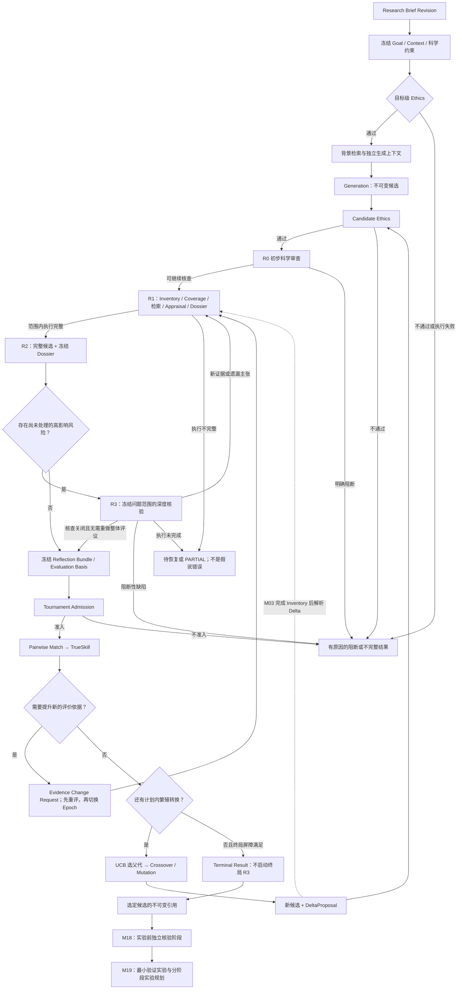
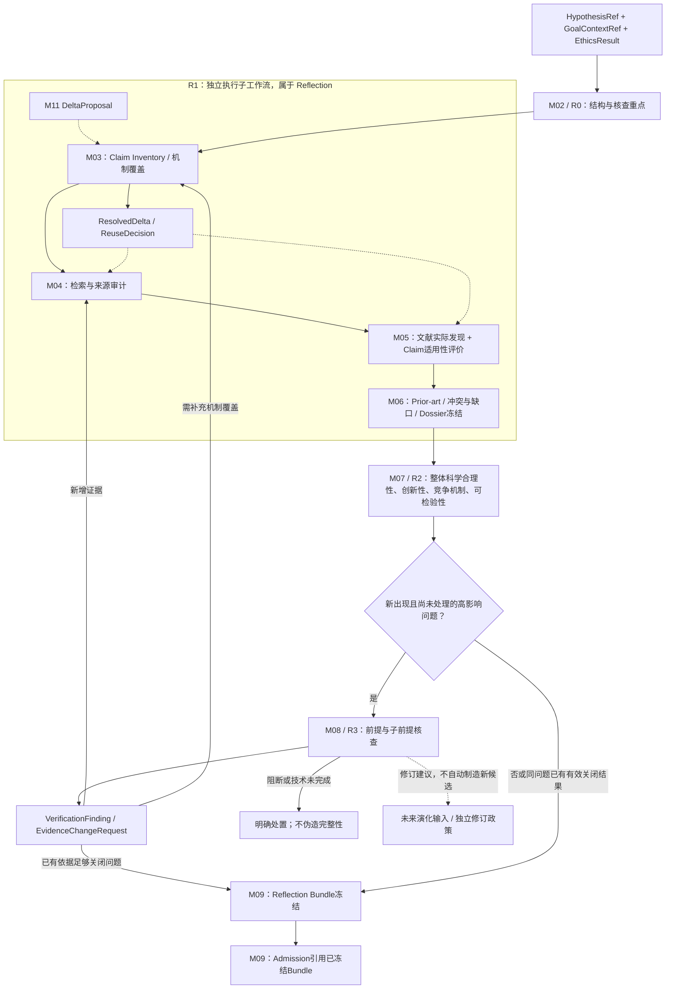
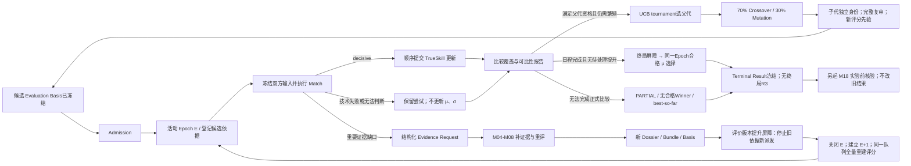
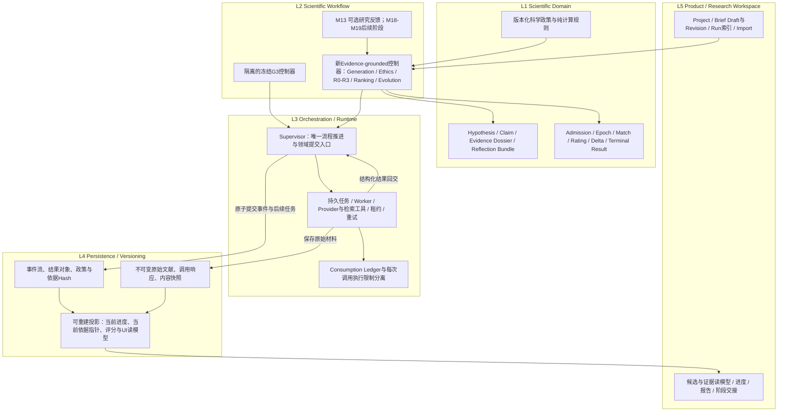
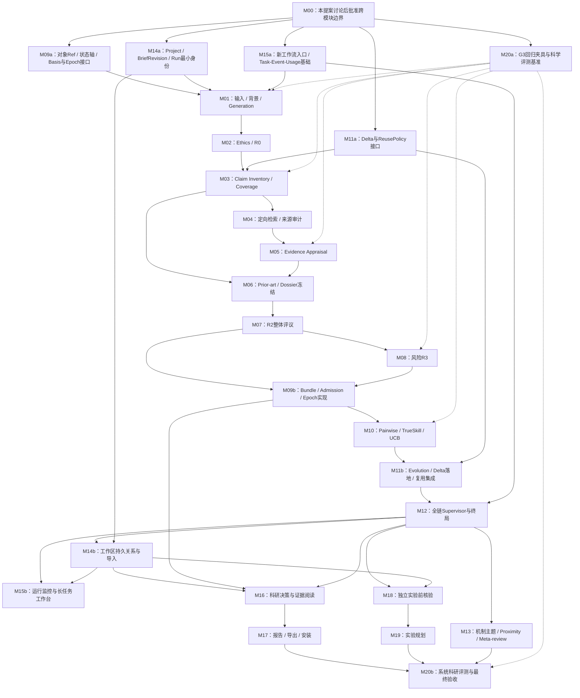

# M00 第一阶段：源码对照审查与目标架构提案

**状态：PROPOSED / 待讨论。不是 Architecture Baseline，不是 accepted Handoff。**

本报告仅执行只读资料与源码审查；未修改 GitHub、原始附件、科学运行记录或已确认决策。此前的论文重建作为方法索引使用；关键机制已回查原论文。文中的工程方案需要用户确认后，才能进入基线定稿和后续模块实施。

审查起始时间：2026-10-30 07:12:11 UTC（北京时间 15:12:11）。实际审查 main：`7313ca032e4f5f0c84578523e0f5639ad038e7af`，与用户给出的旧基准相同。该提交时间为 2026-10-26 00:46:35 UTC。所有源码定位均固定在这一 SHA；不能把它当作未来窗口中的实时 main。[S00]

证据标签：`[Nature 明确披露]`、`[arXiv 明确披露]`、`[论文推断]`、`[现有源码]`、`[已确认项目决策]`、`[工程建议]`、`[待定]`。来源编号 S / P / F 分别对应文末固定版本源码、论文和输入文件。提案中的类型名只表示接口语义，不代表已经存在的生产 Schema。

# D1｜架构评审摘要

## 1. 总体判断：方向合理，必须先重定评价边界，而不是增加 Agent

**建议保留“证据驱动的科学审查 + 贝叶斯演化搜索”的总体架构，但当前草案尚不能直接作为 M01–M20 的稳定开发基线。** 主要障碍不是缺少某个 Agent，而是尚未统一：谁拥有候选的评价依据、证据变化如何影响比赛、子代如何获得有效的证据复用资格，以及流程什么时候可以结束。[工程建议]

建议将新系统定义为一个新的、显式版本化的 Evidence-grounded Ideation Workflow，复用现有持久化运行底座与经过核实的搜索算法，不把独立 Research-v2 分支直接接成 G3，也不原地扩张冻结 G3 的含义。现有 `Supervisor.advance()` 和 `handle_result()` 会把正式 G3 提前路由到专用处理器；后面的 Claim Verification、Lineage、Proximity 和其他 Research-v2 分支并不因此自动参与 G3。[现有源码；S03、S04]

第一阶段科学主线建议为：

研究目标与背景 → Generation → Ethics → R0 → R1（主张、检索、评价、Dossier）→ R2 → 按风险触发 R3 → 冻结评价依据 → Admission → Ranking → UCB 选父代 → Evolution → 子代复审。

**本次用户已取消终局 R3。** 最后一代完成后，只关闭未决执行、完成当前评价版本的比较并冻结 Terminal Result；不再按照 μ 前三名或高 UCB 扩展名单启动一轮 R3。实验前核验仍属于独立的 M18，不能倒写已结束 Run。[已确认项目决策；本次用户指令优先于附件旧条款]

## 2. 与论文最大的实质差异

论文为评议与演化提供方法依据；本项目增加的是“可以验证身份、追踪证据、隔离评价版本”的科学证据工作流，而不是复原一套已公开的 Google 内部实现。

[Nature 明确披露] 初审、检索支持的全文评议、假设/子假设深度核验，以及 Proximity、Meta-review、持久记忆和异步调度。[P-N1、P-N2]

[arXiv 明确披露] 五类 Ideation Agent、TrueSkill、UCB 父代选择及 0.7/0.3 交叉变异。[P-A1、P-A2]

[工程建议／已确认项目决策] R0–R3 的具体流水线、Claim Coverage、Evidence Dossier、Admission、Evidence View、评价 Epoch、证据复用规则和无直接证据候选的准入，是本地扩展。不能把这些契约名称或状态机写成原论文已披露的规范。

需要保留两个文献歧义：arXiv §2 的默认 G=10 与 Appendix D.2 的收敛式设置不是同一完整停止规范；Figure A1 的最高 UCB 表述与正文最高评分/最高评级表述不能直接等同于最终按 μ 选择。当前 G3 的固定三次繁殖转换与 max-μ 终局属于本地明确实现，而非论文唯一结论。[P-A1、P-A2、P-A4；S08]

## 3. 当前最值得保留的五项能力

**第一，明确的实际调用链与工作流隔离。** Workbench → RunService → CoreRunner → Supervisor → Worker。G3 的专用路由已存在，能成为新工作流显式隔离的参照，但不能把旧分支的开关全部打开后宣称得到新架构。[S01、S03、S04、S19、S22]

**第二，不可变内容、来源快照、精确绑定和谱系的基础。** SourceUnit 标识假说自身的文本出处，EvidenceUnit 标识论文快照里的材料；二者不是同一种“来源”。ClaimLineage 已区分 retained/modified/split/combined/new，并以候选、主张和内容身份绑定。应复用这些基础，不应把 title/abstract-only 或 critical-only 的旧限制复制进新科学方法。[S12–S15]

**第三，确定性的相对评分与父代选择。** G3 的比赛结果、TrueSkill 重放、balanced pairing、UCB tournament selection、冻结的交叉/变异选择和父代内容均已有真实实现。保留算法核心和可重放性质，不把旧配额当成新系统必然合适的科学标准。[S06–S08]

**第四，任务持久化和恢复边界。** 现有代码已区分任务、外部调用、原始响应、解析结果与领域提交，具有租约、心跳、序列并发检查和幂等身份基础。这些比另建一套通用多 Agent 调度平台更值得复用。[S17–S21]

**第五，科学结果与产品目录分离。** Web Store 不直接写科学表；Project、Draft、Run 目录基础及现有前端可延续。M14–M17 需要补齐版本关系和科学读模型，不需要以“重做工作区”为前提。[S22、S23]

## 4. 最可能导致返工的六个问题

| 优先级 | 真实问题 | 必须先定的架构边界 | 影响 |
|---|---|---|---|
| P0 | 同一候选在不同比赛中可能使用不同证据或评议，但仍累积同一 μ、σ | 冻结 Evaluation Basis；已参赛依据变化进入新 Epoch，不能原地替换 | M06–M12 |
| P0 | R3 的新证据由谁写入？R2 是否重做？谁判断再触发？ | R3 只产出发现/请求；M06 生成 Dossier，M07 整体重评，M09 控制版本 | M03–M12 |
| P0 | 子代先 Delta 后 R1，但 Delta 需要子代 Claim Inventory | 演化产生 DeltaProposal；覆盖完成后解析 ResolvedDelta；仅后者可授权复用 | M03、M04–M06、M11 |
| P0 | `needs_more_evidence` 可能让 2-valid/6-focal 配额频繁耗尽 | 准入、科学未知、非决定性比较、补证据请求和执行失败分开 | M07–M12 |
| P0 | “保留 G3”只保留名字，却因新代码改变全包身份而无法恢复旧运行 | 独立封存可执行 G3；新运行身份与新资源策略，不放宽旧验证器 | M09、M12、M15、M17、M20 |
| P0 | 最后才做 M09 契约、M15 运行底座和 M20 科学评测 | 将契约、最小运行适配与评测基准前置；功能编号不等于执行顺序 | M01–M20 |

这些是建议确认的跨模块决策；风险阈值、证据质量标准、Claim 粒度和比较配额数值仍应分别留给 M02/M03/M05/M08/M10。

## 5. 输入冲突和缺失项

本次实际收到 7 份 Markdown：COMMON_CONTEXT、DECISION_LOG、PROJECT_STATE、WORKFLOW_PROTOCOL、HANDOFF_TEMPLATE、Evidence Dossier Contract V1、Reflection Pipeline Contract V1。未找到独立的 `Evidence Appraisal Rubric V1` 或独立 `M00 模块说明`；M00 范围按本次任务正文与模块状态板确定。不能据此声称已完成该 Rubric 的审查。[F01–F07]

| 条目 | 材料冲突 | 本轮处理 |
|---|---|---|
| 终局 R3 | Reflection Contract D9、§3 D3/D9、§5.3、T16 仍要求终局短名单 R3；决策日志 O-006、状态板 O-CORE-4 仍保留扩展规则 | 本次用户已取消；列为应废止/改写的旧条款，不再列作需要决定的终局科学问题 |
| R3 触发数量 | 决策日志 D-003 仍写“两类”，实际只剩高影响风险 | 修改措辞为风险触发；不是再新增第二类 |
| needs_more_evidence | DECISION_LOG D-008 为“待进一步完善”；Reflection Contract D7 标“已定” | 当前源码不更新非决定性结果的事实可确认；新流程补证据/新 Epoch/重试策略仍须审议 |
| 合同状态 | 两份 Contract 总体标拟议，内部部分条目标已定 | 仅与用户明确决定一致的方向作为已确认；字段、生命周期细项和新 Epoch 全量重建仍属提案 |
| 项目状态 | 状态板所有 M00–M20 为 not_started | 这是新模块规划状态，不代表仓库没有相应基础能力；也不构成任何模块已验收的证明 |

上述冲突已在本报告中显式处理；没有修改原附件。后续确认时应追加带 supersedes 的决策记录，而不是擦掉旧记录。

## 6. 本轮建议优先裁决的六组选择

Q1：采用独立 Evidence-grounded 工作流与封存 G3 的双轨，而不是原地扩展 G3。

Q2：以候选作用域 Claim、冻结 Dossier/Reflection Bundle 及实际模型可见 Evidence View 共同构成唯一评价依据。

Q3：已参赛候选的科学评价依据变化时，先批量完成重评，再全量重建新 Epoch；第一版不做评分迁移或旧比赛局部失效修补。

Q4：不强制所有 `needs_more_evidence` 继续重复比赛；由结构化问题分流处理，明确允许“无完整相对排名”的终局。新流程不默认继承 2-valid/6-focal 数值。

Q5：风险 R3 使用可关闭的问题/核查计划；修复候选交回 Evolution，不在 Reflection 内自行无限生成新版本。M18 作为独立阶段，不重开原 Run。

Q6：前置 M09a 接口、M11a Delta/复用契约、M15a 运行适配、M20a 评测和 M14a 最小对象身份。

取消终局 R3、不设用户预算、完整主张覆盖和 HITL 暂缓已经确认，不需要重复裁决。

# D2｜论文—当前代码—目标设计对照矩阵

这里的 P 是论文方法，A 是本次固定 SHA 的真实实现，T 是已确认方向与本次建议，G 是实现差异。各代码编号在附录给出完整路径、函数及阅读行号。论文摘要只用于方法定位，不以合理工程设计填补未披露细节。

| 领域 | P：论文 | A：当前 main 的实际路径 | T：目标 | G 与推荐处理／模块 |
|---|---|---|---|---|
| 1 目标、上下文、约束 | [Nature 明确披露] Research Plan 的偏好、属性、约束；[arXiv 明确披露] directive 为入口。[P-N1、P-A1] | RunService.validate/create 冻结 manifest/goal/profile；_batch2_task 绑定 directive/version/hash。不是可以任意改变当前任务目标的聊天上下文。[S01、S05] | [已确认项目决策] 研究问题中心；[工程建议] BriefRevision → Goal/ContextSnapshot → Run。区分科学目标、参考材料、实验约束、执行配置 | 保留快照；补充目标与上下文的稳定分离、明确领域支持范围。重大范围变化新 Run，评价政策变化新 Epoch。M01/M09/M14 |
| 2 背景检索 | [arXiv 明确披露] 初始候选分别做并行文献调研；15 篇是特定实验配置。[P-A1、P-A4] | Directive Ethics PASS 后建立四个 root query tasks；RootRetrievalResultV2 → RootLiteratureReview → RootGroundingFrozen；相同查询可复用。当前 PubMed、摘要、有限查询/页/来源数。[S05、S09] | [已确认项目决策] 背景检索；[工程建议] 独立背景上下文与 R1 证据核查，共享来源存储与检索工具，不共享未经核验的支持结论 | 新 R1 不能把背景综述当作 Claim Verification；需多源/全文可扩展材料接口，首版支持范围明确。M01/M04/M05 |
| 3 初始 Generation | [Nature 明确披露] 多策略生成；[arXiv 明确披露] 温度 1.6、简洁性。[P-N2、P-A1] | _handle_batch2_result：冻结来源综述和原始来源输入 → GroundedGenerationResultV1 → HypothesisContentCreated；包含机制、假定、预测、证伪项；重复 ID/内容检查；安全重设计保留来源上下文。[S05、S09] | [已确认项目决策] 保留生成主线；[工程建议] 固定输入事实范围、输出完整候选与未知前提，背景仅是候选生成依据 | 不必重写生成器；新增候选格式通过版本适配，不把 Claim/Appraisal 逻辑塞入 Generation。M01/M03 |
| 4 Ethics | [arXiv 明确披露] 目标与候选安全筛查。[P-A3] | DirectiveEthics、CandidateEthics；PASS 后才 Reflection；REJECT 最多一次 safe redesign；技术未知不能伪装 PASS。[S05、S09] | [已确认项目决策] 每个新候选重新 Ethics；[工程建议] 保留目标级 screening，安全修订作为新候选且不改变科学父代来源 | 必须保留；科学未知不等于伦理拒绝。后续实验方案安全核查归 M18/M19。M02/M11/M12 |
| 5 Reflection | [Nature 明确披露] initial/full/deep 等策略；没有披露本项目 R0–R3 对象契约。[P-N2] | BaselineReflectionResultV1 是 critiques/plausibility/prior_research/testability/originality/complexity 文本；模型输入为 directive+candidate。_baseline_ready_candidates 不检查“科学通过”或逐主张证据完成。[S02、S05、S09] | [已确认项目决策] R0→R1→R2，按风险 R3；[工程建议] 整体评议只由 R2 汇总，R3 不另建竞争的总体评分 | **核心新增能力**，不是把旧 Review 字段改名。旧 full_review 配置标签不证明 G3 已执行证据支持的完整评议。M02–M09 |
| 6 Claim Verification / Appraisal | [论文推断] 主张级显式证据账本可支撑论文中的核验策略；论文未给出本地 V1/V2 或 Dossier 结构 | 独立 Research-v2 有 claim decomposition→claim_search_plan→检索→V2 verification 的调度和结果应用；G3 的提前分流与 profile 校验明确排除它们。旧 policy 默认3 critical claims，另有 max_total_claims=8；V2 route 仅纳入 critical、title/abstract，并按来源与 Token 过滤。[S03、S10–S13、S24] | [已确认项目决策] 所有科学实质主张覆盖，四轴状态分离；[工程建议] 发现、解释、适用性和研究独立性分别记录，Dossier 集成 | 来源身份、绑定、原始存储可复用；旧完整性/固定上限/摘要证据等级不得直接升级为完整科学评价。M03–M06 |
| 7 Ranking / TrueSkill | [Nature 明确披露] Elo；[arXiv 明确披露] TrueSkill 成对比较。[P-N3、P-A2] | select_baseline_pair 实际为 balanced pairing，不是 YAML 表面的 ucb_pairing 路径；replay_bayesian_rating 只处理 decisive。当前 μ0=25、σ0=25/3、β=25/6、τ=25/300、draw=0。[S06、S07] | [已确认项目决策] 保留 pairwise/μσ，无固定证据加权；[工程建议] Match 绑定双方 Basis/View、统一 policy 与 Epoch；比较完整性单独记录 | 保留确定性更新，替换评价上下文输入；配额和不确定结果处理需要重新验证。M09/M10 |
| 8 Tournament / UCB | [arXiv 明确披露] UCB 与 tournament parent selection；具体本地配额未披露。[P-A1、P-A2] | 每候选至少2个 decisive 才进入父代/终局池；任一不足者6次 focal机会耗尽可令全轮不完整。父代从累积合格池随机取 k=2，以 μ+σ 选优，不同父代无放回。[S06、S08] | [已确认项目决策] 保留 UCB 父代选择；[工程建议] 区分 Admission、比较覆盖、父代资格、终局资格，不以 σ 解释科学证据可信度 | 2次决定性胜负不是科学校准，也不保证决定性比较图连通。新数值留 M10，接口现在固定。M09/M10/M12 |
| 9 Evolution / Lineage | [arXiv 明确披露] 70/30 Crossover/Mutation；[Nature 明确披露] 多种改进策略。[P-A2、P-N3] | G3 冻结 operator/父代/比较边界；新内容有候选级 parent_content_ids，之后 Ethics→baseline Reflection；不会自动做逐主张 Delta。ClaimLineageV2 在另一条显式工作流中已有真实解析/应用基础。[S04、S08、S14、S24] | [已确认项目决策] 子代 Delta→Ethics→R0/R1/R2/按需R3；[工程建议] 两阶段 Delta、分层复用、子代独立评分 | 保留演化主体；复用谱系身份但不能把文本相似或 retained 标签当作证据适用性的证明。M03/M11/M04–M09 |
| 10 Proximity / Meta-review / 多样性 | [Nature 明确披露] 相似关系和跨候选反馈；arXiv 五 Agent 列表未明确重述其去留。[P-N3、P-A2] | 存在 Proximity/feedback 相关代码与非 G3 路径；G3 profile 禁止相应 meta/evolution rounds，实际 balanced pairing 不依赖语义邻近图。[S03、S16、S25] | [工程建议] 保留能力位置，M13 实现为机制主题与非阻断建议；先测重复/塌缩，再决定是否进入搜索控制 | 不作为第一阶段准入依赖，不为了完整“Agent名单”强制实现；改变评价标准须改 policy/Epoch。M13/M20 |
| 11 代际、完成和终局 | [arXiv 明确披露] 演化多代；终止与最终指标有文内不同描述。[P-A1、P-A2、P-A4] | G0四个root槽位，G1–G3各两个子代槽位；累积池；完成比较后 max μ；不完整仅 best_so_far。_baseline_search_stop 冻结原生结果，随后零模型 finalization。没有终局 R3。[S06、S08、S26] | [已确认项目决策] 取消终局R3；[工程建议] 先延续 G3 研究日程做对照，固定终局屏障与 max-μ 合格选择；无合格完整排名允许明确无 Winner | 不复制草案中的“核验→新排名→核验新前三名”循环；M18 是新阶段。停止科学规则后续研究。M09/M10/M12/M18 |
| 12 长任务、存储、恢复 | [Nature 明确披露] Supervisor、异步工作与持久记忆；生产事务/版本契约未公开。[P-N1、P-N4] | CoreRunner、Worker、SQLite事件/任务/外部调用；lease/heartbeat、序列/幂等、终局恢复。RunService 对包级 code_identity 和固定费用 envelope 做强校验；不能任意配置为无预算。[S01、S17–S21] | [已确认项目决策] 保留 G3、只记录消耗；[工程建议] 新 workflow identity、分离 ConsumptionLedger 与每调用执行限制、复用提交底座、G3 独立环境 | 不为每 Agent 建独立调度器；不通过写超大预算假装无额度。运行基础先于 M01/M12 完整集成交付。M09/M12/M15/M17/M20 |

## 现有源码中的五种能力必须分开看

1. **正式 G3：** 由 release profile、CoreRunner、Supervisor baseline 路由共同决定的实际流程。
2. **Claim Verification V1/V2：** 具备真实任务构建、检索和结果应用路径，但由其他 profile/contract 显式启用；不是 G3 内已工作的 R1。
3. **Claim Lineage：** 具备父代主张引用、变化提案、子代拆解后解析与应用基础；不等于 G3 候选级 parent_ids。
4. **其他 Research-v2：** 独立 UCB comparison pairing、population policy、Meta-review、Proximity 等，不可与 G3 的同名能力混用。
5. **目标新能力：** 完整机制覆盖、科学证据 Appraisal、候选 Dossier、分层 R0–R3、评价依据提升和 Epoch 重建，尚未在所核实的正式 G3 路径中实现。

# D3｜目标架构与五张流程图

**本节全部为目标架构提案；流程中的已确认方向来自本次任务及 F01/F02，新增返回路径、对象和关闭机制属于工程建议。** 图3按用户最新决定改为“Ranking / Evolution / 终局冻结”，不再设计终局 R3 循环。

## 图1：完整科研流程

图中的 R3→R1 不是要求重搜所有旧文献，而是按新增主张/证据工作单完成必要补充。Dossier 更新后必须重新形成整体 R2；图中经过 R1 后自然进入 R2。已经完成的同一核查问题不能仅因重新运行 R2 就自动再次启动。

## 图2：R0–R3 的职责、所有权和返回路径

R1 不是另一个对整体假说作最终结论的“科学家”。M03 定义要核查什么，M04 负责确实检索并保存什么，M05 判断研究实际发现与特定 Claim 的关系，M06 聚合冻结；M07 才解释完整机制。M08 对指定高影响问题深入核查，不重复一轮全部 R1，也不直接修改分数。

## 图3：Ranking / Evolution / 终局冻结

这里的 Epoch 全量重建、比较可比性条件和新系统最终 max-μ 规则均是建议确认项。旧 G3 的 2-valid/6-focal 保留不变；新流程是否延续这些数值，由 M10 的科学评测决定，不能在 M00 默认为已冻结。

## 图4：五层架构与写入所有权

### L1：Scientific Domain

M00 先统一科学对象的身份、作用域、不可变性和状态语义。主张颗粒度、研究类型评价项和高影响风险分类不在此提前冻结。候选内容、证据与排序估计必须分离：一个候选可以科学上值得探索，但当前比较还不充分；也可以模型相对排名很高，但仍有关键未知。

### L2：Scientific Workflow

新流程采用显式工作流版本，不根据输出字段形状猜测走 G3 还是新路径。R1/R3 可以各有多个工具或模型任务，但不是多个拥有独立终局权的调度器。科学返回路径只允许明确的 EvidenceRequest、CoverageRepairRequest、RevisionSuggestion；请求本身不能修改已冻结对象。

### L3：Orchestration & Runtime

保留 Supervisor 拥有推进与提交的架构，内部拆出按工作流版本选择的控制器，而不是把新增科研步骤继续无边界塞进一个条件分支。Worker 执行冻结任务并返回结构化结果；不自行登记 Tournament、覆盖 Dossier 或产生 Winner。持久化任务可并行，领域提交与评分更新使用确定的事件序列。

取消用户预算策略不等于取消 API 单次超时、上下文容量、并发约束和技术失败处理。新增工作流应显式表达“只记账、无用户额度”，而不是把旧 max_usd/max_calls 改成一个很大的数字。来源材料超过上下文窗口时分批处理并聚合，不能静默截断 Claim 或证据后声称完整。[工程建议；当前约束见 S01/S21]

### L4：Persistence & Versioning

原始材料、候选、Inventory、Dossier、Bundle、Match、Epoch 结果和 Terminal Result 都是不可变科学记录。`current_dossier`、工作台进度和显示排名是可重建投影；它们不能取代被 Match 引用的历史快照。历史事件重放是恢复既有计算，不是重新调用 LLM 来“重现”相同输出。

跨代研究记忆优先由来源索引、Claim/机制依赖、证据评价、问题关闭记录和谱系构成。暂不增加一个能把自由文本总结升级成事实的独立 Memory Agent。共享证据材料不等于共享所有候选的科学结论。

### L5：Product & Research Workspace

Project 是长期研究容器；Brief Draft 可编辑，启动 Run 时固定 BriefRevision 和 GoalContext；Run 是一次明确版本的研究执行。当前工作区的“最新候选”只是一种视图，终局报告应指向确切 Candidate/Basis/Epoch。Import 保存来源与兼容性状态，不自动成为可以继续执行的原生 Run。M18/M19 通过 SelectedCandidateRef 接收科研对象，不读取“当前最高分卡片”这种会变化的 UI 状态。

## 图5：M00–M20 实施依赖图

a/b 表示原模块内的契约前置与后续实现，不新增一组 M21+。M01 与 M04 共享早期定义的 LiteraturePort，不让背景生成依赖尚未完成的 Claim-directed 工作流；否则会出现 M01→M03→M04→M01 的开发依赖环。M08 可以在 M07 的接口批准后用夹具并行开发，生产接入仍须等待真实上游验收。

# D4｜跨模块核心对象与接口级规范

## 1. 权威链：不是更多对象，而是不可混用的身份

**推荐权威链：**

`GoalContextRef → HypothesisRef → ClaimInventoryRef → DossierRef → ReflectionBundleRef → EvaluationBasisRef → AdmissionDecision → EpochEntry → Match → RatingSnapshot → TerminalResult`

`EvaluationBasisRef` 是这些既有对象与评价政策的轻量清单/摘要，不复制一份 Dossier，也不是新 Agent。它的作用是让每场比赛和每次父代选择能回答：“究竟评价了哪份候选、哪组证据、哪版评议，模型实际看到了什么？”

### SourceUnit 与 EvidenceUnit 的区别

[现有源码] SourceUnit/SourceUnitV2 来自假说的 title、claim、mechanism、assumptions、predictions、falsifiers；EvidenceUnitV1 来自论文快照的 title/abstract。ClaimRecordV2 的 SourceUnit 绑定证明主张来自哪段候选文本，不证明文献支持该主张。[S12–S15]

[工程建议] 保留旧身份与 reader；新增全文、表格、用户材料或其他领域数据库时，以新版本材料模型表达。不能让旧 `provider=pubmed`、`content_level=title|abstract` 的对象静默承载全文。精确片段、实际研究发现与对 Claim 的科学解释必须分别可定位。

## 2. 核心对象、所有者与交付接口

| 对象／接口 | 必须一致的语义 | 写入/构建责任 | 主要消费者与禁止事项 |
|---|---|---|---|
| Research Goal / Context | 目标、适用体系、输入材料、科学约束与评价偏好是固定快照；执行配置另列 | M01；运行采用由 M12 提交 | 所有科学模块；不能把工作区 Draft 的后续修改带入旧 Run |
| HypothesisRef | 一份不可变科学候选；ID、内容身份和 Hash 一致。科学内容修订生成新候选并记录谱系 | M01/M11 提案，M12 持久提交 | 所有模块；不得以新文字覆盖父代再沿用评分 |
| Claim / Inventory | Claim 是候选作用域内的主张；包含适用条件与角色；Inventory 包括依赖、覆盖与遗漏 | M03 | M04–M08/M11；跨候选语义相似键只可用于检索，不能直接充当相同身份 |
| Search Plan / Coverage | 声明的检索范围、适用意图、真实执行、筛选/评价覆盖和未完成项分开 | M04；M03定义科学核查需求 | M05/M06/M09；完成仅指范围内执行，不宣称穷尽全球文献 |
| Evidence Finding / Assessment | 文献实际发现与模型科学解释分开；评价绑定 Claim、上下文、材料层级与方法政策 | M05 | M06–M08；不能以来源 Hash 正确代替科学判断正确 |
| Evidence Dossier | 候选证据依据的冻结清单：Inventory、Coverage、Assessment、Prior-art、冲突/缺口、政策 | M06 是唯一组装/冻结所有者 | R2/R3/Ranking/Evolution；提供权威输入版本，不是“科学真理数据库” |
| Evidence Context View | 实际进入模型的证据视图；从 Dossier 可追溯派生，保存选择策略、遗漏/汇总信息与输入 Hash | 使用模块按共同接口生成；M09约束身份，M15保存实际调用 | R2/R3/Ranking；不能只记录 Dossier ID，却无法知道模型是否看过关键反证 |
| Reflection Bundle | R0、R2、必要 R3、所用候选/Dossier与政策的冻结组合；R3未触发必须有明确判定，而非含义不明的空值 | M09 组装；M02/M07/M08 产出内容 | Admission/Ranking/Evolution；先冻结 Bundle，再作 Admission，避免循环依赖 |
| Tournament Admission | 对指定 Basis 的资格结论，分开完整性、科学阻断、非致命未知；不包含比较成熟度 | M09 | M10/M12；模型文案“看起来不错”不能代替结构化准入 |
| Evaluation Epoch | 一套一致评价政策和不可变候选依据的比赛空间；成员可追加新候选，已参赛依据不能被替换 | M09 定义，M12 协调切换 | M10/M11/终局；Generation与Epoch不是同一计数器 |
| Match / Rating | Match 保存双方 Basis、实际输入视图、比较政策、顺序与结果；Rating为该Epoch内有序决定性事件的投影 | M10 | M11/M12/M16；非决定性/技术失败不伪造胜负；不跨Epoch拼接 μσ |
| Claim Delta | Proposal 表示演化意图；ResolvedDelta 对应真实子代 Inventory 与父代主张；removed/retained/modified/split/combined/new 可追溯 | M11 政策与提案；M03解析接入，M12提交 | M04–M06；未解析、上下文不等价或语义改变时，不能授权评价结论复用 |
| Research Run | 冻结 workflow/version、目标、科学政策、模型/Prompt/资源身份；调度和消耗属于该 Run | M12/M15 | 产品只引用状态，不凭浏览器连接推断完成；新流程不得伪装成旧G3 |
| Terminal Result | 固定结果边界与依据；执行完整性、选择状态、Winner和best-so-far分别表达 | M12，使用M09/M10已冻结结果 | M16–M19；已结束Run不因后续实验前核验而改写 |
| SelectedCandidateRef | 明确引用某个 Terminal/候选/Basis/Epoch，并声明后续研究上下文 | M14的阶段交接；M18消费 | M18/M19；不是一个随最新排名变化的列表下标 |

## 3. 必须分开的状态轴

已确认的四轴是 Contract Validity、Retrieval Execution、Assessment Execution、Epistemic Status。[F06 §4]

在它们之外还需要独立表达：机制覆盖状态、Review Execution、Scientific Disposition、Admission、Comparison Coverage、Run Execution 与 Selection Status。没有必要把这些状态做成一个巨大枚举；模块输出分别保留，再由确定性规则形成调度判断。[工程建议]

| 情形 | 科学语义 | 运行与比较处理 |
|---|---|---|
| 已执行完整范围检索，没有直接支持 | 科学未知，可能是值得探索的新机制 | 只要可检验且无阻断问题，允许准入；不能自动 needs_more_evidence |
| 反证检索未完成、来源获取失败 | 执行不完整 | 待恢复或明确 PARTIAL；不能标“未发现反证” |
| 证据存在重要冲突但未否定核心机制 | 冲突/不确定 | R2判断影响；必要R3；可有条件准入 |
| 核心前提被可信且适用的证据直接否定 | 潜在阻断性科学缺陷 | 由版本化科学政策评定；不是凭一个 relation 字段自动封杀 |
| 双方都可检验、证据完整，但当前无法比较优先级 | 比较非决定性 | 不更新TrueSkill；不自动触发重复文献检索 |
| Judge 输出非法或API错误 | 技术失败 | 记录尝试/真实消耗；重试不改变科学输入 |
| Prior-art 重合 | 新颖性问题 | 是否阻断取决于研究目标；不等于机制错误 |

## 4. 证据变化与评价版本规则

**建议采用“语料可增长、评价依据不可偷偷变化”的规则。** 新发现先进入共享材料库；不是每新增一篇文章就重建所有候选。只有被采纳进入某候选科学依据、改变其评议输入时，才走评价版本提升。

| 变化 | 候选内容 | Dossier/Bundle | Epoch处理 |
|---|---|---|---|
| 新材料被获取，但未改变任何候选评价依据 | 不变 | 不强制新建 | 不变；材料库记录新来源 |
| 尚未参赛候选补齐证据 | 不变 | 完成并冻结新依据 | 可首次加入当前兼容Epoch |
| 已参赛候选的证据、评议或模型可见科学输入改变 | 不变 | 新版本，不覆盖旧版本 | 第一版推荐统一新Epoch重评；旧评分保留 |
| 新子代 | 新候选身份 | 独立Inventory/Dossier/Bundle；可以合法复用材料 | 同政策下作为新成员加入；评级从先验开始 |
| 候选科学命题被改写 | 新候选身份 | 重新Ethics与完整评议 | 按新候选处理，不继承父代分数 |
| 科学目标、适用体系发生实质变化 | 新GoalContext；通常新Run | 不自动复用旧整体结论 | 不跨研究目标比较旧 μσ |
| 仅界面标题、注释等不进入科学输入的展示属性变化 | 科学内容不变 | 不变 | 不变 |
| 终局后M18产生新发现 | 原Run不变 | 在新阶段创建补充评价对象 | 原Terminal不变；需要重排时建立关联的新评价Run/研究分支 |

“重大变化”的科学细则由 M06/M09 制定。M00 先确定保守边界：**被 Match 使用的已冻结科学输入不得原地替换。** 新材料是否需要提升、是否只属展示元数据，必须有明确分类记录，不能通过篡改 Hash 或修改旧评议来规避版本管理。

## 5. Epoch 重建的推荐协议

M09先登记 EvidenceChangeRequest；M12停止使用受影响旧依据派发新的比较/父代选择；已在途结果仍按原Epoch和原Basis保存。M04–M08完成必要补证据与重评；M06/M09形成新依据。到版本提升屏障时，固定本轮可比较候选集合，关闭旧Epoch，从相同先验建立新Epoch并重新比较。

未变化的 Dossier/Bundle 可以复用；**评级和历史胜负不能自动迁移到新Epoch。** 第一版不做“只删掉若干场旧比赛然后修正μσ”的局部算法，因为它将同时引入比较依赖传播、采样偏差和重放顺序问题。此项是建议，不是附件已经批准的政策。

补充核查期间不使用旧评级继续繁殖受影响候选。Generation序号、Epoch序号、候选依据版本和技术Attempt必须独立，不能把重评当作又产生了一代科学假说。

## 6. 子代复用的四级边界

1. **原始材料复用：** 同一不可变来源快照可直接引用；不等于再次实际检索，也不能重复记为新增文献。
2. **文献实际发现复用：** 相同材料版本与抽取政策下，Observed Finding可复用，保持原始出处。
3. **Claim×Evidence评价复用：** 只有主张含义、物种/模型、条件、干预、时间、结局、方向与评价政策等适用条件相容时，才能建立新的子代绑定并记录复用依据。`retained_from`本身不充分。
4. **整体评议与评分不继承：** 子代完整R2重新执行；必要R3重新判定；TrueSkill由子代自己的比赛形成。

如果Delta尚未解析或复用条件不能确定，允许回退为重新评价，不应为了缓存命中率牺牲科学性。缓存是执行优化，不是科学证明。

## 7. 关闭循环而不压制科学未知

R3的目标是关闭“规定范围内是否发现使机制失效的问题”，不是把新机制证明为真。为每项核查保留问题身份、涉及的主张、输入依据、检查范围、发现和关闭状态。重新运行R2不能仅因风险文字仍存在，就重新提交完全相同的R3。

推荐每次核查先形成有限、可核对的 VerificationPlan；不按固定Claim数截断，但禁止“继续搜索直到不存在任何未知”。计划执行完后可以得到非阻断未知、阻断缺陷或明确不完整。新出现的实质问题进入新的请求；重复无进展请求必须被识别并返回有原因的处置，而非无限追加任务。

若R3要求改写机制，它返回RevisionSuggestion，而不是在Reflection内部自动生成新候选。是否增加额外修复槽位属于搜索政策变更，留M11/M12单独审议。先不让“修复→重审→再修复”成为没有边界的隐含生成循环。

# D5｜Architecture Decision Records（待讨论版）

## A. 已确认决定：继承，不重新发明

| 记录 | 状态与依据 | 本轮保留的含义 |
|---|---|---|
| D-001/D-002 | [已定] F02及本次指令 | 第一阶段包含R0/R1/R2；R1为Reflection内部的独立执行子流程，检索/绑定仍是独立任务 |
| D-003修订 | [已定] 本次指令 | 只有风险触发R3；取消终局前三名/高UCB R3，旧相关条款需标 superseded |
| D-004 | [已定] F02 | 每个新子代重新Ethics和完整科学评议；可有条件增量复用证据 |
| D-005 | [已定] F02 | 必要科学主张不按固定数目截断；完整性针对机制覆盖而不是凑满数量 |
| D-006 | [已定] F02 | 不设置用户预算/额度；记录阶段、调用和Run消耗 |
| D-007 | [已定] F02 | 无直接证据但完整核查、无阻断问题且可检验，可进入Ranking |
| D-011 | [已定] F02 | 保留pairwise、TrueSkill、UCB、70/30演化主体及G3回归参照；不把G3数值自动当成新流程最终科学标准 |
| D-012/D-013 | [已定] F02及本次指令 | 内部科研人员、假说中心工作区；HITL另题研究，当前不设计其交互 |
| 重要证据变更 | [已定] 本次指令、F01/F07 | 新评价版本；不把证据分数通过固定权重加入TrueSkill |

D-008的非决定性比较后续工作流存在文件间状态冲突，不能仅因某份草案写了“已定”便把补检索/重评/配额数值全部冻结。

## B. 建议确认的关键 ADR

### M00-P01｜新工作流与 G3 的隔离

**为什么现在决定：** release服务验证全包代码身份和固定配置；新文件、新Schema或新资源策略都可能使旧Run恢复校验失效。[S01]

**备选：** 原地扩展G3；完全复制一套新系统；保留封存G3运行环境，新工作流复用可兼容的基础设施。

**推荐：** 第三种。新 workflow/profile/contract 显式身份；旧G3保留其代码、依赖、资源、原生结果和读写语义。不要通过放宽旧校验器来“兼容”。共享底座的修改必须有G3回归证据，历史Run仍由匹配的发行环境恢复。

**影响：** M09/M12/M15/M17/M20。**状态：[建议确认]**；封存清单和具体打包方式在批准后由M15/M17实现，当前不创建冻结标签。

### M00-P02｜R1 独立执行，但不建立第二个整体评议权威

**为什么现在决定：** 如果Claim Agent和Reflection都能修改整体结论，Dossier、R2和Admission会争夺科学解释权。

**备选：** 单个超长Reflection调用；独立自治Claim Agent；Reflection内可独立调度的R1工作流。

**推荐：** 第三种；M03定义主张，M04取材料，M05作证据评价，M06聚合，M07形成完整机制评议。进程数、模型数、是否并行不是科学职责划分的依据。

**影响：** M02–M09/M12。**状态：[建议确认]**；分层方向已确认，这里确认的是写入和调用所有权。

### M00-P03｜冻结评价依据与实际可见输入

**为什么现在决定：** 仅保存候选Hash或DossierHash不能说明Judge是否看到反证、看的是哪版R2，后续无法可信重评或解释排名。

**备选：** 动态读取最新对象；仅固定Dossier；固定候选、Inventory、Dossier、Bundle、科学政策和实际Evidence View。

**推荐：** 第三种。Dossier是版本化证据输入的权威，不是事实真实性的担保。所有模型推断和真实材料分层；上下文视图的裁剪/汇总可审查。Bundle先冻结，Admission再引用，避免Bundle与Admission互相哈希。

**影响：** M03–M12/M16/M17。**状态：[建议确认]**。精确字段和序列化规则由M09a与对象所有者协调，不在M00提前定死。

### M00-P04｜重要依据变化后全量重建 Epoch

**为什么现在决定：** 旧评级累计了旧判断；只对变化候选重置μσ，而保留其他候选从旧比赛获得的分数，会留下间接污染。

**备选：** 原地改旧输入；局部撤销比赛并迁移评分；统一屏障后新Epoch从先验重新比较。

**推荐：** 第一版选第三种，允许复用未变的科学对象，不迁移旧胜负。将同一轮已知变化聚合后提升，避免每到一篇文献就立即重建。物理上可并行审查，逻辑上不混用两个评价时期的输入。

**影响：** M06–M12/M15/M17。**状态：[建议确认]**。精确“实质变化”标准归M06/M09；增量失效算法延后。

### M00-P05｜DeltaProposal 与 ResolvedDelta 分离

**为什么现在决定：** 当前草案存在“Delta先于R1，但Delta依赖R1 Inventory”的循环。

**备选：** 演化器直接宣布主张恒等；把完整R1搬到Ethics前；保留演化变化提案，待M03覆盖检查后解析。

**推荐：** 第三种。子代仍按用户规定先产生Claim Delta相关信息再进入Ethics；只有ResolvedDelta与上下文适用性检查通过后，才可复用证据评价。M03共享同一套主张语义，不让M11再造另一套拆解器。

**影响：** M03/M04/M05/M06/M11。**状态：[建议确认]**。这是对执行层次的澄清，不改变子代完整重审要求。

### M00-P06｜风险R3的有界问题工作流

**为什么现在决定：** 不解决关闭语义，R2→R3→新Dossier→R2会无限重复；反之，直接把R3结果写进μσ会破坏评分依据。

**备选：** 无条件反复核验直到不存在风险；一次R3后不允许新事实重评；按问题身份、冻结范围与新事实增量关闭/重开。

**推荐：** 第三种。R3只检查指定问题并发出结果/补证据请求；M06拥有Dossier写入，M07拥有整体重评。来自Ranking等处的风险先交R2作高影响判断，而不是成为第二种绕过R2的R3入口。修订建议不自动创建无配额的新候选。

**影响：** M03–M09/M11/M12。**状态：[建议确认]**。高影响阈值和核查范围的科学标准归M08；取消终局R3本身已经确认。

### M00-P07｜非决定性比赛与比较资格分开

**为什么现在决定：** G3的2-valid/6-focal可在证据审查更严格后阻断整轮；把科学未知解释为检索失败又会压制新假说。[S06]

**备选：** 强迫Judge选胜者；所有不确定都补检索；区分可检索的具体缺口、完整但不可比较、真正平局、技术失败。

**推荐：** 第三种。非决定性结果不更新TrueSkill；补证据必须提出可定位的问题，且同Basis下重复请求去重。新流程的最少有效比较、配对与连通性标准由M10评测，M00只固定其应输出ComparisonCoverage与未完成原因。

**影响：** M07–M12。**状态：[建议确认]**。不得修改冻结G3的配额；也不得把M10未验证的配额标为论文参数。

### M00-P08｜终局只冻结，不追加排序驱动的核验

**为什么现在决定：** 已取消终局R3；仍需防止旧草案的“新前三名再核验”循环在M12偷偷回来。

**备选：** 最后再跑一轮R3；直接拿当前最高μ而忽略在途证据；等待必需任务与版本提升关闭后形成终局。

**推荐：** 第三种。第一版以同一Epoch内达到正式比较资格的最高μ作为选择规则，对照G3；执行不完整或不能形成充分可比的候选集合时输出明确状态与best-so-far，不制造正式Winner。M18核验结果不改旧Terminal。

**影响：** M09/M10/M12/M18。**状态：[建议确认]**。max-μ作为新流程规则需确认；它与论文最高UCB表述并不完全相同。

### M00-P09｜记账与资源授权分离

**为什么现在决定：** 当前budget同时参与任务授权、调度、重试和终局，不能仅改前端预算选项。[S01、S21]

**备选：** 把旧上限设为极大值；删除全部限制和账本；新工作流明确使用仅记账策略，保留每调用技术边界。

**推荐：** 第三种。外部调用有唯一ID与实际尝试记录；reported/estimated/unavailable分开。重放不再记为一次新调用，重试若实际请求则单独记录。Claim或证据超窗通过分批处理，不以截断换取“完成”。

**影响：** M04/M05/M09/M12/M15/M17。**状态：[建议确认]**；不设用户预算已经确认，需确认的是实现边界。

### M00-P10｜跨模块基础前置

**为什么现在决定：** 若按M01到M20机械串行，M09的身份、M11的Delta、M15的恢复和M20的科学标准会迫使前面模块返工。

**备选：** 按编号顺序开发；由M00设计全部Schema；保留模块所有权但拆出早期接口/夹具工作包。

**推荐：** 第三种。M09a、M11a、M14a、M15a、M20a先交付最小共同边界，详细科学政策仍由各模块决定。M00不实现这些模块，不批准尚未讨论的字段。

**影响：** 全部。**状态：[建议确认]**。

### M00-P11｜跨代记忆与M13的第一阶段位置

**为什么现在决定：** 模型总结若直接成为后续“事实”，会绕开证据来源；Meta-review改变Judge标准还可能破坏Epoch一致性。

**备选：** 新建权威Memory Agent；直接复制全部Nature辅助策略；先维护结构化科研记录与来源索引，M13作为非阻断研究建议。

**推荐：** 第三种。M13先给主题、重复机制和未来生成方向，不作为Admission门。若以后用它改变评议标准，必须明确policy/Epoch版本。多样性指标从M20a开始测，不等M13完成才发现搜索塌缩。

**影响：** M03–M06/M10–M13/M20。**状态：[建议确认]**。

### M00-P12｜工作区、终局与第二阶段的单向交接

**为什么现在决定：** 项目列表的可更新状态不能成为科学依据；实验前发现问题也不能修改已导出的历史研究结论。

**备选：** 所有阶段共用一个可变Run；独立但无来源关联的实验项目；带SelectedCandidateRef的独立阶段。

**推荐：** 第三种。保留Project/Draft/Run目录基础，补充不可变BriefRevision、Import provenance和阶段关联。M18按实验上下文/证据时效做增量核验，M19做实验规划。要求重新比较时产生关联的新研究执行，不自动重开历史Run。

**影响：** M12/M14–M19。**状态：[建议确认]**。不在此设计HITL反馈按钮、反馈传播或人工改分。

## C. 待定科学问题与归属

| 问题 | 状态 | 决策所有者 | M00先要求的接口边界 |
|---|---|---|---|
| 必要Claim与critical粒度、隐含前提、Coverage判定 | [待定] | M03 | Inventory、依赖和未覆盖项可表达；不得固定数量截断 |
| 不同研究类型的因果、直接性、偏倚、适用性标准 | [待定]；Rubric未提供 | M05 | Findings与Interpretation分开，Appraisal政策版本和材料层级可追溯 |
| 研究独立性、重复队列/重复实验、冲突综合 | [待定] | M05/M06 | 支持study/source-family引用，不能以篇数当独立证据数量 |
| 整条机制的prior-art重合判定 | [待定] | M06 | 与一般支持证据分开，不把“未检索到”当全球首创 |
| R0足以拒绝的结构性缺陷 | [待定] | M02 | 不确定问题向R1传递；具体科学阻断须有类型和理由 |
| R3高影响风险、核查范围与关闭标准 | [待定] | M08 | CheckRequest/Plan/Result/Closure；不得恢复终局短名单触发 |
| 证据变化是否需要评价版本提升 | [待定细则] | M06/M09 | 已参赛输入不可原地换；变更有明确来源与分类 |
| 新流程比赛次数、配对、连通性与争议策略 | [待定] | M10 | ComparisonCoverage、非决定性理由、可用父代/终局资格分开 |
| 自适应停止和科学收敛 | [后续模块决定] | M10/M12/M20 | 先用明确有限代际日程；不能跨Epoch直接比较μ平台期 |
| 实验前核验的时效和实验上下文要求 | [后续模块决定] | M18 | 以选定快照为输入，不修改原Run |

## D. 不应在M00提前冻结的实现细节

不在本轮决定数据库每张表的全部字段、Python类名、向量模型、Claim个数、相似度阈值、R3风险数值、每条证据的综合权重、最终实验的样本量、具体Prompt全文或所有测试断言。必须先约定接口语义及所有权，再由各模块提供设计和科学评测。

# D6｜M01–M20 模块实施蓝图

## 1. 调整原则与实施顺序

保持原M01–M20编号，不额外制造更多Agent。建议仅拆出原模块的a/b工作包：M09a公共接口、M11a Delta/复用接口、M14a最小工作区身份、M15a运行/记账适配、M20a评测夹具。M06内部拆为Prior-art科学服务和Dossier确定性组装器；没有必要为这两件事再建新模块。

建议顺序：**M00确认 → 公共接口与评测基础 → M01–M06证据链 → M07–M09科学评议与准入 → M10–M12演化闭环 → M13–M17研究工作区增强 → M18–M19第二阶段 → M20最终验收。** 设计可并行，生产接入须等待其上游accepted交接；不能用“接口看起来齐了”替代上游科学验收。[F04]

### M01｜研究输入、背景检索与初始Generation

**目标：** 将Brief固定为Goal/Context，创建有独立背景依据的完整候选。**上游：** M09a身份接口、M14a Brief/Run关联、M15a任务与文献工具接口、M20a夹具。**输入→输出：** BriefRevision/材料/约束 → GoalContextSnapshot、BackgroundContext、HypothesisRef与生成来源。

**必须遵守：** 背景综述不等于候选证据验证；生成不能使用未声明的“模型记忆事实”作为已核实证据；模型与Prompt配置留痕。**内部可决定：** 任务解析、探索方向、生成Prompt和背景查询策略。**非职责：** 全Claim拆解、Appraisal、排名或用户额度。**交接条件：** 候选机制/假定/预测/证伪结构可消费；来源/约束身份固定；可由M02直接审查；与共享LiteraturePort无开发依赖环。

### M02｜Ethics Gate 与R0

**目标：** 分开安全筛查与快速科学结构审查。**上游：** M01、M09a。**输入→输出：** GoalContext/Hypothesis → 目标与候选Ethics结果、R0Result、需核查问题。

**必须遵守：** 安全未知、技术失败与科学未知不合并；R0不假装已完成新颖性文献核验。**内部可决定：** 安全分类和R0拒绝/继续标准、风险提示Prompt。**非职责：** 正式证据评价、TrueSkill、完整实验伦理审批。**交接条件：** M03能定位核查重点；所有拒绝均有结构化理由；明确何种情况可进入R1。

### M03｜Claim Inventory 与完整机制覆盖

**目标：** 覆盖科学实质主张、必要前提、机制桥接和可检验预测。**上游：** M01/M02、M09a、M11a。**输入→输出：** HypothesisRef/R0Focus/可选DeltaProposal → Inventory、CoverageMap、Claim依赖与ResolvedDelta。

**必须遵守：** 不设固定Claim数量上限；候选作用域身份；显式文本主张与推导出的隐含前提区分；上下文条件参与复用判断。**内部可决定：** 粒度、critical规则、分批拆解/覆盖检查方法。**非职责：** 搜索文献、决定论文支持强度、整体候选准入。**交接条件：** 每一必要机制环节有主张或明确缺口；源片段可定位；新子代映射不靠文本相似强行认定。

### M04｜Claim-directed Retrieval 与来源审计

**目标：** 执行按主张与科学意图声明的检索、获取和材料筛选。**上游：** M03、共同LiteraturePort、M15a；调用M11a复用政策。**输入→输出：** Inventory/SearchPlan/IssueRequest → SourceSnapshot、SearchCoverage、筛选/获取记录和未完成原因。

**必须遵守：** 来源存在性与科学支持分开；四类意图按Claim角色说明适用性；结果分页/来源去重/检索失败如实记录；不静默删掉反证。**内部可决定：** provider、查询改写、去重、相关性筛选、范围内结束标准。**非职责：** 文献科学质量最终评价、Dossier冻结、否定假说。**交接条件：** M05能访问实际材料而非只有模型综述；全部选入/排除/未取得材料可追踪；摘要与全文层级明确。

### M05｜Scientific Evidence Appraisal

**目标：** 判定每项研究实际上发现了什么，以及在何条件下支持/反驳某Claim。**上游：** M03/M04、M20a；必须补齐并评审真实Rubric。**输入→输出：** Claim上下文/材料 → ObservedFinding、EvidenceAssessment、适用性/因果性/局限、研究独立性信息。

**必须遵守：** 不把相关性自动当因果；不以来源合法性替代科学正确性；复用必须通过上下文与政策检查；模型confidence不是事实概率。**内部可决定：** 各研究类型Rubric、冲突标注、证据抽取与复核过程。**非职责：** 整体假说排名、固定加权总分、自动操纵检索。**交接条件：** 独立科学标注样例验证支持/反证和适用性判断；每条结论可定位原始材料；未评价材料不会被标为已完成。

### M06｜Prior-art 与Evidence Dossier

**目标：** 整理机制级先前研究、冲突/缺口，形成可冻结的证据档案。**上游：** M03–M05、M09a。**输入→输出：** Inventory/Coverage/Assessment → PriorArtSynthesis、DossierRef、证据变更影响说明。

**必须遵守：** Dossier是聚合与版本边界，不重复M05的每篇科学评价；prior-art不是支持证据的简单计数；不改旧V2 complete语义。**内部可决定：** 机制重合比较、冲突综合、档案结构与科学变化分类。**非职责：** 全流程调度、准入、评分。**交接条件：** M07能取得完整依据及局限；四轴与Coverage明确；新旧Dossier有可检查差异；同一候选不出现两个无法区分的“权威最新版本”。

### M07｜R2 Evidence-grounded Full Reflection

**目标：** 针对完整假说作整体科学评议。**上游：** M02/M03/M06、M09a。**输入→输出：** 完整Hypothesis+冻结Dossier+R0Focus → R2Result、重大缺陷、竞争解释、可检验性和高影响核查请求。

**必须遵守：** 不仅汇总逐Claim标签；检查组合机制、方向、上下文与必要因果桥接；补证据通过请求返回上游；不自行覆盖Dossier。**内部可决定：** 整体评议方法、缺陷分级、解释力/新颖性/可检验性评价。**非职责：** 全量检索实现、TrueSkill更新、R3调度权。**交接条件：** 评议逐项绑定依据；未知与阻断区分；M08能够只凭结构化问题开展深核查。

### M08｜风险触发R3 Deep Verification

**目标：** 深查可能使核心机制失效的前提、子前提和重要冲突。**上游：** M07接口、M03/M04/M05/M06工具链、M09a。**输入→输出：** 高影响Issue/冻结依据 → VerificationPlan、Finding、关闭状态、补证据或修订建议。

**必须遵守：** 没有终局前三名/高UCB入口；新材料由M06提升、整体结论由M07重评；同一问题不无进展重复；不能以尚未实验证实为当然阻断。**内部可决定：** 高影响标准、去情境化前提检查、子前提展开和科学关闭规则。**非职责：** 重跑全部R1、创建科学候选、修改排名。**交接条件：** 所有请求能落到可检查结局；反例能够改变准入；核查未完成不会被伪装为科学支持。

### M09｜Reflection Bundle、Admission与Epoch

**目标：** 提供跨模块统一的评价依据与版本治理。**上游：** a阶段依赖M00；b阶段依赖M02–M08。**输入→输出：** 科学结果/政策 → FrozenBundle、BasisRef、AdmissionDecision、EpochDefinition、PromotionDecision。

**必须遵守：** Bundle先冻结；准入不等于比较成熟；不把无直接证据自动拒绝；重要变更不修改既有Match。**内部可决定：** 接口序列化、政策一致性校验、依据提升分类、确定性准入组合。**非职责：** 替代M07/M08作具体科学评判、生成比较胜负或设置演化策略。**交接条件：** M10只接收稳定且可验证的输入；两个科学版本不会误用同一评级身份；旧G3 reader保持原行为。

### M10｜Pairwise Ranking、TrueSkill与UCB

**目标：** 在固定科学目标和评价依据下形成可解释相对排序和探索指标。**上游：** M09b，M20a评测。**输入→输出：** admitted Basis集合/Policy → Match、RatingSnapshot、ComparisonCoverage、EligibleParent/FinalSet、EvidenceRequest。

**必须遵守：** 对科学未知不能机械弃权；但无可靠胜负不更新μσ；Judge不得暗中检索新证据；实际输入视图可审查；同Epoch内才解释相对排名。**内部可决定：** 配对、比较轮数、AB顺序、争议处理、决定性覆盖条件、参数校准；与G3的差异单独版本化。**非职责：** 来源Appraisal、Dossier写入、候选修订、工作区展示排序算法。**交接条件：** 决定性与非决定性可重放；配额不足/图不连通等有明确报告；UCB用于父代探索，不伪装科学真实性。

### M11｜Evolution、Claim Delta与证据复用

**目标：** 保留交叉/变异主体，同时明确子代新机制与证据适用性。**上游：** a阶段依赖M00/M03接口协作；b阶段依赖M10、M03–M09。**输入→输出：** 冻结父代选择/父代依据/反馈 → 新候选、DeltaProposal、父代贡献与复用决策。

**必须遵守：** 父代不可变；新子代不继承分数；70/30主体保留；完整子代R2重做；变化提案不等于已验证谱系。**内部可决定：** 交叉与变异Prompt、变化类型解析、主张等价/适用性复用政策。**非职责：** 跳过子代Ethics/R1、擅自改变UCB或增加修复槽位、把证据缓存当科学判断。**交接条件：** M12可安排完整子代生命周期；每项复用有条件与来源；未解析Delta有安全回退为重新评价的路径。

### M12｜Supervisor全链集成与终局选择

**目标：** 把已验收模块接成可恢复且可终止的科学流程。**上游：** M01–M11、M15a、M20a。**输入→输出：** RunManifest/任务事件 → 阶段推进、代际与Epoch屏障、TerminalResult。

**必须遵守：** 不再创造第二套科学规则；不暗中补槽或强迫Winner；Generation和Epoch分离；已结束Run不接受新的科学结果；无终局R3。**内部可决定：** 并发与调度、版本提升合并时点、停止原因、恢复/最终化实现。**非职责：** 改Claim/Appraisal/R3阈值、HITL机制、详细实验设计。**交接条件：** 根候选及子代都走真实新链；所有终局引用有效；既有G3回归与新链集成证据分别提供。

### M13｜机制主题、Proximity与Meta-review

**目标：** 描述研究空间、发现机制重复及改进后续探索。**上游：** M03/M06/M10/M12。**输入→输出：** 候选机制、证据、比较与评议 → 主题/相似关系/多样性指标/版本化研究反馈。

**必须遵守：** 第一阶段不成为准入硬依赖；反馈不是证据事实；改变评议标准必须走新政策/评价版本。**内部可决定：** 语义与机制距离、聚类、代表候选、反馈策略。**非职责：** 直接改μσ、自动判定文献真伪、决定终局资格。**交接条件：** 能解释聚类与建议来源；有独立消融显示是否增加实质机制多样性，而非只使文字更不同。

### M14｜Project / Draft / Run / Import

**目标：** 长期科研对象的稳定关联。**上游：** a阶段M00；b阶段M12/M09。**输入→输出：** 项目信息/Brief修订/RunRef/导入包 → 可追溯对象目录和阶段关联。

**必须遵守：** 可编辑草稿不改变运行快照；导入不自动取得执行权或科学可信性；目录不直接写科学表。**内部可决定：** 项目关系、修订/再次研究/导入去重与索引。**非职责：** 科学评价、评分、HITL反馈传播。**交接条件：** 每个Run可追溯到确切BriefRevision；编辑/再次研究不造成不明重复；M18可取得SelectedCandidateRef。

### M15｜运行基础与长任务工作台

**目标：** 新工作流可执行、可恢复、可观察，并与消费记录一致。**上游：** a阶段M00/M09a；b阶段M12/M14。**输入→输出：** 冻结任务、Provider结果、生命周期事件 → 持久提交、进度/异常、Usage和恢复结果。

**必须遵守：** 新旧workflow隔离；raw结果先留存、科学状态由Supervisor提交；每调用技术限制不变成用户预算；浏览器断开不决定Run是否停止。**内部可决定：** Worker并发、心跳、队列、技术重试、日志和进度投影。**非职责：** 科学准入阈值、实验流程或产品收费。**交接条件：** 真实中断/恢复/迟到结果/重复提交场景有运行证据；用量重放不重复计数；旧G3恢复边界有明确说明。

### M16｜V5.1科研决策与证据阅读

**目标：** 让内部科研人员看懂主张、依据、缺口、比较和下一步。**上游：** M06/M09/M12/M14/M15；主题可接M13。**输入→输出：** 科学只读投影 → 候选决策卡、主张—证据视图、排名理由和结果阅读。

**必须遵守：** 前端不能自己重新判断Admission或用不同排序替代后端；μ/σ不标为真值概率；当前结果与冻结终局清楚分开。**内部可决定：** 阅读层级、导航和信息密度。**非职责：** 重画已认可V5全部视觉、HITL机制、证据评价算法。**交接条件：** 读者能从关键结论追溯材料和评价版本；未知、不完整和阻断风险不混为一个警告。

### M17｜报告、导出和安装

**目标：** 产生与科学快照一致、可携带的研究成果包。**上游：** M12/M14–M16。**输入→输出：** TerminalResult/对象与来源 → 人类报告、机器清单、兼容性与运行环境说明。

**必须遵守：** 报告来源于冻结对象，不临时再让模型改变结论；保留未知与负面结果；不把提案标为已实施。**内部可决定：** 格式、导出目录、安装与发行包。**非职责：** 重新排名、修改历史Run、扩展科学方法。**交接条件：** 导出能验证来源、版本与Hash；无原聊天也能理解结果；G3与新系统发行身份明确。

### M18｜第二阶段Pre-experiment Verification

**目标：** 针对选定候选和实际实验情境核对时效、关键假定及可执行前提。**上游：** M12/M14 SelectedCandidateRef；复用M03–M08工具接口。**输入→输出：** 选定快照/实验情境 → Phase2Verification、适用性限制、新证据与继续/暂缓条件。

**必须遵守：** 不属于取消掉的终局R3；不对全部榜单自动重跑；旧Run不被修改。**内部可决定：** 哪些检查可沿用、哪些因时间/模型/实验条件变化必须重做。**非职责：** 自动翻写旧Winner、完整实验计划或HITL反馈机制。**交接条件：** M19取得明确的已核查范围与未决前提；新证据的来源和后续处置可追踪。

### M19｜最小验证实验与分阶段规划

**目标：** 把科学假说转成能区分机制和替代解释的验证方案。**上游：** M18、Goal/实验资源约束。**输入→输出：** 已核验候选/关键未知 → MinimalExperiment、对照与测量、证伪条件、分阶段Plan。

**必须遵守：** 不把LLM模拟当实验结果；明确新计划与原假说的关系；实验执行日志与真实结果未来另有来源。**内部可决定：** 领域实验方法、技术可行性、样本/统计设计和阶段停止条件。**非职责：** 本轮实现自主湿实验或重做Ideation。**交接条件：** 计划可被科研人员审阅，关键观测能支持或否定主张而非只追求正结果。

### M20｜科研评测、系统回归与验收

**目标：** 分开证明工程正确与科学评价有效。**上游：** a阶段M00；b阶段各模块交接。**输入→输出：** 固定任务/专家标注/代码与策略身份/运行包 → 回归、消融、科学错误分析与验收记录。

**必须遵守：** 从M00后即开始；专家离线标注不等于设计HITL运行交互；不以Hash测试通过宣称因果判断正确；不同Run/Epoch的μ不能直接作为质量提升量。**内部可决定：** 任务集、盲审/标注协议、支持与反证误判、机制覆盖、多样性、可检验性及排名一致性指标。**非职责：** 为了过测试擅改科学政策或回写冻结G3。**交接条件：** 提供实际命令、样本、结果、失败/跳过与局限；独立报告G3回归、新链可靠性、科学增益和真实消耗。

## 2. 每个模块统一交接包

每个模块至少交付：批准的设计与所有权边界、实际实现commit、输入输出契约版本、真实科学样例及反例、执行过的测试与跳过项、可运行最小示例、资源记录、与G3兼容性说明、未决问题及阻断范围。下一模块不得从聊天记忆猜测“已确认”内容。[F05]

M01–M12的接口交付应包含实际对象样例，而不只有自然语言说明。上游待定科学细则可保留为PolicyRef，但未实施/未验收的政策不能被下游默认成通过。

# D7｜M00验收标准、完成状态与待确认事项

## 1. 本轮实际完成什么

本轮完成的是**第一阶段静态调用链审查和架构提案**。GitHub连接器用于读取固定commit的文件和真实分支HEAD；开始及报告整理末期复核main均为`7313ca032e4f5f0c84578523e0f5639ad038e7af`。已核查G3入口、基线路由、Root grounding、Reflection准入、比赛与评分、父代和终局、独立Verification/Lineage分支，以及运行与Web持久化边界。

没有修改仓库或输入资料；没有创建开发分支、提交、PR或标签；没有执行G3、离线测试、在线模型调用、历史Run重放或科学有效性实验。容器尝试获取本地只读代码副本因网络解析失败，后续使用GitHub连接器完成静态阅读。因此不能声称本地工作树干净、全仓测试通过、旧Run恢复成功或已经完成科学回归。

## 2. M00验收表

| 标准 | 本轮状态 | 达到最终M00基线仍需什么 |
|---|---|---|
| 当前main身份核实 | 已完成：SHA、提交时间、树身份明确 | 后续窗口仍需再次检查最新main |
| 冻结G3身份与真实路径 | 已完成静态核实：profile/search/rating/pairing/selection/terminal均已定位 | 独立可执行基线包、真实Run/回归夹具和恢复验证尚未建立 |
| 论文披露／推断／项目／工程设计区分 | 已完成；关键章节回查 | 新增科学细则继续保持来源标记 |
| 终局R3取消冲突处理 | 已明确，不再作为设计入口 | 用户批准后在决策日志及草案中追加supersedes，不篡改历史 |
| 当前实现与目标重大差异 | 已形成12项P/A/T/G矩阵 | 实施前按最新代码再次核对受影响路径 |
| 跨模块对象与所有权 | 已提出接口级规范 | 用户确认P01–P12中的全局取舍，相关模块再实现契约 |
| 高风险状态/版本问题 | 已给出方向：Basis、Epoch、R3关闭、Delta分层、终局不可变 | 配额、风险阈值等在各负责模块评测验收 |
| M01–M20边界与依赖 | 已形成完整蓝图及前置工作包 | 批准开发顺序与接口交接门，不按编号机械串行 |
| 科学方法Rubric审查 | 未完成：独立Appraisal Rubric未提供 | M05必须获得实际材料并评审，不得凭本报告填作已验收 |
| 无聊天记忆可开展后续工作 | 提案包可独立阅读、追踪来源及问题 | 还不是可实施的accepted Handoff；须经第二阶段讨论与第三阶段基线定稿 |

**本轮结论：Phase 1 review complete / architecture proposed；M00 尚未 accepted，架构尚未冻结。**

## 3. G3身份清单（已核实的静态事实）

| 项目 | 身份或行为 |
|---|---|
| main SHA | `7313ca032e4f5f0c84578523e0f5639ad038e7af` |
| Git tree | `3af0c224d664c3df5d1ba7528323f04041b0d6a1` |
| release profile | `ideation-performance-dev-g3-v1` |
| profile文件Git blob | `fc8803379c38677b3b13bed0afbf15e932185670`；`src/co_scientist/release/resources/g3.yaml` |
| search policy | `2608-ideation-search-g3-v1` |
| 实际比较调度 | `2608-balanced-pairing-v1` / `select_baseline_pair` |
| 评级 | `trueskill_v1`；μ0=25，σ0=25/3，β=25/6，τ=25/300，draw=0 |
| 父代 | `select_baseline_parents`；k=2，κ=1，70/30，累积合格池 |
| 研究日程 | G0四root槽位，三次繁殖转换、每次两子代槽位；失败和安全重设计另有事件，不等于保证产生10条有效假说 |
| 比较配额 | min_valid_decisive=2，max_focal_attempts=6 |
| 终局 | `2608-final-max-mu-v1`；完整时最高合格μ；不完整保留best-so-far而非正式Winner |
| 旧资源包络 | 60 USD风险上限、143模型dispatch、48检索dispatch、7200秒watchdog等，均属旧G3事实，不是新流程要求 |
| spec SHA256 | 配置/代码声明为`000103561ed701648b3ca9b43521e174571cb4b638f6280263f55f5f6ff59874`；本轮未取得全量本地代码副本重新计算该文件Hash |

注意：`research_protocol_version: research-v2`、`required_before_admission: initial_review/full_review`、`selection.version: ucb_pairing_v1`等配置文字不能取代分支调用链。`Continuous R2 G3 DEV`中的R2还是发行/运行语境，不能据此认定已实现本项目科学层R2。

## 4. 建议在批准后补齐的G3保留材料

建议封存代码/依赖/资源身份、固定科学配置、Prompt与模型调用契约、可公开或内部合规使用的代表Run、原始事件与结果、预期科学轨迹和旧读取器。再验证恢复、确定性评级重放、终局身份和新旧工作流隔离。

本段是保留范围建议，不是已经完成的Baseline G3 Preservation Plan，也没有建立新的冻结标签。具体发行、迁移和历史运行恢复范围由M15/M17/M20落实。

# 附录A｜未来必须验证的跨模块场景（本轮未执行）

这里只列能发现架构返工的验收场景；更细的Schema测试与Prompt测试留各模块。

1. 候选无直接证据，但Inventory、检索、Appraisal完整且可检验：可以准入，不制造支持文献。
2. 反证检索失败：标执行不完整，不能显示“未发现反证”。
3. 文献摘要只报告相关关系：不能升级成直接因果支持；材料层级与外推限制被R2看到。
4. 两篇论文共享同一实验/队列：科学综合可识别非独立来源，不按篇数加权。
5. 子代保留同一句Claim但改变模型/干预/时间或结局：旧Assessment不能无条件复用。
6. 交叉后出现父代都没有的机制桥接：覆盖检查能识别，并进入必要检索与评议。
7. R3新证据改变关键科学判断：形成新Dossier/R2/Bundle，不直接改旧Match或μσ。
8. R2重复报告已完成的同一风险：不无限重启R3；有有效关闭记录或明确新事实。
9. Match请求补证据：技术失败、可检索缺口、不可消除的科学未知和相对难分分别处理。
10. 已参赛候选依据改变：旧Epoch与新Epoch的事件、评分、父代选择不混用。
11. 新Epoch的评级从先验重建；未变化候选不携带从旧对手评价获得的评分优势。
12. 决定性比赛图不充分可比：不把任意先验最高μ当成已验证的全局Winner。
13. 取消终局R3后：G3日程结束不会按前三名/UCB再自动调度R3；终局屏障仍检查必要在途工作。
14. M18发现反证：原Terminal不变，新阶段保留差异及关联，不能把旧导出静默改掉。
15. 新包改变code_identity：旧G3需要匹配环境，不能用关闭校验解决恢复问题。
16. 同一外部调用结果重放：科学事件/评分/账本不重复；真实重试调用单独记录消耗。
17. 所有候选均被阻断或只有一个可评候选：报告真实结果类别，不能虚构成对优胜。
18. 全Claim覆盖超出模型窗口：分块处理并保留覆盖证明，而非只取前若干Claim。

# 附录B｜待确认后才进行的文档修订

- `06_DECISION_LOG.md`：为取消终局R3追加明确supersession，修正D-003“两类”的旧措辞；D-008补全经过讨论的处理规则；O-006不再保留为终局高UCB待定问题。
- `02_PROJECT_STATE.md`：删除/替换O-CORE-4的终局R3稳定循环表述；M00状态与实际批准过程一致，不因生成本报告便改成accepted。
- `Reflection Pipeline Contract V1.md`：删除D9和§5.3的终局R3入口，更新相关测试；明确Bundle先冻结后Admission、R3返回路径、Evidence View与Epoch提升。
- `Evidence Dossier Contract V1.md`：明确SourceUnit/EvidenceUnit的不同作用、上下文适用性、材料层级扩展与四级复用；不将拟议字段名视作既有代码。
- 后续模块说明：增加M09a/M11a/M14a/M15a/M20a前置交接，保留原模块所有权。
- `Evidence Appraisal Rubric V1`：先取得实际原文件再评审；本报告不生成一个同名“替代原文”。

# 附录C｜源码与资料证据索引

## 1. 固定版本源码

所有行号均为固定SHA源码行号，不是连接器JSON显示的L2行号。范围为本轮实际读取的相关片段；本报告不声称逐行审阅了整个仓库。下列链接固定commit，不使用会变化的main链接作为代码结论依据。

| 来源 | 路径、函数及相关行号 | 支持的结论 |
|---|---|---|
| [S00] | GitHub branches/main；审查开始与末期重复核对 | HEAD、提交时间、Git tree |
| [S01] | `src/co_scientist/release/service.py` 55–220；`code_identity`、`budget`、`RunService.validate/create/_verify` | 正式入口、全包身份、固定G3配置与费用风险包络 |
| [S02] | `src/co_scientist/supervisor/orchestrator.py` 225–315；`_baseline_ready_candidates`、`_baseline_parent_context` | 实际G3准入、父代文献与评议上下文 |
| [S03] | `domain/ideation_core_boundary.py` 1–196；`batch34_execution_enabled`、`validate_batch2_boundary`；以及`supervisor/orchestrator.py` 5870–5940 `advance` | G3与Research-v2能力的显式隔离 |
| [S04] | `supervisor/orchestrator.py` 317–455、3745–3795；`_handle_baseline_search_result`、`handle_result` | G3结果提前分流、新子代与baseline比较提交 |
| [S05] | `supervisor/orchestrator.py` 1050–1350；`_batch2_task`末段、`_handle_batch2_result` | Root检索/综述/生成/安全/基线Reflection的真实任务接续 |
| [S06] | `domain/bayesian_ranking.py` 1–213；`TrueSkillConfig`、`select_baseline_pair`、`replay_bayesian_rating` | 实际balanced pairing、2/6配额、非决定性不更新、顺序重放 |
| [S07] | `release/resources/g3.yaml`；文件Git blob `fc8803379c38677b3b13bed0afbf15e932185670` | G3配置、科学参数、检索限制与名义字段 |
| [S08] | `domain/population_evolution.py` 1–145；`ShortSearchPolicy`、`read_search_policy`、`select_baseline_parents`、`baseline_final_choice` | 固定G3日程、UCB父代与max-μ终局 |
| [S09] | `domain/ideation_prerequisites.py` 280–470；RootRetrievalResultV2、RootLiteratureReviewResultV1、CandidateProposalV1、BaselineReflection/Ranking/EvolutionResultV1 | 来源层级、基线审查/比赛/演化契约 |
| [S10] | `domain/claim_verification.py` 1–240；ClaimVerificationPolicy、ClaimDecompositionOutputPolicy、EvidenceSnapshot | 默认critical/total上限、摘要材料与旧状态语义 |
| [S11] | `supervisor/verification_route_v2.py` 1–220；`build_verification_inputs_v2` | V2的critical-only、支持/反证/先前工作/竞争机制、来源/Token选择 |
| [S12] | `domain/source_units.py` 1–149；SourceUnitV2、`source_units_v2_for_content`、`resolve_source_units_v2` | 假说文本出处身份，不是论文证据身份 |
| [S13] | `domain/evidence_units.py` 1–151；EvidenceUnitV1、`evidence_units_for_snapshot`、`resolve_evidence_units` | 论文标题/摘要材料身份与精确偏移 |
| [S14] | `domain/claim_lineage.py` 1–230；ClaimRecordV2、FrozenParentHypothesisV2、LineageChangeProposalV2、ClaimLineageTargetV2 | 候选作用域主张、合格父代引用与变化类型 |
| [S15] | `domain/claim_verification.py` 202–240；EvidenceBindingV2及V2关系类型 | 证据绑定类型基础；不等于新科学Appraisal规范 |
| [S16] | `supervisor/feedback_loop.py` 1–159；`feedback_event`、`next_feedback_task`、`exploration_pair` | 现存Meta-review/feedback辅助路径与预算依赖 |
| [S17] | `runtime/core_runner.py` 1–220；CoreRunner初始化、`_compose`、`run_worker_step` | 真实运行装配和FullIdeation专用路径 |
| [S18] | `runtime/worker.py` 1–220；Worker、`recover`、`_authorize_before_recovery`、`_execute_with_heartbeat` | 租约/心跳/恢复与每调用执行限制 |
| [S19] | `runtime/core_runner.py` 350–548；`execute/resume/drive/_drive`、`_finish_continuous_partial` | 实际推进、停止、终局恢复和运行watchdog |
| [S20] | `adapters/persistence/sqlite.py` 1–190；RunRow、EventRow、TaskRow、ExternalCallRow | 科学事件、任务幂等约束与外部调用记录 |
| [S21] | `release/resources/g3.yaml`；`runtime/core_runner.py` 415–548 | G3运行包络与运行时耗尽/异常进入PARTIAL |
| [S22] | `src/co_scientist_web/app.py` 1–120；`create_app`、`service` | Web到RunService的边界、独立目录入口 |
| [S23] | `src/co_scientist_web/store.py` 1–123；Store及`save/get/run_root/job` | 产品目录独立于原生科学数据 |
| [S24] | `supervisor/orchestrator.py` 3000–3100、3790–3980、4100–4270；后续任务分支与`handle_result` | V1/V2 Verification、ClaimLineage和检索授权有真实执行基础，非只有数据类 |
| [S25] | `supervisor/orchestrator.py` 5940–6200，非G3的`advance`分支 | 独立Research-v2的Lineage/Verification/Proximity/Admission处理 |
| [S26] | `supervisor/orchestrator.py` 454–648；`_advance_baseline_search`、`_baseline_search_stop`、`_resume_baseline_finalization` | 代际推进、原生终局快照与零模型最终化 |

S03、S04、S24等包含多处范围，链接定位首个主要位置，其他路径/行号在表内保留。前缀省略的`domain/`、`runtime/`、`supervisor/`等均位于`src/co_scientist/`。

[S00]: https://github.com/syrsteven/co-scientist/commit/7313ca032e4f5f0c84578523e0f5639ad038e7af
[S01]: https://github.com/syrsteven/co-scientist/blob/7313ca032e4f5f0c84578523e0f5639ad038e7af/src/co_scientist/release/service.py#L55-L220
[S02]: https://github.com/syrsteven/co-scientist/blob/7313ca032e4f5f0c84578523e0f5639ad038e7af/src/co_scientist/supervisor/orchestrator.py#L225-L315
[S03]: https://github.com/syrsteven/co-scientist/blob/7313ca032e4f5f0c84578523e0f5639ad038e7af/src/co_scientist/domain/ideation_core_boundary.py#L1-L196
[S04]: https://github.com/syrsteven/co-scientist/blob/7313ca032e4f5f0c84578523e0f5639ad038e7af/src/co_scientist/supervisor/orchestrator.py#L3745-L3795
[S05]: https://github.com/syrsteven/co-scientist/blob/7313ca032e4f5f0c84578523e0f5639ad038e7af/src/co_scientist/supervisor/orchestrator.py#L1050-L1350
[S06]: https://github.com/syrsteven/co-scientist/blob/7313ca032e4f5f0c84578523e0f5639ad038e7af/src/co_scientist/domain/bayesian_ranking.py#L1-L213
[S07]: https://github.com/syrsteven/co-scientist/blob/7313ca032e4f5f0c84578523e0f5639ad038e7af/src/co_scientist/release/resources/g3.yaml
[S08]: https://github.com/syrsteven/co-scientist/blob/7313ca032e4f5f0c84578523e0f5639ad038e7af/src/co_scientist/domain/population_evolution.py#L1-L145
[S09]: https://github.com/syrsteven/co-scientist/blob/7313ca032e4f5f0c84578523e0f5639ad038e7af/src/co_scientist/domain/ideation_prerequisites.py#L280-L470
[S10]: https://github.com/syrsteven/co-scientist/blob/7313ca032e4f5f0c84578523e0f5639ad038e7af/src/co_scientist/domain/claim_verification.py#L1-L240
[S11]: https://github.com/syrsteven/co-scientist/blob/7313ca032e4f5f0c84578523e0f5639ad038e7af/src/co_scientist/supervisor/verification_route_v2.py#L1-L220
[S12]: https://github.com/syrsteven/co-scientist/blob/7313ca032e4f5f0c84578523e0f5639ad038e7af/src/co_scientist/domain/source_units.py#L1-L149
[S13]: https://github.com/syrsteven/co-scientist/blob/7313ca032e4f5f0c84578523e0f5639ad038e7af/src/co_scientist/domain/evidence_units.py#L1-L151
[S14]: https://github.com/syrsteven/co-scientist/blob/7313ca032e4f5f0c84578523e0f5639ad038e7af/src/co_scientist/domain/claim_lineage.py#L1-L230
[S15]: https://github.com/syrsteven/co-scientist/blob/7313ca032e4f5f0c84578523e0f5639ad038e7af/src/co_scientist/domain/claim_verification.py#L202-L240
[S16]: https://github.com/syrsteven/co-scientist/blob/7313ca032e4f5f0c84578523e0f5639ad038e7af/src/co_scientist/supervisor/feedback_loop.py#L1-L159
[S17]: https://github.com/syrsteven/co-scientist/blob/7313ca032e4f5f0c84578523e0f5639ad038e7af/src/co_scientist/runtime/core_runner.py#L1-L220
[S18]: https://github.com/syrsteven/co-scientist/blob/7313ca032e4f5f0c84578523e0f5639ad038e7af/src/co_scientist/runtime/worker.py#L1-L220
[S19]: https://github.com/syrsteven/co-scientist/blob/7313ca032e4f5f0c84578523e0f5639ad038e7af/src/co_scientist/runtime/core_runner.py#L350-L548
[S20]: https://github.com/syrsteven/co-scientist/blob/7313ca032e4f5f0c84578523e0f5639ad038e7af/src/co_scientist/adapters/persistence/sqlite.py#L1-L190
[S21]: https://github.com/syrsteven/co-scientist/blob/7313ca032e4f5f0c84578523e0f5639ad038e7af/src/co_scientist/runtime/core_runner.py#L415-L548
[S22]: https://github.com/syrsteven/co-scientist/blob/7313ca032e4f5f0c84578523e0f5639ad038e7af/src/co_scientist_web/app.py#L1-L120
[S23]: https://github.com/syrsteven/co-scientist/blob/7313ca032e4f5f0c84578523e0f5639ad038e7af/src/co_scientist_web/store.py#L1-L123
[S24]: https://github.com/syrsteven/co-scientist/blob/7313ca032e4f5f0c84578523e0f5639ad038e7af/src/co_scientist/supervisor/orchestrator.py#L3000-L3100
[S25]: https://github.com/syrsteven/co-scientist/blob/7313ca032e4f5f0c84578523e0f5639ad038e7af/src/co_scientist/supervisor/orchestrator.py#L5940-L6200
[S26]: https://github.com/syrsteven/co-scientist/blob/7313ca032e4f5f0c84578523e0f5639ad038e7af/src/co_scientist/supervisor/orchestrator.py#L454-L648

## 2. 论文原文定位

arXiv abs在本次审查时仍仅显示v1，提交日期2026-08-27；本报告使用`2608.26701v1`，不假称存在更晚版本。

| 来源 | 精确定位 | 本轮用途 |
|---|---|---|
| [P-N1] | Nature Methods：Overview of Co-Scientist architecture；From research goal to research plan configuration | 目标、偏好/约束、Supervisor、异步与持久记忆 |
| [P-N2] | Nature Methods：Generation agent；Reflection agent | 多种生成策略、Initial/Full/Deep/Observation/Simulation/Recurrent review |
| [P-N3] | Nature Methods：Ranking agent；Evolution agent；Proximity agent；Meta-review agent | Elo、演化和辅助研究反馈能力 |
| [P-N4] | Nature Supplementary Note 8，PDF物理页56起；Note 9/10由正文索引定位 | Supervisor与Agent伪代码；仅回查相关部分，不声称本轮重新逐页校勘全部120页 |
| [P-A1] | arXiv §2 Methods / Ideation | 独立初始调研、温度1.6、Bayesian/UCB、70/30、默认G10 |
| [P-A2] | arXiv Appendix A.1.1；Figure A1图注 | 五Agent、结构化候选、TrueSkill、父代与终局措辞 |
| [P-A3] | arXiv §2.2 Reducing harmful research | 目标与候选安全层 |
| [P-A4] | arXiv Appendix D.2、Table A4 | 特定实验模型/15篇调研配置、收敛式Ideation设置 |
| [P-A5] | arXiv §2.1.1 Idea generation；§2.1.2 Further claim verification and factual alignment | 不把论文写作的数值惩罚或执行日志事实核对等同于本地R1文献证据评价 |

[P-N1]: https://www.nature.com/articles/s41586-026-10644-y
[P-N2]: https://www.nature.com/articles/s41586-026-10644-y
[P-N3]: https://www.nature.com/articles/s41586-026-10644-y
[P-N4]: https://media.springernature.com/original/springer-static/esm/art%3A10.1038%2Fs41586-026-10644-y/MediaObjects/41586_2026_10644_MOESM1_ESM.pdf
[P-A1]: https://arxiv.org/html/2608.26701v1
[P-A2]: https://arxiv.org/html/2608.26701v1
[P-A3]: https://arxiv.org/html/2608.26701v1
[P-A4]: https://arxiv.org/html/2608.26701v1
[P-A5]: https://arxiv.org/html/2608.26701v1

**方法边界补充：** arXiv中对实验/论文结果做执行日志核验的Claim verification，不能仅凭同名词等同于本项目在实验之前对机制主张进行的R1文献核查。此前重建中的检索次数估算、数据表、并发屏障、最终复核和收敛阈值都不应自动升格为论文事实或已确认项目决策。

## 3. 输入文件定位

| 来源 | 文件及本轮关键行 | 使用边界 |
|---|---|---|
| [F01] | `00_COMMON_CONTEXT.md` L15–27、L32–39 | 已确认方向、现有能力与拟议契约边界 |
| [F02] | `06_DECISION_LOG.md` L7–17、L23–29、L34–37 | 已确认决定、D-008待完善及残留终局条款 |
| [F03] | `02_PROJECT_STATE.md` L7–27、L29–37 | 原模块划分和系统级待定问题；不是实时完成证明 |
| [F04] | `03_WORKFLOW_PROTOCOL.md` L5–14、L18–26 | 只读设计门、批准后实施、accepted接口交接 |
| [F05] | `01_HANDOFF_TEMPLATE.md` L5–24 | 正式交接所需内容；不会自动保存到仓库 |
| [F06] | `Evidence Dossier Contract V1.md` L4–31、L54–61、L75–127、L150–183 | 总体拟议状态、职责分离、四轴与版本、开放科学标准 |
| [F07] | `Reflection Pipeline Contract V1.md` L5–30、L64–100、L147–161、L209–306 | 分层方向、终局R3冲突、Epoch提案与未冻结字段 |
| [F08] | 本对话此前38页论文重建PDF | 二级重建输入，不覆盖当前用户决定或原论文 |

[F01]: inputs/00_COMMON_CONTEXT.md
[F02]: inputs/06_DECISION_LOG.md
[F03]: inputs/02_PROJECT_STATE.md
[F04]: inputs/03_WORKFLOW_PROTOCOL.md
[F05]: inputs/01_HANDOFF_TEMPLATE.md
[F06]: inputs/Evidence%20Dossier%20Contract%20V1.md
[F07]: inputs/Reflection%20Pipeline%20Contract%20V1.md
[F08]: inputs/prior_reconstruction.pdf

本提案包的所有新设计均保持PROPOSED。下一阶段先讨论Q1–Q6；用户确认后再形成Architecture Baseline、Global Decision Log、Interface & Ownership Map、Module Dependency Map、Baseline G3 Preservation Plan和正式M00 Handoff。