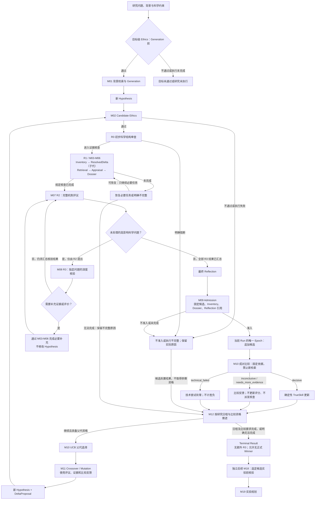
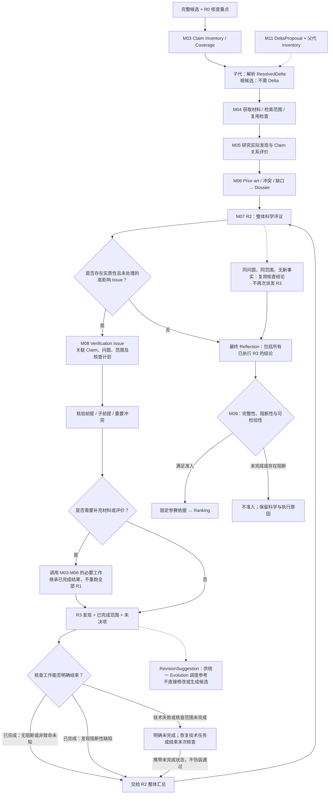
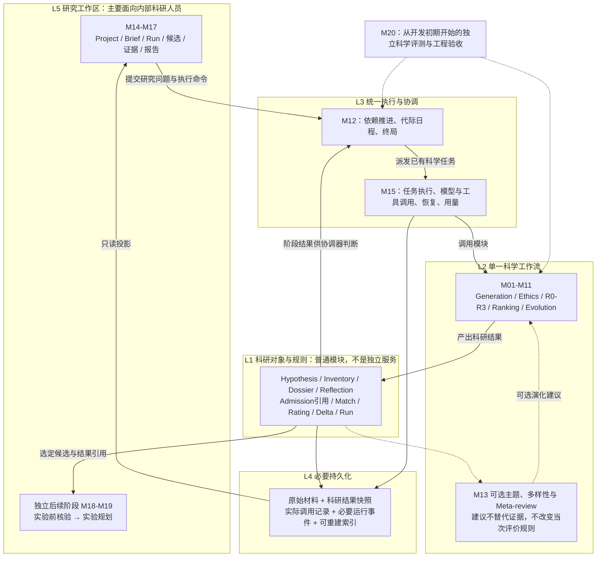

# M00 Phase 2｜单一科学优先 Co-Scientist 架构修订

**状态：修订提案／待最终确认。不是 Architecture Baseline，不是实施授权。**

**核心变化：** 重新构建一个正式系统；科学审查全部在Ranking之前；Ranking只比较；一个正常Run使用一个Epoch；新子代独立审查；旧G3只作历史参考与独立对照。拟议的对象封装精简为科研结果、入场引用和实际调用记录，不再建设常规Epoch重建或历史兼容平台。

本报告包含本轮要求的六项成果。先阅读第1节决策与替换清单，再看第2–4节流程、对象及模块依赖；第5节处理旧代码，第6节仅保留两项需单独裁决的搜索行为。新增建议未被标为已批准。

## 目录

1. 修订后的架构决策清单
2. 三张核心架构图
3. 跨模块核心对象与职责
4. M01–M20模块依赖与科学验收
5. 旧G3代码复用与清理原则
6. 最后仍需确认的关键问题

---
# 1. 修订后的架构决策清单

**文档状态：M00 Phase 2 修订提案，待最终确认。用户本轮明确决定记为 [已定]；本报告的新建议仍为 [拟议]。这不构成 Architecture Baseline 冻结、开发授权或模块验收。**

## 1.1 总体结论与本轮修订范围

新 Co-Scientist 是**单一、重新构建的科学研究系统**，不是 G3 的增强模式，不维护新旧两个正式 Controller。旧 G3 只保留为固定源码、算法、配置和科研输出的参考与独立对照。

主线是：研究问题与背景 → Generation → Candidate Ethics → R0 → R1 → R2 → 必要时 R3 → R2 汇总 → 固定评价依据 → Admission → Ranking → Evolution。根候选和子代进入同一审查流程；Ranking 与科学核查之间没有反向执行入口。

正常 Run 只有一个连续的 Evaluation Epoch。不同 Generation 的候选经审查后追加进入；已入场候选的科学内容、Dossier 和正式 Reflection 不再改变。最后一代只完成正常审查、计划内比较和终局选择，不追加终局 R3。M18/M19 是独立后续阶段。

本轮以用户反馈为最高优先输入，对 Phase 1 的目标设计进行替换；Phase 1 的论文及源码阅读仍是历史证据，不因设计变化被改写。旧源码引用固定于 `7313ca032e4f5f0c84578523e0f5639ad038e7af`，不是本轮重新核实的最新 HEAD，也不构成移植验收。

本轮只生成修订文档；未修改原附件、仓库源码，未提交 GitHub，未执行科研 Run、旧 G3 或代码测试。没有重新验证论文版本或全仓现状。

## 1.2 [已定]：由本轮反馈直接确认

| ID | 已定决定 | 替代的旧结论／实施含义 | 影响模块 |
|---|---|---|---|
| C01 | 单一新系统重建；G3 仅作历史参考与实验对照 | 替代 P01 双轨与封存正式运行环境要求；不承担旧 Run 恢复、旧 Controller 或向后兼容义务 | 全部，重点 M12/M15/M17/M20 |
| C02 | R0/R1/R2 与风险 R3 分层；M03–M07 各自科学职责明确 | R1 是 Reflection 内部工作流，不设第二个整体科学评判权威 | M02–M09 |
| C03 | R3 仅由 R2 高影响科学风险触发，且全部在 Ranking 前 | 删除 Ranking 直接或经 R2 间接发起 R3 的执行路径 | M07–M12 |
| C04 | Ranking 只做成对比较与比较反馈；评分由确定性 TrueSkill 代码更新 | 删除 EvidenceRequest、补文献、重评和 Dossier 写入权；Comparative Feedback 不是正式 Reflection | M10–M12 |
| C05 | 不做最后一轮额外 R3 | 删除前三名／高 UCB 短名单核验及相应循环；M18 不回写 Ideation 终局 | M08/M12/M18 |
| C06 | 正常 Run 一个 Epoch；入场依据固定，成员可追加 | 替代自动 Epoch Promotion、全量重建、局部 Match 失效和评分迁移 | M09/M10/M12 |
| C07 | Generation/Evolution 创建或修订科学内容；Reflection 只评价 | 内容修改产生新候选，保留来源关系；R3 不直接改 Hypothesis 或创建子代 | M01/M03/M07/M08/M11 |
| C08 | 保留成对比较、TrueSkill μ/σ、UCB 父代选择、Crossover/Mutation 主体 | 0.7/0.3 为已有项目选择；不自动继承 2-valid/6-focal、k=2、三代日程等旧参数 | M10/M11/M12 |
| C09 | 非决定性比较不更新评分，不自动启动任何核查 | `needs_more_evidence` 是在固定依据下缺少特定区分信息的报告，不是调度命令 | M10/M12 |
| C10 | 可以产生比较不充分、无合格 Winner 的明确结果 | 不强迫胜负，不把 best-so-far 伪装成正式 Winner | M10/M12 |
| C11 | 科学必需主张完整覆盖，不设固定数量上限 | 分批与上下文管理不能静默删除必要机制环节 | M03–M06 |
| C12 | 检索与评价完整、无阻断问题且可检验时，无直接证据也可准入 | 科学未知、技术失败、流程不完整和科学缺陷分别表达 | M02–M10 |
| C13 | 不设置用户资源预算，只记录实际消耗 | 资源统计不作为普通科学候选的准入或淘汰条件 | 全部，重点 M15 |
| C14 | 科学职责不由模型数、进程数、Agent 数决定；工程以必要性为原则 | 不在 M00 固定全部 Schema、Prompt、错误码、Hash 包装或框架 | 全部 |
| C15 | HITL 另题；M18/M19 是 Ideation 后的独立阶段 | 只保留候选修订和阶段交接语义，不实施人工反馈传播 | M12/M14/M18/M19 |

C08 不意味着这些超参数具有论文唯一性。本轮按已确认项目方向保留算法主体，不新增关于论文内部实现的真实性主张。

## 1.3 [拟议]：对用户建议的评估和推荐

| ID | 推荐采用的设计 | 解决的真实问题 | 不增加什么 |
|---|---|---|---|
| N01 | 最终 Reflection 内引用 R0、最终 R2 和已发生的 R3；Admission 保存一份轻量入场引用清单 | 区分“已经审查完的哪个候选”而不层层包装 | 不强制独立的 Reflection Bundle、Evaluation Basis 服务或三套生命周期 |
| N02 | Evidence View 作为实际模型调用记录的一部分；保存所用条目、材料范围、摘要／裁剪方式及实际输入 | 可核对 R2/Judge 是否真正看到关键反证 | 不新增科学评价层或 Evidence View Agent |
| N03 | Evolution 输出 DeltaProposal；M03 建 Inventory 后解析 ResolvedDelta；M04/M05判断复用 | 消除 Delta 先于 Inventory 的依赖环，避免演化器自行认定证据可继承 | 不为逐字措辞变化建立全局身份图 |
| N04 | 所有 R3 结果都返回 R2，R2 必须形成最终整体评议 | 避免 R3 与 R2 并列作整体裁判，避免无新文献时绕过汇总 | 不要求重复全部 R1 或全部模型调用 |
| N05 | 每个 R3 绑定明确科学问题与核查范围；按问题关闭，不按任意次数关闭 | 既防重复核查，又允许实质新问题深入研究 | 不设置“最多三次 R3”作为科学完成标准 |
| N06 | M20a 在 M01 正式开发前建立小规模科学评价样例与对照方法 | 科学增益不再到开发结束才被讨论 | 不等于提前做完全部专家标注或冻结全部指标 |
| N07 | M01/M04 共享检索能力；材料层不绑定 PubMed 或标题／摘要 | 支持摘要、全文、补充材料及问题驱动获取 | 不在 M00 承诺任何数据库接入或全文获取率 |
| N08 | 第一版完成规定评价与比较资格后，选择合格候选中最高 μ | 明确终局选择函数，避免将 UCB 探索值当成最终推荐值 | 不提前决定比赛配额、覆盖阈值或保证 Winner；见第6节 F1 |
| N09 | 严重运行／来源完整性缺陷使受影响运行暂停或不完整结束；不常规修补比赛图 | 使异常退出可解释，保持一个 Epoch 的正常路径 | 不自动重建 Epoch；细节由 M09/M12 |
| N10 | 比较公平性按共同核查政策、风险触发标准和呈现方式评测 | 版本固定不能替代科学公平 | 不要求相同文献数量或每个候选执行相同次数 R3 |
| N11 | M13 为可选、非阻断科研反馈，收益通过消融决定 | 避免为凑齐 Agent 而扩大首阶段 | 不让 Meta-review 修改当次 Run 的审查／排序规则 |
| N12 | M09a/M11a/M14a/M15a/M20a 只先交付必要语义、样例、最小执行与评测基础 | 支持独立模块开发而不前置完整平台 | 不新增正式科学模块，不强制采用事件溯源或分布式框架 |

以上为本轮推荐，不因为出现在报告中就变成 [已定]。其中影响搜索行为、需单独裁决的 F1/F2 见第6节；其余细化由归属模块按已定边界完成设计。

## 1.4 P01–P12 替换映射

| Phase 1 条目 | 本轮替代版本 | 状态 |
|---|---|---|
| P01 新旧双轨隔离 | 单一新系统；选择性移植；G3 仅独立对照 | [已定]，原方案被替代 |
| P02 R1 独立工作流 | 保留 M03–M07 职责；没有第二个整体评价 Agent | [已定] |
| P03 Bundle/Basis/View 组合 | 固定参赛依据已定；轻量引用清单与调用内视图记录 | 核心 [已定]；封装 [拟议] |
| P04 实质变化后全量重建 Epoch | 正常 Run 一个 Epoch、依据固定、只追加新候选 | [已定]；旧 P04 撤销 |
| P05 两阶段 Delta | 新子代→Ethics→R0→Inventory→ResolvedDelta→增量证据工作 | [拟议]，推荐采用；旧先后顺序被替代 |
| P06 风险 R3 | 仅 R2 触发；所有结果回 R2；无 Ranking 间接入口 | 触发权 [已定]；关闭实现 [拟议/待定] |
| P07 非决定性比较 | 四类结果分清；反馈不执行；数值配额交 M10 | 边界 [已定]；科学标准 [待定] |
| P08 终局冻结 | 无额外 R3、无版本提升屏障；最高合格 μ 为建议 | 取消核验 [已定]；选择函数 [拟议] |
| P09 资源记账 | 记账与单次技术执行约束分开，不迁移旧总额度包络 | 方向 [已定]；实现 [后续模块] |
| P10 基础前置 | 最小接口/样例/评测，非完整基础设施 | 最小化要求 [已定方向]；工作包落地 [拟议] |
| P11 M13/研究记忆 | 来源、对象和结果索引为基础；M13 可选并做消融 | [拟议]；不恢复评价反向执行 |
| P12 后续阶段 | M18/M19 独立交接，不重开原 Ideation Run | 阶段边界 [已定]；内部功能 [待定] |

## 1.5 [待定]：明确留给后续模块

| 科学或实现问题 | 归属 | M00 只约束什么 |
|---|---|---|
| Generation 策略、Prompt、种群与代际规模 | M01/M11/M12/M20 | 产出完整候选；不继承 G3 参数作为默认真理 |
| Claim 粒度、必要前提、Coverage 完整性 | M03 | 不截断必要主张；隐含前提不冒充候选原文 |
| 数据库、全文能力、来源筛选、多轮检索结束 | M04/M05 | 实际访问范围、未取得材料与科学未知分开 |
| Appraisal Rubric、研究独立性与因果性 | M05 | 研究实际发现与模型解释分别记录 |
| Prior-art 整体机制重合与冲突综合 | M06 | 不以局部已知推导整体无新颖性 |
| R0 阻断标准、R2 评议维度与科学缺陷判定 | M02/M07 | 科学结论不能由调度器代作 |
| R3 风险识别、检查充分性、语义去重与关闭 | M08 联合 M07/M20 | 所有检查在入场前；重复无进展有明确出口 |
| 配对、有效比较量、位置偏差、父代及终局资格 | M10/M20 | 不强制胜负；无反向核查；只在同一 Epoch 内解释评级 |
| 交叉/变异机制与复用判定细则 | M11/M03/M04/M05 | 子代内容、实际 Delta、适用性判断分开 |
| 自适应停止、HITL、工作区和实验规划细节 | 各专题 | 不由 M00 预先填满 |
| 目录、分支、数据库、队列、序列化和代码移植步骤 | M00 后的实施规划及对应模块 | 不引入旧兼容义务，不影响单一科学流程 |

## 1.6 旧文件同步修订索引

本轮不覆盖输入文件；本修订稿中的新目标设计替代下列旧要求。旧文件只作为历史来源，不应与本稿并列充当当前指令。

| 文件／位置 | 应撤销或替换的内容 |
|---|---|
| Phase 1 D1 | 删除双轨、旧运行恢复作为核心风险；风险重心改为科学评测、R3关闭、比较资格与证据适用性 |
| Phase 1 D2 | P/A 列只保留历史证据；T/G 列中兼容、Epoch 提升、先跑旧 G3、旧 reader 义务全部由本稿替代 |
| Phase 1 D3 图1–图5 | 三张新核心图替代目标流程与分层；模块依赖按第4节；取消终局循环与自动 Epoch 提升 |
| Phase 1 D4 | 删除长引用包装链及 Epoch 重建协议；改为第3节轻量对象与入场规则 |
| Phase 1 D5 | 按本节 P01–P12 映射替换 |
| Phase 1 D6 | M09/M10/M12 删除 PromotionDecision/EvidenceRequest/切换重启；M15/M17/M20 删除历史兼容验收 |
| Phase 1 D7 | 改验收为新系统闭环和独立科学评测，不要求旧 G3 恢复通过 |
| 00_COMMON_CONTEXT.md | 替换“先 Delta 后 Ethics”、保留旧 reader/兼容等目标性含义；固定 G3 commit 仅为历史参考 |
| 06_DECISION_LOG.md | D-008 改为非决定性不更新、不发起核查；删除 O-005/O-006/O-007 中常规重建、终局高UCB与补检索闭环任务 |
| 02_PROJECT_STATE.md | 删除 O-CORE-4/O-CORE-5 的旧终局及重建问题；M09 改为最小准入/Epoch；M00 仍是讨论修订，其他模块不得改成已实现 |
| 03_WORKFLOW_PROTOCOL.md | 新系统验收不要求兼容旧运行；仍保留批准后实施、真实科学与工程验证、模块交接 |
| 01_HANDOFF_TEMPLATE.md | “与冻结G3兼容性”改为“旧代码复用来源与验证；适用时附独立G3对照” |
| Evidence Dossier Contract V1 | 旧 V2 类型必须复用、旧 reader 不变等不再是新系统约束；保留来源、科学解释及覆盖边界 |
| Reflection Pipeline Contract V1 | 删除 D9/§5.3 终局 R3、§5.2 自动重建、R3直接准入和直接回Generation；改为本稿流程；测试同步替换 |

不新建复杂的历史文档治理系统。最终确认后，只需让下一模块拿到一份明确的当前架构说明、当前决策表和相关接口样例。

---

# 2. 修订后的三张核心架构图

图中主流程与禁止方向来自本轮 [已定] 决策；轻量引用、Issue 关闭、Delta 解析及最小存储组织是 [拟议] 的落地方式。它们是项目目标图，不是论文原图，也不代表已有代码已经完成。

## 图1：完整科学研究流程

图1只有一个合法的“Ranking 后重新审查”情形：Evolution 已创建**新的子代**，该子代进入同一审查流程。不存在对已经参赛父代的 Reflection 回调。`needs_more_evidence` 只流向比较记录、后续演化参考和运行完成性判断。

R3 发现新材料时，补齐必要证据与评价，再回 R2；没有新材料时，R3 结论仍回 R2。R3 不能绕过 R2 固定参赛依据，也不能自行创建子代。

“完成规定工作”不表示科学假说已被证实。技术失败、核查不完整与科学阻断均有明确结果，不为了进入下一代而伪造准入、比较或 Winner。

目标级 Ethics 未通过时，不执行背景生成。个别候选的阻断或执行未完成只向调度器报告真实处置，不因此取得参赛资格；整个 Run 的完成性由 M12 根据所有必要任务与比较结果判断。

## 图2：R0–R3 与核查关闭

### 核查关闭的最小语义 [拟议]

Verification Issue 是 R3 记录中的一个简单工作项：候选、相关 Claim、科学问题、核查范围、已执行检查、发现和结束原因。它不需要独立服务，也不需要给每个措辞建立 Hash。

“检查已结束”和“问题已有答案”不是同一件事。范围内检查可以结束于：
- 未发现阻断性问题，但仍有未验证的新机制；
- 发现足以影响核心机制的缺陷；
- 技术或材料原因使核查未完成。

前两种是**完成核查后的科学结论**；第三种不能被当成核查完成或科学无反证。它们都交回 R2 统一解释。R2 对未完成结果只能形成未完成的总体评议，除非已明确按科学政策处置必要检查；不得悄悄把必需 R3 改成“无需执行”。

同一问题再次出现，只能引用已有检查记录。只有出现实质新问题、先前未覆盖的科学范围或新事实时，才可在入场前创建新的核查任务；换一种措辞不算新问题。M08 评估语义匹配及新问题标准，M12 处理任务重复与技术恢复。

问题关闭机制阻止重复核查，但不宣称任意开放科研任务必然自动收敛。若当前声明的核查范围无法完成，必须保留未完成结果；不能靠不断改写问题继续追加任务，也不能因想结束运行就强行认定科学通过。充分性与结束标准交 M08/M12/M20 评测。

如果 R2 在汇总中发现 Inventory 漏掉必要前提，补充的是 M03 的**核查对象和 Coverage**，不是悄悄为 Hypothesis 添加新机制。需要修改假说内容时，输出 RevisionSuggestion，交 Generation/Evolution 形成新的候选。

## 图3：单一新系统的最小分层架构

五层是职责划分，不要求五个进程、五个微服务或五套存储。

M12 是唯一科学流程协调入口，但不承包所有科学算法；M03–M11 保有自己的判断责任。M15 执行任务并保存调用事实，不能替 M07 认定科学通过，也不能替 M10 裁决胜负。M09 是准入规则与引用管理模块，不再是 Epoch 重建平台。

M13 可根据已有科研记录给出探索建议，但不改本次 Run 的固定评议政策，不把新反馈写入已参赛候选。M18/M19 读取选定快照，在新阶段产生自己的结果。

旧 G3 不在正式架构内。需要旧对照时，由 M20 使用固定的历史源码、必要配置及可比较输出；这些不是新系统的运行依赖。

---

# 3. 跨模块核心对象与职责

## 3.1 最小对象关系

**Hypothesis → Claim Inventory → Evidence Dossier → 最终 Reflection → 入场引用 → Match → Rating。**

Claim Delta 连接父子代；Research Run 关联目标、固定评价政策、代际日程、一个 Epoch 及结果。这个链条表示输入依赖，不表示每一步必须新增数据库表或包装类。

### 对三种容易膨胀的抽象的处理建议 [拟议]

| 概念 | 建议实现 | 仍须保证的能力 |
|---|---|---|
| Reflection Bundle | 合并为“最终 Reflection 及其阶段记录引用”；保留名称兼容文档理解即可，不强制独立领域对象 | 最终 R2、所有必要 R3、所用 Dossier 和未决问题可定位 |
| Evaluation Basis | Admission 中的一份轻量引用清单，而非专门服务或再次聚合全部内容 | 固定 Hypothesis、Inventory、Dossier、最终 Reflection、评价政策 |
| Evidence View | ModelCall 记录内的输入追溯信息，必要时引用输入文件 | 能重建实际可见证据，知道摘要/裁剪及是否漏掉重要反证 |

语义固定先于 Schema。字段、嵌套形式、数据库主键和序列化由对应模块决定；M00 不要求每个对象同时拥有独立 ID、版本号、内容 Hash 和封装 Hash。

## 3.2 核心对象与唯一科学责任

| 对象 | 必要科研语义 | 科学所有者／主要使用者 |
|---|---|---|
| **Hypothesis** | 一份确定的科学主张及完整机制、假定、预测、证伪条件；科学内容变化产生新候选，保留父代/修订来源。显示名称、排版不必制造科学版本 | M01 创建根候选；M11 创建子代。Reflection 只有只读权 |
| **Claim Inventory** | 覆盖该候选科学实质主张、必要依赖、核查范围及遗漏；区分候选明说的主张和评审推导出的必要前提。Claim 在候选内可定位即可，不强制全局语义统一 | M03；M04–M08/M11 使用 |
| **Evidence Dossier** | 已取得材料、研究实际发现、与 Claim 的关系及适用条件、检索/评价范围、Prior-art、冲突、缺口和局限。材料真实性与解释正确性分开 | M04 获取材料；M05 作单项判断；M06 综合并交付 Dossier |
| **Reflection** | 候选整体科学评价；R0 提示、R2 综合结论、必要 R3 的问题与结果、阻断性缺陷和可检验未知。最终决定必须由 R2 汇总，不建立 R3 整体裁判 | M02/M07/M08 产出各自结果；M07 对最终科学评议负责；M09 检查完成性 |
| **Match** | 对两个已入场候选的成对比较；绑定双方引用、相同比较政策、呈现顺序、实际调用和结果。Comparative Feedback 不是正式 R2，也不能派发核查 | M10 |
| **Rating** | 同一 Epoch 内，从有效决定性 Match 顺序计算的 μ/σ 及必要比较记录。子代从自己的初始评级开始；不由模型直接写 μ/σ，不叠加证据固定分数 | M10；M11/M12 消费 |
| **Claim Delta** | DeltaProposal 表示修改意图；ResolvedDelta 表示真实父子 Claim 的 retained/modified/removed/split/combined/new 关系及影响 | M11 提案与关系语义；M03 在完整 Inventory 后解析；M04/M05各自负责材料/评价复用 |
| **Research Run** | 一次研究执行：固定目标、评价政策、选定方法配置、候选集合、代际日程、唯一 Epoch、执行状态、消耗与终局；新研究不是旧 Run 的可变视图 | M01 定义研究输入；M12 协调科学执行；M15执行/保存；M14建立工作区关联 |

### 两个必要但轻量的协调记录

**Admission** 保存检查结果和入场引用：安全结果、必要科学核查是否完成、是否阻断、可检验性以及采用的上述对象。它不重复写一份科学评议，不包含比较充分度，不替 M07/M08判断具体科学问题。

**Terminal Result** 保存实际终局：执行是否完整、比较是否达到已规定资格、是否产生正式 Winner、候选引用与理由、未完成项。可有 best-so-far，但必须明确其不是正式 Winner。它可作为 Run 的结果文档，不要求再增一套对象生命周期。

## 3.3 最小接口：只定义输入、输出和权限

| 接口语义 | 输入 → 输出 | 不允许的副作用 |
|---|---|---|
| `generate` | 研究问题、约束、背景材料 → 新 Hypothesis | 不写评议、不写评级 |
| `screen_and_review_initial` | 目标/候选 → Ethics、R0、核查重点 | 不把无证据推成已证伪 |
| `inventory` | 候选、R0重点、可选父代 Inventory/DeltaProposal → Claim Inventory、Coverage、可选 ResolvedDelta | 不改候选内容 |
| `retrieve` | 主张、核查意图、材料需求、复用上下文 → 材料及实际检索范围 | 不宣布整体机制可信 |
| `appraise` | Claim、材料、科学情境 → 文献发现与关系/适用性评价 | 不写 TrueSkill、不发明全文发现 |
| `assemble_dossier` | Inventory、检索及评价结果 → Dossier | 不覆盖已经参赛的档案 |
| `reflect` | 完整候选、Dossier、R0及已有R3记录 → 整体 R2、必要高影响 Issue、RevisionSuggestion | 不修改 Hypothesis，不使用排名作为科学正确性证明 |
| `verify_issue` | R2 Issue、相关依据 → 核验发现、完成范围和结束状态 | 不直接准入、改分、生成子代；结果必须回 `reflect` |
| `admit` | 已完成科学结果和政策 → 固定入场引用及资格决定 | 不把“没有直接证据”设为自动拒绝 |
| `compare` | 两个入场引用、统一比较政策 → Match 和非执行性反馈 | 不检索、不重评、不更新 Dossier |
| `rate / select_parents` | 同 Epoch 有效比赛、资格状态 → μ/σ、UCB选择结果 | 不将非决定性或技术错误当作输赢 |
| `evolve` | 已选择父代、固定依据、评议和比较反馈 → 子代、DeltaProposal、贡献与改进说明 | 不覆盖父代，不继承父代评分 |
| `finish_run` | 日程状态、科学结果、比较资格 → Terminal Result | 不自动增加终局 R3 或重启 Epoch |

这些函数名仅用于表达接口，**不是本轮要求实现的 Python API**。

## 3.4 Epoch 与数据变化规则

[已定] **一个正常 Run 对应一个连续 Epoch；Generation 是候选产生的轮次，不是评价规则的版本。**

| 变化 | 处理方式 |
|---|---|
| 入场前 R3 得到新证据／新解释 | 补充必要 R1，更新 Dossier，R2 汇总；尚未参赛，不涉及 Epoch 切换 |
| G1/G2 等产生新候选 | 独立审查，固定依据后加入当前 Epoch；不继承父代评分 |
| 已入场候选得到新的 Match | 保存比较与反馈；决定性结果更新该 Epoch 的评级；不改变正式 Reflection |
| Ranking 表示缺少区分性信息 | 记录原因供 Evolution/后续研究；不派发 R1/R2/R3 |
| 需要改变科学内容 | M01/M11 创建新候选并审查；不原地改已入场版本 |
| 只需追加文献或纠正证据解释而不改科学内容 | 当前不实施；未来独立重新评价 Run，HITL专题决定 |
| 发现严重来源/运行完整性缺陷 | [拟议] 暂停或不完整结束；不自动撤销若干 Match、迁移评分或重建 Epoch |
| M18 有新发现 | 在独立阶段保存，不修改旧 Terminal Result |

入场前允许修改工作中档案；任何模型已经实际使用的输入都应保留调用副本。入场后，只读引用不再解析为“最新 Dossier”。

材料库可以为后续候选增加资料，但不能因此静默更新已经入场的候选。新候选的检索时间与复用范围应可见；固定依据保证可追溯，不自动保证知识覆盖完全对称。第一版不新增跨候选证据失效传播器，M20单独测量这种信息覆盖差异。

## 3.5 Ranking 结果与反馈的权限

| 对外结果 | 语义 | 评分与后续行为 |
|---|---|---|
| `decisive` | 当前材料与统一目标下有可辩护的相对优先级 | 确定性代码提交一次评分更新 |
| `inconclusive` | 比较已完成，但不能可靠区分 | 不更新；可依 M10 已定策略安排其他比较，不调用核查 |
| `needs_more_evidence` | 存在可具体指出且具有区分作用的重要未知信息 | 不更新；保存问题与为何影响比较；仅作为后续演化或新研究参考 |
| `technical_failed` | 调用、解析或执行失败 | 无科学胜负；技术重试规则归 M15，结果与用量如实记录 |

实现上 `technical_failed` 可属于执行状态，而非科学 Outcome；M00不要求强塞进一个枚举。缺少直接证据、存在新机制或做过较少文献检索，均不足以自动产生 `needs_more_evidence`。

Judge 可以比较**双方本次固定材料**中已经表达的支持、冲突和局限；不能把临时检索或模型记忆包装成新核验结果。它对旧 Reflection 的不同看法只形成 Comparative Feedback，不回写正式审查。

[拟议] 优先为每个候选准备结构一致的比较材料，并在入场时固定其证据摘要；每场记录实际呈现。是否采用分段阅读、怎样压缩长 Dossier 由 M10/M20评测。关键反证或重要限制在首次比赛前发现被遗漏时，先修正呈现再入场；已经参赛后发现的严重输入构造缺陷，按异常处理，不悄悄替换旧输入继续累计评分。仅凭“记录了遗漏”不能宣称比较公平。

## 3.6 子代 Delta 与增量证据核查

推荐顺序：

**M11 新子代与 DeltaProposal → Ethics → R0 → M03完整Inventory → ResolvedDelta → M04/M05增量检索与评价 → M06新Dossier → M07完整R2 → 必要R3及R2汇总 → Admission。**

ResolvedDelta 回答“实际改了什么”，不独自回答“可以复用什么”。对 retained、modified 等关系，M04/M05仍检查生物体系、实验条件、干预、方向、时间及结局等适用性。

| 可复用层次 | 最小规则 |
|---|---|
| 原始材料 | 引用同一实际材料，不重复把缓存命中记成新检索 |
| 文献发现 | 同一材料与有效抽取范围可复用；保留出处 |
| Claim × Evidence 判断 | 含义和适用情境相容时才复用；不能仅凭 retained 标签 |
| 完整子代 Reflection | 不继承；重新评价组合机制 |
| Rating | 不继承；子代独立参赛 |

Delta无法可靠解析时，可退回完整重新核查，而不是让谱系工具失败自动等于科学候选失败。是否已经完成 Claim Coverage 与是否成功节省检索工作是两件事。该降级方式属[拟议]，由M03/M11联合评测。

## 3.7 文献与材料能力的扩展边界

[拟议] M04拥有检索/获取能力的共享接口，M01使用它做背景研究；M15负责调用执行，不拥有检索科学策略。两者可以在接口确认后并行开发，不产生“M01必须等完整M04，而M04又必须等M03/M01”的开发环。

最低材料语义是：来源身份、实际取得内容、访问层级、取得/未取得范围及时间、可定位段落。可表达摘要、全文、补充材料和多种来源；首版实际支持哪些，由M04/M05确认。

R3可以根据问题要求更深材料；取不到必要全文时应记录限制或核查未完成，不能假装全文核验已完成。长材料和大量Claim允许分批，但最终Coverage与Dossier不得只覆盖模型窗口中幸存的片段。

---

# 4. M01–M20 更新后的模块依赖与科学验收

## 4.1 开发原则

模块编号不等于执行顺序。科学任务的数据依赖也不意味着所有实现都必须串行：固定输入样例可以支持早期独立算法开发和专家评测；正式接入主线时才要求上游接口与科学输出通过验收。

**本轮没有授权启动 M01 或任何模块的生产实现。** 以下“可开始”表示 M00关键决定确认后可以安排的工作，不代表模块已经获批或已完成。

保留 M01–M20 编号。M09名称建议改为“最终评议交付、准入与单一Epoch”，去掉复杂版本治理含义。M12只协调一个新科学流程；M15不恢复旧G3；M17不做旧发行包兼容；M20的旧G3对照是独立实验，不是旧架构回归义务。

## 4.2 五个最小前置工作包 [拟议]

| 工作包 | 开发前只需交付 | 不需要先做 |
|---|---|---|
| **M09a** | 候选/最终评议/入场引用的必要语义；一个Epoch；Match结果四类；一份正常及不完整样例 | Epoch重建引擎、全部Pydantic类、所有错误码 |
| **M11a** | DeltaProposal/ResolvedDelta的科学关系；M03解析、M04/M05复用判断的所有权；一组父子样例 | 完整谱系平台、全球Claim注册、另一套拆解器 |
| **M14a** | Project—Brief修订—Run的最小关联；研究输入与工作区草稿区分 | 完整多用户工作区、复杂导入/迁移体系 |
| **M15a** | 可调用模型/检索的最小执行接口；实际输入/输出留存、必要任务持久化和重试/记账；新系统基本重启能力 | 分布式平台、历史G3恢复、全套业务事件溯源 |
| **M20a** | 固定研究任务、输入材料、专家评价样例、错误类型与独立对照方法；开发用与留出评价的分离 | 完成所有Rubric、全部消融、精确验收阈值 |

M04提供共享检索接口的语义，M15a承载实际工具执行，M01/M04各自定义背景和Claim-directed查询策略。此接口小范围协作即可，不再新设一个正式模块。

## 4.3 M01–M12 科学内核依赖表

“独立开发”一栏只表示在接口确认后可以用固定样例进行方法实现与评测；“正式接入”一栏给出不能用模拟输入替代的上游验收。

| 模块 | 独立开发的最小前提 | 正式接入须等待 | 核心输入 → 输出／下游交付 |
|---|---|---|---|
| **M01 研究输入、背景检索、Generation** | M09a/M14a/M15a/M20a及共享检索接口 | 自己的生成科学样例与调用记录验收 | Brief/约束/背景 → GoalContext、来源明确的Hypothesis；交M02/M03 |
| **M02 Ethics与R0** | 候选接口；M20a安全/科学边界样例 | M01候选契约 | Goal/Hypothesis → 安全结果、初评、核查重点；不能写正式证据结论 |
| **M03 Inventory与Coverage** | 固定候选与专家覆盖样例；M11a关系语义 | M01/M02；子代模式还需M11输出 | Hypothesis/R0/父代关系 → 完整Inventory、依赖/缺口、ResolvedDelta；交M04/M05 |
| **M04 Claim-directed Retrieval** | Claim/材料接口；共享检索执行；检索样例 | M03；实际provider能力验收 | Inventory/复用上下文/核查范围 → 材料、检索/筛选记录、访问限制；交M05/M06 |
| **M05 Evidence Appraisal** | 固定文献与Claim配对、专家标注样例 | M03/M04材料契约；自身Rubric评测 | 文献及情境 → 研究发现、关系/直接性/因果性/适用性/局限；交M06 |
| **M06 Prior-art与Dossier** | 固定Inventory及Appraisal样例 | M03–M05 | 覆盖/材料/单项评价 → 机制级先前研究、冲突/缺口与Dossier；交M07 |
| **M07 R2整体Reflection** | 固定完整候选/Dossier；与M08协作Issue语义 | M02/M06；有R3时需M08结果 | 完整依据 → 初次R2、必要Issue、汇总后的最终Reflection、RevisionSuggestion |
| **M08 R3核验** | M07 Issue接口和专家高影响问题样例 | M03–M06工具链及M07触发；先做无R3主线不必等所有深核验策略 | Issue/范围/依据 → 核验发现、完成范围、结束状态；一律回M07 |
| **M09 最终评议交付、Admission、Epoch** | a阶段只需M00语义；可先写轻量准入规则样例 | M02–M08相应结果；未触发R3有明确理由即可 | 完整科学评价 → 固定入场引用、资格与原因；交M10/M12 |
| **M10 Pairwise、TrueSkill、UCB** | 固定已审查候选对和专家偏好样例；纯数学部分可先测 | M09；自身位置偏差/非决定性/覆盖策略评测 | 入场引用+规则 → Match、μ/σ、比较充分度、父代选择/资格、非执行性反馈 |
| **M11 Evolution、Delta与复用语义** | 固定父代/评议/比较反馈；M11a/M03关系样例 | M10父代选择；M03–M09子代完整复审接口 | 父代及反馈 → 子代、DeltaProposal、机制变化与改进说明；解析/复用不由演化模型自证 |
| **M12 单一Supervisor与终局** | M09a/M15a；可先做依赖顺序样例 | M01–M11科学主线逐步验收 | Run计划及模块结果 → 任务推进、代际调度、终局与真实不完整原因；无反向核查及Epoch提升 |

### M07/M08 的实现依赖不是源代码循环

M07定义何时提出Issue并消费R3结果；M08消费Issue并产生结果。共享一个轻量接口即可，不要求双方导入彼此实现。M12在运行时协调R2→R3→R2；先用固定Issue/Result样例分别评测两模块。

### M03/M11 的实现依赖也不是开发循环

M11a先约定变化关系和示例。M03负责解析实际子代Inventory中的关系，M11复用该接口并检验是否实现预期改进。不能因M11尚未完成演化算法就阻止M03做Coverage研究，也不能让M11用另一套Claim定义绕开M03。

## 4.4 M13–M20 后续边界

| 模块 | 上游与可并行工作 | 下游交付与禁止扩张 |
|---|---|---|
| **M13 机制主题/Proximity/Meta-review** | 可用候选、机制、证据样例独立设计；实际评测用M03/M06/M10/M12输出 | 可选主题和演化建议；不设Admission门，不更新已参赛证据/评议，不改变当前Run评价政策 |
| **M14 Project/Brief/Run/Import** | a阶段最小关联前置；完整实现消费M12/Run结果 | 草稿、研究输入与运行结果关联；不接管科研状态，不承担旧G3运行导入恢复 |
| **M15 运行基础与长任务工作台** | a阶段前置；其余与M12/M14集成 | 新系统持久任务、调用记录、用量、进度与技术恢复；不负责科学判定和旧运行兼容 |
| **M16 科研决策与证据阅读** | 可用对象样例做阅读设计；正式使用M06/M07/M09/M10/M12 | 主张—证据、缺口、排名理由和候选比较；不在前端自算科学结论 |
| **M17 报告、导出、安装** | 使用M12/M14/M15输出；阅读格式可与M16并行 | 新系统成果包和安装交付；不携带旧Controller或强制旧数据迁移 |
| **M18 独立实验前核验** | 边界已知，细节后续；消费选定Hypothesis/证据/Reflection/实际实验情境 | 独立阶段结果、继续/暂缓与新发现；不自动重开Ideation、不批量复核榜单 |
| **M19 实验规划** | 消费M18及实际资源约束 | 可区分假说与竞争机制的最小实验、对照/测量/证伪条件；不伪造执行结果 |
| **M20 科学评测与验收** | a阶段早于M01；后续与每个模块同步 | 工程通过情况、科学错误/收益、消融、资源；G3仅独立对照，不要求新系统运行旧测试套件 |

## 4.5 建议实施波次

**波次0：M00确认后的最小接口与评测。** 完成M09a/M11a/M14a/M15a/M20a及共享检索接口。能用固定案例解释输入输出、用最小执行记录支撑实验即可，不等待完整平台。

**波次1：科学方法并行原型。** M01/M02研究候选生成与初评；M03研究完整机制覆盖；M04研究检索；M05研究证据关系；M10研究比较偏差与数学更新。M07/M08/M11可用专家样例研究，不依赖端到端生产运行。

**波次2：完成一条候选的证据驱动审查。** M03→M04→M05→M06→M07，无风险时由M09准入；有风险时由M08核查、M07汇总。用最小真实调用链证明没有遗漏必要科学步骤。

**波次3：成对比较与一个完整子代。** M09→M10→M11→M02/M03→增量R1→完整R2/必要R3→M09。测试的是机制变化和证据适用性，不只是任务能跑通。

**波次4：多代单一闭环与科研工作区。** M12完成配置化研究日程、终局与不完整出口，M15补充真实故障恢复，M14/M16/M17交付科研阅读与导出。M13是否加入由消融收益决定。

**波次5：M18/M19独立后续阶段与M20系统验收。** 不因产品界面完善而放宽科学模块验收，也不因旧G3软件兼容测试未移植而阻止新系统交付。

## 4.6 M20a 最低评测接口 [拟议]

最低输入是一组可复用的 Evaluation Case，而不是一个大平台。每个案例至少提供：

1. 研究问题、适用体系、任务所需的候选/父子代/候选对和可用材料；
2. 专家指出的必要科学点、可接受判断及理由、重要错误类型和仍有争议之处；
3. 被评价模块、使用材料范围、方法配置以及预期检查的能力。

最低输出是一份**模块实际结果 + 专家对照判定 + 主要错误/分歧 + 实际调用与消耗记录**。M20决定指标、样本量、标注一致性、盲评、留出方式和验收标准；M00不预设成功率阈值。

| 评测对象 | 应在早期出现的案例/问题 | 主要判读 |
|---|---|---|
| M03 | 多段机制、隐含必要前提、可检验新桥接 | 是否漏掉真正决定机制成败的环节，而非只比较Claim数 |
| M04 | 支持、反证、已有机制、竞争解释；成功空检索与技术失败 | 是否找到关键方向材料，覆盖说明是否诚实 |
| M05 | 相关性与因果、跨模型外推、摘要未披露方法、重复数据来源 | 是否正确解释研究实际发现与适用范围 |
| M07 | 单环节各有依据但组合机制不成立；已有研究只覆盖部分机制 | 能否识别整体缺陷、替代解释和真实新意 |
| M08 | 高影响前提冲突；重复Issue；无新文献但已有核验结果 | 核查是否改变有用科学判断；关闭是否合理 |
| M10 | A/B换序、证据条目数量变化、不同机制主题、R3深度差异 | 专家偏好一致性、偏差、非决定性语义与排序稳定性 |
| M11 | 真实桥接改进与文字扩写；复杂组合产生新错误 | 子代是否修复问题/提出新预测，而非仅更长 |
| M12 | 多代搜索、无合格候选、比较不足与真实资源消耗 | 是否加速获得值得验证的假说，而不是只产生更多对象 |

这些是**待制作的案例类型**，不是已经完成的专家标注数据。本轮未得到独立Appraisal Rubric；其科学设计与检验仍由M05/M20负责，不把文档字段当成已有Rubric。

G3对照优先使用相同研究问题和可比的科学输出。若模型、材料时间或推理资源不同，记录这些差异，不能把所有差异归因于新架构。跨Run的μ大小不能直接作为科学质量增益；应采用独立专家评价、固定对照任务和后续验证结果。经费不限额不意味着实验中不记录或不分析计算投入。

## 4.7 工程验收与科学验收分别交接

每模块交接只需：必要接口与样例、实际实现范围、实际跑过的工程验证、科学评测结果及局限、用量和未决问题。未实施的保持设计状态。

不再要求“兼容冻结G3”。如移植旧代码，附来源和该片段在新输入下的验证；如使用G3对照，附独立对照结果。界面或来源Hash测试通过不能代替科学验收。

### 附录：替换 Phase 1 的重点验收场景

| 场景 | 新版应证明什么 |
|---|---|
| G0与G2候选完成审查后加入 | 同Run同Epoch，各自参赛依据固定 |
| Ranking返回needs_more_evidence | 不更新TrueSkill；不产生检索、R2或R3任务 |
| R3没有获得新文献 | 核验结论仍经R2汇总后才能完成Reflection |
| R3发现阻断问题 | R2解释其整体影响；不直接改假说或生成子代 |
| R2重复提出同一已核查Issue | 复用结论；无新范围或事实时不重复派发 |
| R3任务技术失败 | 明确执行未完成；不能当作无反证 |
| 新子代含modified/combined关系 | Inventory在先；ResolvedDelta与复用判断在后；完整R2重新执行 |
| Delta工具无法解析但候选可核查 | 允许回退全量核查，不把缓存/谱系失败当科学错误 |
| 无直接证据但核查完整 | 可以进入准入判断；不是自动needs_more_evidence |
| Compare A/B换序或材料长度改变 | 记录对偏好的一致性和偏差影响，不能只验证JSON结构 |
| 有效决定性Match重放 | 不重复更新μ/σ或消费记录；技术重试不等于新科学比赛 |
| 比较资格不足 | 输出不完整/无Winner；不强迫额外科学核验或决定性胜负 |
| 新系统发行 | 不要求运行旧Controller、读取旧事件契约或恢复旧Run |

删除旧版“正常流程全量重建Epoch、迁移/失效旧Match、核验新前三名、旧G3恢复兼容”的常规验收要求。精确断言和错误处理仍由归属模块设计。

---

# 5. 旧 G3 代码复用与清理原则

## 5.1 复用的前提

**旧代码的存在不构成迁移理由，旧测试通过也不构成新科学能力的有效性证明。**

本节的源码判断复用 Phase 1 在固定提交 `7313ca032e4f5f0c84578523e0f5639ad038e7af` 的静态审查及本对话已有源码摘录。本轮没有再审查最新 main、运行测试或验证移植。因此“可直接复用”指算法可沿用、少量纯函数可作为迁移候选，不代表整文件已获移植批准。

迁移单位优先是：**纯函数、窄接口适配器、可独立执行的工具、可解释的科学样例**。不是整个Orchestrator、整套profile、整份领域契约或整套历史测试目录。

## 5.2 四类处理

| 类别 | 候选内容与固定源码位置 | 新系统中的处理 |
|---|---|---|
| **A 算法可直接沿用，代码验证后移植** | `src/co_scientist/domain/bayesian_ranking.py`：`TrueSkillConfig`、`replay_bayesian_rating` 中调用TrueSkill的数学更新；原审查范围1–213行 | 保留μ/σ及决定性比较更新；把数学部分与旧事件名称、TournamentEntry和配额解耦；参数重新显式选择与评测 |
| **A 算法可直接沿用，代码验证后移植** | `domain/population_evolution.py`：`select_baseline_parents` 中UCB与随机tournament、算子抽样；原审查范围1–145行 | 保留UCB和交叉/变异主体；不复制候选至少2个决定性结果、k=2、固定槽位或G1–G10边界 |
| **A 小工具可独立验证后移植** | 文本/标识解析、材料去重、单元测试辅助函数，具体文件由移植审查列出 | 只移植新接口实际需要的工具；未逐项检查者不声明成熟，不为复用而增加新Hash封装 |
| **B 重构后复用** | `adapters/literature/pubmed.py`、`agents/executor.py` 中检索与获取能力；`supervisor/verification_route_v2.py::build_verification_inputs_v2` | 提取provider/tool适配能力；重写主张覆盖与材料选择策略；不继承critical-only、标题/摘要限定或固定来源截断 |
| **B 重构后复用** | `domain/evidence_units.py::evidence_units_for_snapshot/resolve_evidence_units`；`domain/source_units.py`；原审查分别1–151、1–149行 | 保留“候选原文出处”和“文献材料出处”不同语义；扩大可访问材料范围；不为旧V1/V2读者保留平行模型 |
| **B 重构后复用** | `domain/claim_lineage.py` 的retained/modified/split/combined/new与removed表示；`supervisor/lineage_event_path.py` | 采用有科学用途的关系表示，统一到Inventory后的Delta解析；不移植历史目标冻结、旧任务授权和多版本包装 |
| **B 重构后复用** | `runtime/external_calls.py`、`runtime/worker.py`、`adapters/persistence/sqlite.py` | 保留实际请求/响应留存、必要幂等与新运行恢复思想；抽出新系统所需功能，去掉旧预算授权、profile分支和历史状态契约 |
| **B 调度思想可评测后复用** | `bayesian_ranking.py::select_baseline_pair` 的覆盖与位置轮换；`select_ucb_pair` 的其他启发式 | balanced pairing是候选策略，不是已定最优方案；新系统M10只选经验证的一套策略，不迁移全部历史路由 |
| **C 不迁移的历史实现** | `supervisor/orchestrator.py` 的G3/Batch2/Batch34/Research-v2多分支；`ideation_core_boundary.py`等旧边界读取器 | 不整体复制；M12按新流程重写，科学判断留在各模块 |
| **C 不迁移的历史实现** | `release/service.py::code_identity/validate/_verify`、`release/resources/g3.yaml`的整包身份与费用包络、旧schema兼容视图 | 只作为旧对照记录；新发行不承诺旧Run恢复，不靠新文件触发旧包身份验证 |
| **C 不自动迁移的可选实现** | `supervisor/feedback_loop.py`、旧Proximity任务链、旧终局/收敛控制 | M13作为可选科学方法重新评测，不把历史“已有”当作核心依赖 |
| **D 必须重新设计的科学能力** | 完整Claim Coverage、实际发现/解释分离、Scientific Appraisal、机制级Prior-art、R0–R3闭环 | 由M03–M08和M20评测建立，不把旧类型改名当作完成 |
| **D 必须重新设计的搜索与接口** | 固定入场依据、单一Epoch准入、非执行性比较反馈、Delta条件复用、比较资格与终局 | M09–M12按本轮方向设计；不继承自动核查/自动重建路径 |

SourceUnit证明“这条主张来自候选哪一部分”；EvidenceUnit证明“这段材料来自哪份文献”。来源绑定正确仍不能说明模型判定的因果关系正确。两者的科学用途保留，旧类型名、版本号与严格继承树不必保留。

## 5.3 最小迁移验收

对每个拟移植组件，只回答四个问题：

1. 新工作流是否确实需要它，以及它是否比一个更小的新实现更清晰；
2. 能否在不导入旧G3 Controller、profile、预算授权和旧事件全集的情况下独立工作；
3. 有哪些真实输入、正常/失败样例证明它在新接口下正确；
4. 它只证明工程行为，还是还需要科学质量评测。

纯数学组件用数值与顺序验证；检索组件用实际材料范围和错误记录验证；Appraisal、Reflection、Ranking与Evolution必须另做科学评测。未通过独立审查的组件不冠以“成熟可复用”。

不为了维护两套系统创建一层庞大的兼容适配器。若提取旧函数需要复制多份历史Schema和状态机，优先重写窄接口。

## 5.4 G3 作为独立对照的保留范围

保留固定commit、必要模型/Prompt/科学配置、可获得的代表性运行结果、输入研究问题和可比较的科学输出；记录对照中的实际消耗及材料范围。能够取得更多原始记录时保留来源，但不把恢复全部历史Run当成新系统交付条件。

需要重跑G3对照时，可以由M20在独立实验环境处理；这既不是新系统内的正式Controller，也不是新发行包需要长期支持的功能。本轮不创建该环境，也不启动对照Run。

“旧G3对照”“移植函数的回归”“新系统科学增益”分别报告。旧G3某个工程用例不适用于新流程时，不为维持旧用例而重新加入已经取消的架构。

---

# 6. 最后仍需确认的关键问题

单一新系统、Ranking不反向核查、单一Epoch、参赛依据固定、R3只在入场前且由R2触发、无终局R3、Reflection不改假说等已经确认，本轮不再将其列为选项。

本报告推荐采用的轻量对象组织、调用内Evidence View、Inventory后的ResolvedDelta、R3统一回R2和最小前置评测，均按 [拟议] 提交；具体Schema、数据库和实现方式归各模块。这里仅列**会改变科学搜索行为、值得单独裁决的两项选择**。

## F1｜第一版终局是否采用“最高合格 μ”？

**尚未已定的原因：** 本轮反馈将最高μ列为[拟议]；保留UCB父代选择并不能自动推出终局也使用UCB或μ。

**可选方案：**
- A：达到M10规定的比较资格后，从同Epoch的合格候选中选择最高μ。
- B：按UCB选择，给未充分比较候选的探索潜力更高优先级。
- C：只交付短名单，第一版不输出算法选出的正式Winner；或另行研究保守评级规则。

**推荐 A。** UCB继续承担父代探索；最终推荐依据已完成比较的相对偏好。这个选择不表示μ是科学真实性，也不表示只要有最大μ就可以产生Winner。

**需同时保持的边界：** M10定义比较资格、覆盖与可信的选择条件；M00不设任意次数或σ阈值。条件不足时仍允许无正式Winner。主导候选可报告为best-so-far，不改名成正式结果。

**影响：** M10输出可选择候选及资格说明；M12执行选择函数；M16/M17准确展示正式结果与不完整结果。数值并列时的处理是M10内部细节。

## F2｜科学审查未准入的候选，第一版是否自动进入修复型 Mutation？

**为什么是新增的全局缺口：** R3可以提出RevisionSuggestion，但被阻断的候选没有进入Tournament，也没有可用的UCB父代资格。因此“把建议交给Evolution”本身没有说明它能否作为演化父代。

这不是是否允许Reflection改假说的问题——答案已经是不允许——而是**谁有资格被Evolution修复，以及是否增加一种父代选择入口**。

**可选方案：**

| 方案 | 行为 | 代价 |
|---|---|---|
| **A：第一版只从已准入且达到父代资格的集合繁殖** | 被阻断候选保留完整评议与RevisionSuggestion；不自动产生修复子代。已准入候选仍可依据缺陷做Mutation | 最简洁，保持单一选择规则；可能放弃某些可修复但未准入的有价值想法 |
| **B：增加显式“修复用途”的Mutation调度** | M12按研究计划从已完成科学审查、具可修复缺陷的未准入候选选择修复来源；不造μ/σ、不伪装UCB选择；新子代完整复审 | 提高修复覆盖，但新增修复来源选择标准、次数/日程与消融；需单独统计对原70/30搜索过程的影响 |
| **C：Reflection一提出修改就立即生成子代** | 隐含即时修复循环 | 与已定职责冲突，不推荐，也不作为本稿合法方案 |

**推荐第一版 A。** 优先验证“完整证据审查→可靠成对比较→正常演化”的科研收益，不在确认前悄悄增加第二个父代池。RevisionSuggestion不丢失；是否用于未来显式修复研究可后续评测。

若选择 B，它仍使用Mutation，不需要新增一个Repair Agent，但必须把“正常UCB选择”和“科学修复来源选择”区分。伦理未通过或技术上未完成审查的候选不能通过这一通道绕过原要求。何种科学缺陷可修复由M07/M11/M20研究，不在M00凭一个标签批准。

**影响：** M09的准入结果、M11的父代输入语义、M12的日程和M20的消融设计。三张主图没有画入未获确认的修复入口，不代表其已经否决或已经实现。

## 不再提升为 M00 裁决的问题

R3科学阈值、核查范围充分性、非决定性比较比例、最低比较数量、具体配对策略、证据摘要长度、数据库/全文实现、任务重试上限、自适应停止、HITL传播和前端细节，仍由原模块研究。

严重完整性异常按“暂停或不完整结束、不常规重建”的方向细化给M09/M12。正常科学未知或两份研究结论不同不能自动被升级为完整性异常；本稿不额外引入一个异常检测科研Agent。

## 本轮交付状态

六项修订文档与三张Mermaid图已形成提案；核心方向按用户反馈标为已定，新增建议及上述两项选择未标为已批准。尚未形成Architecture Baseline或accepted Handoff，尚未开展模块实施。

本轮进行的是**文档与流程一致性检查**，不是运行级或科学能力验收；未执行科研Run、代码测试、模型比较实验或专家标注评估。

---

## 材料与阅读说明

本稿依据本轮用户《M00 Phase 1 架构审查反馈与修订要求》、上一轮 `M00_PHASE1_REVIEW.md` 及 D1–D7 分件，以及此前提供的七份项目资料修订。旧文件名称如下：

- `00_COMMON_CONTEXT.md`、`06_DECISION_LOG.md`、`02_PROJECT_STATE.md`；
- `03_WORKFLOW_PROTOCOL.md`、`01_HANDOFF_TEMPLATE.md`；
- `Evidence Dossier Contract V1.md`、`Reflection Pipeline Contract V1.md`。

旧附件中关于双轨／旧运行兼容、终局R3、Ranking反向核查和常规Epoch重建的条款，仅作为被替代记录；不构成本稿中的有效架构要求。旧源码事实按第5节固定commit和路径定位；未以本轮新设计回填“源码已经实现”。

本轮不扩展论文方法复现结论，不把本地对象与执行方向标为论文已披露。未提供的独立 `Evidence Appraisal Rubric V1` 仍不是已审查资料；其设计与专家检验归M05/M20。

这是讨论文件，不能代替后续模块的科学方法设计、真实测试或accepted Handoff。文件夹不包含旧基线运行环境、源代码变更或旧资料副本，避免下游混用。
