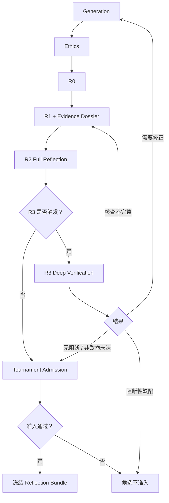

# Reflection Pipeline Contract V1

## Co-Scientist WP2：分层科学审查、Ranking 与 Evolution

**状态：** [拟议] 待评审
**代码基准：** `7313ca032e4f5f0c84578523e0f5639ad038e7af`
**核心框架：** Evidence-grounded Reflection + TrueSkill + UCB + Evolution
**上游契约：** Evidence Dossier Contract V1
**范围：** R0–R3、Tournament Admission、成对比较、演化重审及终局核验。

## 0. TL;DR：一页决策摘要

本节结论：[拟议] 每条候选经过分层 Reflection 后才能进入正式 Tournament；每个新子代重新进入完整审查流程。

| 编号 | 核心决策                                                                     | 状态   | 用途 |
| ---- | ---------------------------------------------------------------------------- | ------ | ---- |
| D1   | R0、R1、R2 为标准审查流程，R3 按触发条件执行                                 | [已定] | 决策 |
| D2   | R0 快速检查结构；R1 构建 Evidence Dossier；R2 综合科学评议                   | [已定] | 实现 |
| D3   | R3 由高影响风险触发                                                          | [已定] | 决策 |
| D4   | 检索与评价完整、无阻断性问题且可检验的候选可以进入 Ranking，即使缺少直接证据 | [已定] | 决策 |
| D5   | Tournament Admission 独立判断执行完整性、科学风险和准入资格                  | [拟议] | 实现 |
| D6   | 保留成对比较与 TrueSkill；Evidence Dossier 作为比较输入                      | [已定] | 决策 |
| D7   | `needs_more_evidence` 记录为非决定性结果，不更新当前 Epoch 的评分          | [已定] | 实现 |
| D8   | 子代重新经过 Ethics 与完整 Reflection；证据按 Claim Delta 增量复用           | [已定] | 实现 |
| D9   | 最后一轮 R3 从 μ 前三名开始，并纳入必要的高 UCB 候选                        | [已定] | 决策 |
| D10  | 资源逐阶段记录；先跑通完整 G3，再讨论自适应停止                              | [已定] | 实现 |

**非目标：** [已定] 本文不设计 Human-in-the-Loop、用户资源上限、最终实验规划或新的固定权重综合评分。

**待定问题：** [待定] R3 风险触发阈值、高 UCB 候选扩展规则、R0 结构性拒绝标准、非决定性比赛重试规则、终局新证据后的稳定条件。

**最大风险：** [拟议] 新增证据审查后，候选可能大量返回非决定性比较，导致 Ranking 资格不足。准入、补充核查与终局规则必须共同设计。

## 1. 问题、范围与非目标

本节结论：[已定] WP2 的目标是在不替换现有贝叶斯演化搜索框架的前提下，提高 Reflection 和成对比较所使用的科学评价信号的可靠性。

[已定] Nature 原论文提供分层 Reflection 思路；arXiv:2608.26701 提供 TrueSkill、UCB、Tournament Selection 与 Crossover/Mutation 的搜索框架。本契约将 Evidence Dossier 接入这一框架，属于本地系统的扩展设计。

[已定] 当前 G3 保留为冻结基准。新流程使用独立的策略、审查包与评价版本；当前 G3 的配对、评分、父代选择和终局行为作为回归对照。

## 2. 核心对象与职责边界

本节结论：[拟议] Reflection Pipeline 负责形成可追溯的科学评议，Tournament 负责相对比较，Evolution 负责产生新候选。

| 对象                 | 职责                                 | 状态   | 用途 |
| -------------------- | ------------------------------------ | ------ | ---- |
| R0 Result            | 快速结构性科学初评                   | [拟议] | 实现 |
| Evidence Dossier     | 主张、检索和科学证据档案             | [已定] | 实现 |
| R2 Result            | 综合科学评议                         | [拟议] | 实现 |
| R3 Result            | 深度核验结论                         | [拟议] | 实现 |
| Reflection Bundle    | 冻结候选及其审查输入与结果           | [拟议] | 实现 |
| Tournament Admission | 判断候选是否满足正式比较资格         | [拟议] | 决策 |
| Pairwise Match       | 两条冻结候选的比较结果与理由         | [已定] | 实现 |
| Evaluation Epoch     | 一组使用一致评价输入与规则的比较集合 | [拟议] | 实现 |
| Claim Delta          | 父代与子代之间的主张变化             | [已定] | 实现 |

[已定] Reflection 不替代 Evidence Appraisal；Ranking 不重写证据档案；Evolution 不覆盖父代和历史比较。各对象的字段与状态见附录 A。

## 3. 关键决策卡 D1–D10

### D1：Reflection 采用分层 Pipeline

[已定] 标准流程为 R0 → R1 → R2。R3 是条件触发的 Deep Verification。Observation Review、Simulation Review、Recurrent/Tournament Review 作为可选扩展策略，不强制串行执行。

### D2：每个候选都接受完整 R0、R1、R2

[已定] R0 检查目标一致性、明显逻辑问题和可检验性；R1 构建完整 Evidence Dossier；R2 使用完整候选及冻结 Dossier 进行综合科学评议。

### D3：R3 有两种触发方式

[已定] 第一种是 R2 识别的高影响科学风险；第二种是最后一轮 Generation 后的终局短名单核验。

[拟议] 高影响风险包括关键因果前提存在重要冲突、核心机制可能建立在错误前提上、关键因果外推可能改变结论，以及 Prior-art 可能覆盖整条机制。精确触发规则见 O1。

### D4：准入以流程完整性和科学判断为基础

[已定] 完成规定范围内的检索与评价、无阻断性问题且具有可检验性的候选可以进入 Ranking。证据不足本身不构成自动拒绝。

### D5：Tournament Admission 独立于 Reflection 文本

[拟议] 准入使用结构化条件检查 Ethics、Coverage、R1、R2、必要 R3 及版本一致性。模型的自然语言结论需要映射到明确状态，才能驱动调度。

### D6：保留 TrueSkill、UCB 与现有搜索主体

[已定] 保留当前 TrueSkill 成对比较、balanced pairing、UCB 父代选择和 0.7/0.3 Crossover/Mutation 配置作为第一版基准。具体策略以冻结配置为准。

### D7：`needs_more_evidence` 不更新当前 Epoch

[已定] 该结果保留为非决定性 Match。重要补充核查形成新 Dossier、新 Reflection Bundle 和新评价版本。

### D8：每个子代重新进入完整 Reflection

[已定] Evolution 后先执行 Claim Delta，再经过 Ethics、R0、R1、R2；触发条件满足时执行 R3。证据可以增量复用，完整 R2 针对子代整体重新执行。

### D9：终局 R3 核验短名单

[已定] 最后一轮 Generation 后，从 μ 前三名开始，并纳入必要的高 UCB 候选。

[待定] 高 UCB 扩展的具体阈值与终局新证据后的稳定条件仍需评审。

### D10：资源记录与停止策略分离

[已定] 记录每阶段和整个 Run 的真实资源消耗。本轮先跑通完整 G3；自适应停止策略与用户使用约束以后另行讨论。

## 4. 状态轴与语义表

本节结论：[拟议] 候选的执行状态、科学审查结论、准入状态、Match 结果和资源使用应独立记录。

| 状态轴                 | 状态或字段                                                                | 语义             | 用途 |
| ---------------------- | ------------------------------------------------------------------------- | ---------------- | ---- |
| Pipeline Stage         | `R0 / R1 / R2 / R3`                                                     | 当前审查阶段     | 实现 |
| Review Execution       | `not_started / in_progress / completed / partial / failed`              | 阶段执行状态     | 实现 |
| Scientific Disposition | `continue / revise / block / unresolved`                                | 科学判断方向     | 决策 |
| Admission              | `eligible / eligible_with_unresolved_risks / incomplete / blocked`      | Tournament 资格  | 决策 |
| Match Outcome          | `decisive / inconclusive / needs_more_evidence / cannot_judge / failed` | 成对比较结果     | 实现 |
| Epoch State            | `active / closed / superseded`                                          | 评价版本生命周期 | 实现 |
| Resource Usage         | `reported / estimated / unavailable`                                    | 资源数据来源     | 实现 |

[已定] `review_incomplete` 属于执行状态；`unresolved_nonfatal` 属于科学判断；`needs_more_evidence` 属于成对比较结果。三者不能共用一个通用的“失败”状态。

## 5. 生命周期与版本隔离

本节结论：[拟议] 只有完成必要 Reflection 并冻结输入的候选才能进入 Tournament；新证据对已冻结排名产生实质影响时，创建新评价 Epoch。

### 5.1 单条候选生命周期



### 5.2 Evaluation Epoch

[已定] 每个正式 Match 记录双方候选的内容 Hash、Reflection Bundle Hash、Ranking Policy Version 和 Epoch ID。

[拟议] 新子代首次完成 Reflection 后可以进入当前活动 Epoch，前提是使用相同的评价规则和兼容的输入契约。已参赛候选的科学评价输入发生实质变化时，进入新 Epoch。

[拟议] 第一版采用完整重建新 Epoch 的方式，暂不实现旧 Match 的局部失效与评分迁移。旧 Epoch 及其全部 Match、μ、σ 和终局记录继续保留。

### 5.3 终局核验生命周期

[已定] 最后一轮 Generation 完成后，从 μ 前三名开始，补入必要的高 UCB 候选，再进行终局 R3。

[拟议] R3 未改变关键科学判断时，可以保留现有 Ranking。若 R3 产生实质性新证据，则创建新 Dossier、重做 R2，并在新 Epoch 中重新比较。新排名产生的短名单需要与当前已完成的终局核验范围核对。

[待定] 若新 Epoch 改变了终局短名单，是否反复核验至短名单稳定，以及如何定义稳定停止条件，后续单独确定。

## 6. 与上下游接口

本节结论：[拟议] Reflection Pipeline 向 Tournament 提供冻结的 Reflection Bundle，Tournament 向 Evolution 提供可追溯的相对比较与排名结果。

| 接口                 | 输入                         | 输出                      | 状态   | 用途 |
| -------------------- | ---------------------------- | ------------------------- | ------ | ---- |
| Generation → Ethics | 新候选                       | 安全审查结果              | [已定] | 实现 |
| Ethics → R0         | 通过的候选                   | 初步科学审查              | [拟议] | 实现 |
| R0 → R1             | 候选及风险清单               | Claim Inventory、Coverage | [拟议] | 实现 |
| R1 → R2             | 冻结 Evidence Dossier        | 完整科学评议              | [已定] | 实现 |
| R2 → R3             | 高影响风险与核查目标         | 深度核验结果              | [拟议] | 实现 |
| R2/R3 → Admission   | 完整审查包                   | 准入决定                  | [拟议] | 实现 |
| Admission → Ranking | 冻结候选与 Reflection Bundle | Match 输入                | [已定] | 实现 |
| Ranking → Evolution | 比较记录、μ、σ、评议问题   | 父代选择与改进方向        | [已定] | 实现 |
| Evolution → Ethics  | 新候选及 Claim Delta         | 新一轮完整审查            | [已定] | 实现 |

## 7. 待定科学标准 / 开放问题

本节结论：[待定] 主流程已经确定；准入阈值、深度核验触发细则、非决定性比较的补充策略及终局稳定条件需要进一步评审。

| 编号 | 问题           | 需要确定的内容                                    | 用途 |
| ---- | -------------- | ------------------------------------------------- | ---- |
| O1   | R3 高影响风险  | 触发条件、证据冲突严重程度与关键 Claim 影响标准   | 待定 |
| O2   | R0 拒绝标准    | 哪些结构性缺陷足以在检索前拒绝候选                | 待定 |
| O3   | 高 UCB 短名单  | μ 前三名以外的候选扩展规则                       | 待定 |
| O4   | 非决定性 Match | 补充检索、再次比较和尝试记录策略                  | 待定 |
| O5   | 新 Epoch       | 何种变化属于实质性评价变化                        | 待定 |
| O6   | Ranking 资格   | 关键未知、冲突证据和非致命风险的具体处理          | 待定 |
| O7   | 终局稳定       | 新证据改变排名后，短名单核验如何结束              | 待定 |
| O8   | 资源指标       | 实际费用、缓存 Token 与外部工具用量的统一统计口径 | 待定 |

## 8. 风险与反模式

本节结论：[拟议] 第一版以流程完整性、输入一致性和独立科研评测为核心验收目标。

| 风险                               | 影响                       | 处理方式               | 状态   | 用途 |
| ---------------------------------- | -------------------------- | ---------------------- | ------ | ---- |
| R1 不完整但候选进入排名            | 排名输入缺少关键依据       | Admission 校验         | [拟议] | 测试 |
| `needs_more_evidence` 被计入胜负 | TrueSkill 被不充分证据更新 | 非决定性结果不更新评分 | [已定] | 实现 |
| R3 改变旧评价输入                  | 历史结果无法复现           | 新 Dossier、新 Epoch   | [已定] | 实现 |
| 子代只审查修改句子                 | 组合机制产生新问题         | 全子代 R2              | [已定] | 实现 |
| UCB 被解释为科学质量               | 搜索优先级与科学结论混淆   | 分离搜索和评价语义     | [已定] | 测试 |
| 多项算法同时改变                   | 无法定位质量提升来源       | 分阶段消融实验         | [拟议] | 测试 |

### 附录 A：关键字段 Schema

本节结论：[工程细节] 下列对象是拟议的最小执行契约，字段名称可以在实现前根据现有事件模型统一。

```python
R0ResultV1 = {
    "hypothesis_id": str,
    "hypothesis_content_hash": str,
    "review_status": str,
    "goal_alignment": str,
    "logical_issues": list[str],
    "causal_chain_gaps": list[str],
    "testability_issues": list[str],
    "claims_requiring_verification": list[str],
    "review_disposition": str,
    "rationale": str,
}

R2ResultV1 = {
    "hypothesis_id": str,
    "hypothesis_content_hash": str,
    "dossier_id": str,
    "dossier_hash": str,
    "review_policy_version": str,
    "supported_strengths": list[dict],
    "critical_weaknesses": list[dict],
    "evidence_conflicts": list[dict],
    "novelty_assessment": dict,
    "weakest_causal_links": list[dict],
    "competing_explanations": list[dict],
    "testable_predictions": list[dict],
    "high_impact_risks": list[dict],
    "required_follow_up_checks": list[dict],
    "review_completeness": str,
    "review_disposition": str,
}

R3ResultV1 = {
    "hypothesis_id": str,
    "hypothesis_content_hash": str,
    "input_dossier_hash": str,
    "trigger_reasons": list[str],
    "claims_examined": list[str],
    "subpremise_results": list[dict],
    "new_evidence_refs": list[str],
    "scientific_disposition": str,
    "review_status": str,
    "new_dossier_id": str | None,
    "rationale": str,
}

ReflectionBundleV1 = {
    "bundle_id": str,
    "hypothesis_id": str,
    "hypothesis_content_hash": str,
    "claim_inventory_hash": str,
    "dossier_hash": str,
    "r0_result_id": str,
    "r2_result_id": str,
    "r3_result_id": str | None,
    "review_policy_version": str,
    "bundle_hash": str,
}

TournamentAdmissionV1 = {
    "hypothesis_id": str,
    "bundle_hash": str,
    "ethics_status": str,
    "coverage_status": str,
    "r1_status": str,
    "r2_status": str,
    "r3_required": bool,
    "r3_status": str | None,
    "admission_status": str,
    "reason_codes": list[str],
}

PairwiseMatchV1 = {
    "match_id": str,
    "epoch_id": str,
    "candidate_a_bundle_hash": str,
    "candidate_b_bundle_hash": str,
    "ranking_policy_version": str,
    "outcome": str,
    "decision_rationale": str,
    "needs_more_evidence_refs": list[str],
    "true_skill_update_applied": bool,
}

ClaimDeltaV1 = {
    "parent_hypothesis_ids": list[str],
    "child_hypothesis_id": str,
    "retained_claims": list[str],
    "modified_claims": list[dict],
    "split_claims": list[dict],
    "combined_claims": list[dict],
    "new_claims": list[str],
    "removed_claims": list[str],
}
```

[工程细节] `ResourceUsageRecordV1` 与 Evidence Dossier Contract 共用。每个任务记录实际调用及用量，再按阶段与 Run 汇总。

### 附录 B：契约测试

本节结论：[测试/防御] 以下测试覆盖主要状态迁移、版本隔离和准入语义。

| 编号 | 测试场景                 | 预期结果                            | 状态        | 用途 |
| ---- | ------------------------ | ----------------------------------- | ----------- | ---- |
| T1   | Ethics 未通过            | 不进入 R0–R3                       | [测试/防御] | 测试 |
| T2   | R0 标记需重点核查        | 进入 R1 并保留问题清单              | [测试/防御] | 测试 |
| T3   | R1 覆盖不完整            | 不进入正式准入                      | [测试/防御] | 测试 |
| T4   | 无直接证据但核查完整     | 可进入 R2/准入判断                  | [测试/防御] | 测试 |
| T5   | R2 发现高影响风险        | 触发 R3                             | [测试/防御] | 测试 |
| T6   | R3 非致命未决            | 可带风险进入准入判断                | [测试/防御] | 测试 |
| T7   | R3 阻断性缺陷            | 不进入正式排名                      | [测试/防御] | 测试 |
| T8   | R3 要求修正              | 新候选重新经过 Ethics 与 Reflection | [测试/防御] | 测试 |
| T9   | R3 核查不完整            | 返回必要核查步骤                    | [测试/防御] | 测试 |
| T10  | `needs_more_evidence`  | 当前 Epoch 不更新 TrueSkill         | [测试/防御] | 测试 |
| T11  | 实质性证据变化           | 新 Dossier 与新 Epoch               | [测试/防御] | 测试 |
| T12  | 子代生成                 | 重新执行完整 Reflection             | [测试/防御] | 测试 |
| T13  | 子代 Claim 未变化        | 可复用证据，但重新执行 R2           | [测试/防御] | 测试 |
| T14  | 子代新增机制             | 新主张核查                          | [测试/防御] | 测试 |
| T15  | 未达到决定性比较资格     | 不成为正式 Winner                   | [测试/防御] | 测试 |
| T16  | 终局候选 R3 出现阻断问题 | 排除并检查下一名候选                | [测试/防御] | 测试 |
| T17  | 新 Epoch 产生            | 旧 Epoch 与历史 Match 保留          | [测试/防御] | 测试 |
| T18  | 同一外部调用事件重放     | 资源用量不重复累计                  | [测试/防御] | 测试 |

### 附录 C：常见误读与禁止推断

本节结论：[测试/防御] 以下语义边界适用于所有阶段。

| 常见误读                         | 正确解释                              | 状态        | 用途 |
| -------------------------------- | ------------------------------------- | ----------- | ---- |
| R0 通过代表科学机制成立          | R0 只完成快速初评                     | [测试/防御] | 测试 |
| R1 完成代表假说已被证实          | R1 表示规定的核查流程完成             | [测试/防御] | 测试 |
| R3 发现一个错误就推翻整条假说    | 需要判断错误是否影响核心机制          | [测试/防御] | 测试 |
| `unresolved_nonfatal` 表示失败 | 它表示尚有非阻断性科学未知            | [测试/防御] | 测试 |
| `needs_more_evidence` 是平局   | 它是需要补充证据的非决定性结果        | [测试/防御] | 测试 |
| μ 是科学真实性分数              | μ 是当前 Tournament 中的相对偏好估计 | [测试/防御] | 测试 |
| σ 是科学证据不确定性            | σ 是 TrueSkill 排序估计的不确定性    | [测试/防御] | 测试 |
| UCB 高就代表科学质量更高         | UCB 用于探索与父代选择                | [测试/防御] | 测试 |
| 新证据可以直接修改旧排名         | 重要评价变化形成新版本和 Epoch        | [测试/防御] | 测试 |
| 子代继承父代评分                 | 子代必须建立自己的比较记录            | [测试/防御] | 测试 |

**评审结论：** [拟议] Reflection Pipeline Contract V1 可作为 WP2 的流程设计基准。O1–O8 是进入代码实现前需要明确的开放问题。
