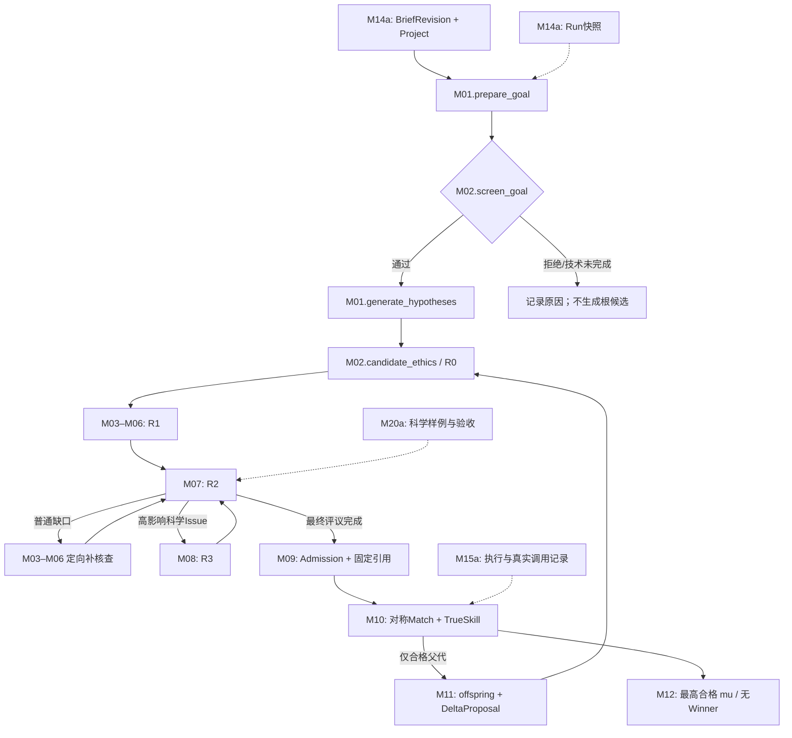

# Co-Scientist W0｜五个先导工作包的最小接口设计

**设计版本：** `W0-MINIMAL-CONTRACTS-v0.1 / proposed`  
**正式上游：** `M00-ARCH-v1.0 / design_accepted`（2026-11-01）  
**源码核实：** 2026-11-01 查询 GitHub `syrsteven/co-scientist` main：`7313ca032e4f5f0c84578523e0f5639ad038e7af`。仅核实 HEAD；本轮未重新逐文件审查、未修改代码或运行测试。  
**范围：** M09a、M11a、M14a、M15a、M20a，以及共享 LiteraturePort 的最低语义。**这不是新增 M09a–M20a 正式模块，也不是已实施的 Python Schema。**

## 0. 结论与本轮设计边界

W0 的目标不是在科学模块开发前建成一个小平台，而是为 M01–M12 提供**足够少、无歧义、可以用样例核查**的接口事实：

1. **固定研究输入：** Project、BriefRevision、Run 彼此区分。已开始 Run 不被后续草稿编辑改变。
2. **固定候选参赛依据：** Admission、单一 Epoch、核心科学输入及可追溯的比较呈现；资格和科学评价不混为一谈。
3. **固定子代变化的先后关系：** M11 提出修改意图，M03 在完整子代 Claim Inventory 后解析真实变化；M04/M05 分别决定材料和科学评价能否复用。
4. **固定一次调用/重试/科学结果的区别：** M15 保存实际输入、输出、材料可见范围、资源及重试事实；M12 调度，M10 决定 Match、TrueSkill 与幂等应用的科学语义。
5. **先建立科学反例：** M20a 以合成样例检验流程不变量，再引入有原始文献和专家标注的真实科研评测；不得把合成样例通过当成科研质量通过。

**不做：** 全量事件总线、旧 G3 恢复与兼容、分布式调度、独立 Evidence View 服务、多层 Evaluation Basis/Bundle 服务、自动重建 Epoch、HITL、具体模型 Prompt、固定科研评分阈值、M01/M09/M10/M11 生产逻辑。

## 1. 端到端调用关系：接口语义，而不是代码导入图

**依赖解释：** Goal Ethics 的调用顺序固定，但 M01/M02 都只依赖共同输入输出；M12 负责实际先后，**不得从运行时回调推导双向代码依赖**。R2 的普通 R1 补核查与高影响 R3 是不同路径，且全部在 Admission 前。Ranking 不发起任一路径。

**R2 普通补核查最小接口：** M07 在 Admission 前提出 `R1SupplementRequest`，至少说明固定候选引用、遗漏的必要前提／Claim Coverage／普通证据评价问题、理由、已有 Dossier 引用和期望补核查范围；M12 派发 M03–M06 完成所需工作，再交回 M07 的 R2 重新整体评价。此请求不是 M08 高影响 `VerificationIssue`，更不能由 Ranking 产生。如果没有实质新材料/覆盖进展而重复出现同一普通缺口，应保留不完整原因并由 M12 作明确停止/未完成处置，不能无进展循环或假称完成。具体充分性判定留给 M03–M07/M20。

## 2. M14a｜Project、BriefRevision、Run：最小运行上下文

**所有权：** M14 管理工作区对象及引用；M01 形成 GoalContext 的科学内容；M02 判 Goal Ethics；M12 冻结运行输入并调度。M14 不决定假说科学正确性。

| 最小语义 | 必须可表达 | 不要求预先规定 |
|---|---|---|
| `Project` | 项目身份、用户可读名称、关联 BriefRevision 与 Run | 完整科研知识库、文件夹树、权限平台 |
| `BriefRevision` | revision 身份、所属项目、用户科学问题/背景/约束/材料引用、上一个 revision（如有） | 对用户开放的每个 UI 字段及复杂编辑冲突机制 |
| `GoalContext` | 由选定 BriefRevision 制备的具体研究目标、研究体系、背景范围及输入来源 | M01 的 Prompt、检索策略和自然语言模板 |
| `Run` | 唯一 `run_id`、所依据的 BriefRevision/GoalContext、所用科学/比较政策引用、运行及终局状态、创建事实 | 旧版 Run 恢复、后续工作区完整 UI |

**关键生命周期：** 用户选择 BriefRevision → `M01.prepare_goal` → `M02.screen_goal` → Goal Ethics 通过后才执行 `M01.generate_hypotheses`。可以在 Goal Ethics 前创建 `prepared` Run 记录以保留拒绝或技术未完成事实，但是否实际落库由 M14/M12 实现决定；**不能因此开始合法 Generation**。

**必须保证：**
- 草稿编辑产生新 revision；旧 revision 和启动时的 Run/GoalContext 引用不被覆盖。
- 新 Project 与旧 Run 可分离；即使工作区页面重新编辑/关闭，不改变已执行模型请求的科学输入。
- `Import` 仅作为 M14 后续能力保留入口，不为 W0 强制实现历史 G3 Run 导入或续跑。

**最低契约样例：** `Project P1` 下有 `Brief B1`、`B2`；`Run R1` 指向 `B1`；用户更新为 `B2` 后，`R1` 的 Goal、模型输入和审查政策仍来自 `B1`。Goal Ethics 拒绝时不存在由该 Goal 合法产生的根候选。

**交接 M01/M12：** 给出可追溯的 `BriefRevisionRef → GoalContextRef → RunRef` 和通过/拒绝/技术未完成三种目标筛查样例，不强制具体类名。

## 3. M09a｜Admission、单一 Epoch 与比较输入冻结

**所有权：** M09 决定 Admission 与入场依据冻结；M10 判断比较覆盖、父代资格和终局资格，并负责每场 Match 科学输入准备；M15 保存模型真实所见字节/文本及工具材料记录；M12 调度。M09 **不**替代 M07 评议，也**不**决定比较配额。

### 3.1 最小 Admission 语义

一次 Admission 至少可解析以下固定事实（字段名均为**说明性名称**）：

| 事实 | 含义 |
|---|---|
| `run_ref`, `hypothesis_ref` | 同一 Run 内的候选科学内容快照；修改科学内容必须产生新候选 |
| `goal/policy_ref` | 本次伦理、科研评价和比较政策适用的固定版本 |
| `ethics_ref`, `inventory_ref`, `dossier_ref`, `final_reflection_ref` | 已经完成的、明确指向科学输入的引用；含必要 R2 补 R1 和 R3 结果 |
| `admission_decision`, `reasons` | 可准入、科学阻断或核查/执行不完整；不是 TrueSkill/父代资格 |
| `epoch_ref`（通过后） | 所属的 Run 唯一正常评价 Epoch；新代候选只追加成员 |

**禁止：** `admitted=true` 被解释为 `parent_eligible=true` 或 `final_eligible=true`。后两种资格由 M10 在科学比较覆盖与公平性评测后决定。无直接证据不等于核查未完成，不能机械拒绝。

### 3.2 同一候选跨 Match 的固定核心科学输入

M10 每次构建 Pairwise 输入时，必须读取固定 Admission 相关材料，并以同一**候选级固定核心科学呈现**展示至少：
- **主要支持：** 实际证据及其支持范围与限制，不把来源条数当强度。
- **重要反证/竞争解释：** 保留关键反例，不能因这场比赛对手不同而隐去。
- **关键未决缺口：** 区分科学未知、材料无法取得、执行尚未完成。
- **最终 R2 Reflection：** 整条机制的结论、条件和主要风险（含必要 R3 归纳）。

核心呈现应根据冻结证据与已批准的**同一生成/裁剪政策**得到，在**首次有效 Match 之前**对该候选稳定化；后续 Match 不可改变核心内容或隐去反证。若上下文约束导致必需核心无法完整进入输入，须明确记录并按技术/输入不足处置，**不能悄悄缩成有利摘要再评分**。

可为特定比较补充从**双方已冻结材料**中选取的针对性证据。M10 对 A/B 使用一致、对称的选择和呈现原则，保存选取依据、引用、顺序、实际输入及失败；“对称”不强制两方字数或文献数相等，但不能对一方挑支持、对另一方挑反证。建议将“固定核心”与“针对性补充”分区呈现，方便核查。

**不新增独立 Evidence View 服务：** M10 在输入准备步骤生成呈现文本，M15 将调用实际内容/引用及选择策略记录；要保持一个候选级核心材料稳定，允许在现有 Match Input/ModelCall 记录里保存核心快照引用，不要求建单独领域真值对象。

### 3.3 单一 Epoch 与 Match 状态

- 正常 Run 只有一个连续 Epoch；新增候选**在自己的 Admission 完成后**入场。既有 Admission 引用及科学依据在整个 Epoch 内固定。
- `decisive` 才允许执行 TrueSkill 更新；`inconclusive` 与 `needs_more_evidence` 不更新。`technical_failed` 不是科学平局，不更新且不能伪造科学未知。
- 一个 Match 的外部 API 可以有多次尝试；**一次已确认决定性科学结果最多应用一次评分变化**。M10 定义 Match/Rating 语义，M15 提供幂等保存/调用事实。
- 若当前没有达到终局资格的候选，M12 明确“无正式 Winner”；有资格时按 **最高合格 μ**，不附加终局 R3。UCB 仅从符合父代资格的集合选演化父代。

**交接 M10/M12：** 已准入/被阻断/未完成各一例；同一候选与不同对手的两场 Match 核心内容相同、一方/两方有针对性补充且对称策略可审核；非决定性不评分；跨代候选入场不替换旧依据。

## 4. M11a｜DeltaProposal / ResolvedDelta / 证据复用责任

**所有权：** M10 只从 Admission+ParentEligibility 池用 UCB 选父代；M11 创建子代和 DeltaProposal；M02 做子代 Ethics/R0；M03 在新子代完整 Inventory 后解析 ResolvedDelta；M04 决定材料获取与原文快照是否复用；M05 独立判断单项科学评价是否仍适用；M06 汇总全新 Dossier，M07 对整个子代重新 R2。

**两阶段语义：**

| 对象 | 谁形成 | 实质含义 | 非含义 |
|---|---|---|---|
| `DeltaProposal` | M11，生成子代时 | 选择何种变异/交叉、预期改变了哪些机制以及来源父代 | 已证实的主张关系或证据继承许可 |
| `ResolvedDelta` | M03，完成子代 Inventory 后 | 对父代与子代具体 Claim 的可追踪关系：`retained / modified / removed / split / combined / new` | 材料必然可复用、R2/Ratings可继承 |

对子代有两个及以上父代时，ResolvedDelta 可用**父代 Claim 集合**指向一个子代 Claim；无需建立新的全局 Claim 注册服务。`removed` 表示父代主张在子代机制中不再被提出，不代表其相关文献可以从其他子代主张的反证审查中消失。

**不确定性处理：** 不可靠映射明确标“无法确认”，M04/M05 对相关新内容采用新的检索和评价；不得为实现缓存命中把 `modified` 伪标成 `retained`。即使内容相同，目标物种、细胞、实验条件或变量定义改变，也要重新核对适用性。原始材料复用不意味着模型对材料的因果解释可以复用；完整子代 R2 和 TrueSkill 评分永不继承。

**最低样例：** 父代机制 A（示例：细胞类型 A 中分子 X 对应激下通路 Y 的影响）转为子代机制 B（细胞类型 B 中同一 X-Y 关系，新增共同调节因子 Z）。M03 应识别适用情境改变及新增桥接；M04 可保留 A 的原始文献快照供参考，M05 不能不加说明地继承 A 研究在 B 情境下的支持强度。样例为**虚构机制结构，用于接口测试，不是生物学证据**。

**交接 M03/M04/M05/M11：** 一个单父代修改、一个双父代合并、一个不能安全映射而改全量核查、一个未准入候选带强修订建议但不能成为父代的样例。

## 5. M15a｜外部调用、实际证据视图、资源与恢复

**所有权：** M15 负责运行/工具事实、调用记录、保存与恢复技术；科学任务是谁、下一步做什么由 M12；哪条科学判断可评分由 M10；证据解释质量属于 M05/M07。

### 5.1 一次 Task、一次外部 Attempt 与一次科学结果

| 层次 | 最小记录 | 原因 |
|---|---|---|
| `TaskRef` | `run_ref`、责任模块、科学任务与输入引用、任务执行状态 | 同一科学任务可有技术重试，不重新定义科学目标 |
| `Model/Tool Call Attempt` | 调用身份、所属Task、供应商/模型或工具、实际请求与可见材料、响应/错误、开始结束、Token/检索/费用（可获得时）、资料访问级别、重试关系 | 区分“真正发出外部请求”与“只是本地重放” |
| `Scientific Result Ref` | 经责任模块认可的输出/引用、应用状态、产生的领域效应身份 | 防止外部重复投递导致新候选/新 Match/TrueSkill 双写 |
| `Checkpoint` | Run 最新已确认的任务完成事实、未完成事实、已应用领域结果、可继续路径 | 浏览器退出/进程失败后可准确恢复新系统 Run |

**必须存实际输入：** M10 的核心科学呈现、对称增补和 A/B 顺序；M07 的实际证据摘要与原文引用；M04 的真实查询范围与获取结果。只记录一个 `dossier_id` 而不保存 Judge 实际所见材料，不满足本设计。

**重试与计费区分：** 新外部请求各有 Attempt；实际消耗逐 Attempt 记录并在 Task/Run 汇总；本地读取已保存调用不再新增 API 消耗。响应未返回时费用、token 可以是 `unknown/unavailable`，不可自行填 0。技术失败不能映射为“无相关文献”或科学 `needs_more_evidence`。

**幂等语义：** 在匹配结果和评分间建立稳定关联（如同一 `match_ref` 的一次合法评分应用）；恢复后重复读取或重复传递相同科学结果**不能重复更新 μ/σ**。不要求在 W0 规定事件总线、DB 事务细节或所有 worker lease 状态。

**交接 M12/M10/M16：** 成功调用；超时但已发送；响应成功而持久化重放；同一 Match 两次到达评分器；两方输入被截断；一次调用缺失关键反证等可检查样例。

## 6. M20a｜科学评测先行，两个不同的通过门

**所有权：** M20制定评测协议/样例管理，科学模块提供真实输出，领域专家标注科学预期；M20 不直接变成可决定每条 Claim 科学真值的生产 Agent。

**第一层：合成机制与流程验收（W0可以准备）**
- 使用明确标为“合成”的模拟材料、候选和结果，测试引用正确、调用顺序、补核查方向、入场与排名边界、子代全量复审、真实输入保存、幂等重试。
- 这些测试只说明架构行为可检验，不能衡量医学文献识别准确率或假说科学价值。

**第二层：有来源、独立专家的科学验收（各模块实施前制定）**
- 建立不同眼科/生物医学任务和原始文献材料；明确摘要、全文/补充材料是否可访问。
- 标注必要因果前提、Observed Finding、支持/反证与条件适用、R2 机制级缺陷、R3 触发理由和成对科学比较依据；争议记录而不是强制共识。
- 研发集和保留评估集分离；统一同一任务、材料可访问范围与模型资源条件，记录科学错误、遗漏、判定不确定及消耗；不直接用跨 Run μ 比科学进步。
- 具体标注者人数、比例、统计指标/阈值由 M20 科学研究后确定；本 W0 **不伪造“专家已评审”或固定通过率**。

科学样例、失败信号与责任模块见另一份 `02_W0_SCIENTIFIC_TEST_CASES_PROPOSED.md`。

## 7. 窄 LiteraturePort：共享工具语义，不新增文献评价体系

| 调用能力 | 最低返回事实 | 谁决定科学含义 |
|---|---|---|
| `search` | 真实查询、检索源、执行状态、返回条目/总量（如报告）、时间、分页/范围、空结果和失败区别 | M01 负责背景调研策略；M04 负责 Claim 检索策略 |
| `fetch` | 指定来源身份、实际得到的摘要/全文/补充材料或无法取得原因、原始引用与访问级别 | M04 来源/材料标准；M05 评价科学含义 |
| `call_record` | 工具实际请求/返回、错误/重试、使用量 | M15 保存执行事实；M20审计来源边界 |

接口是**工具适配能力**，不是 M04 将背景检索和 R1 都收归一处。首版实际提供的检索源不在 W0 强行冻结，也不将系统永久限制为摘要。

## 8. W0 的执行顺序、测试门与交付边界

| 工作次序 | 交付内容 | 可并行项 | 离开 W0 的必要条件 |
|---|---|---|---|
| W0-1 | 由 M20a 准备最小合成反例；划定后续真实科学标注协议 | 可与其余工作并行 | 每项不变量都有可判定的正例/反例；未标注“专家真值”的不冒充真值 |
| W0-2 | M14a `Project/BriefRevision/GoalContext/Run` 引用；M15a Task/Attempt/Result/Checkpoint | 可并行 | Goal Ethics之前不能Generation；旧草稿编辑不影响 Run；重试/用量语义明确 |
| W0-3 | M09a Admission/唯一Epoch/固定核心科学输入；M11a Delta 两阶段 | 可并行 | 真正区分科学准入与Parent/FinalEligibility；子代Review链完整且不借父代评级 |
| W0-4 | 使用 M20a 样例做**跨包纸面/静态走查**，交各模块实际设计负责人 | 必须消费 W0-1/2/3 的结果 | 上下游能说明自己读取/输出的事实和不可拥有的权限；无新增循环依赖 |

**W0 评审时只核对三件事：** (i) 上述接口事实是否足够让 M01/M02/M03/M09/M10/M11 单独设计；(ii) 有没有不必要的服务/状态/数据复制；(iii) 是否存在无法用样例判断的科学边界。W0 整体获设计批准后，才可作为各模块后续实现的接口依据；仍需每模块独立批准生产代码。

## 9. 待下游研究、不在 W0 擅自确定

- M03 的 Claim 粒度、隐含前提识别；M05 的完整科学 Rubric 和证据偏倚/因果标准。
- M08 的高影响风险阈值、R3 问题等价与科学充分性标准。
- M09 的实际 Admission 详细分流与已入场严重数据错误处置。
- M10 的比较策略、数据覆盖、位置偏差、先验参数、父代/终局资格具体门槛。
- M11 的生成 Prompt、真正新机制的判定及 Crossover/Mutation 最优策略。
- M12 的搜索停止/收敛日程；M15 的数据库/任务技术实现细节；M20 的真实专家评测设计、标注协议和指标阈值。

**本轮结论：** 交付的是一个可验收的 **W0 设计提案**，不是 M01 开发计划批准，不覆盖已经接受的 M00 基线，不声明旧 G3 已迁移、外部论文已复验或科研科学质量已达标。
